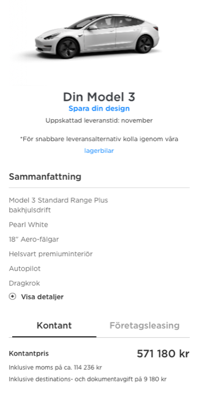
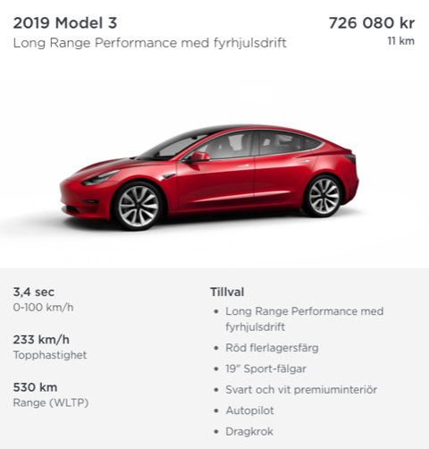
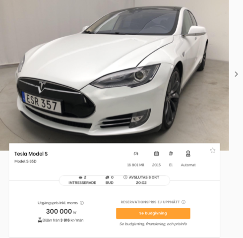
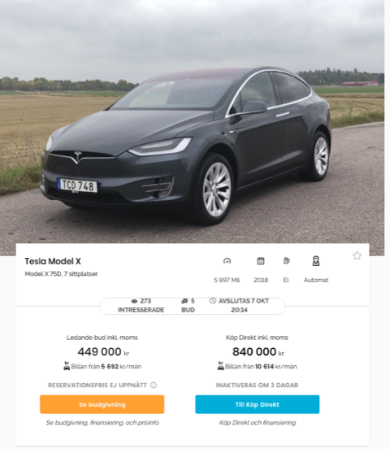
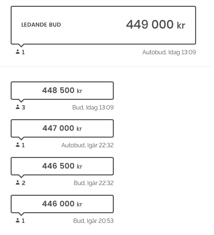

# Todo: It seems I should aim at buying a used Tesla Model 3 with tow bar for up to 930 kg on trailer (as my B drivers license allows me to tow max 750 kg anyways)?

```#4b28f26d``` *As of 2019-10-02 18:00*

[mail plain/text](mail.txt)


So a used Tesla model 3 with tow bar will enable me to tow 750 Kg to a "reasonable price" and in compliance with my type B drivers license (750 kg)

==&gt; Also see "Todo: It seems importing a Tesla from Norway to Sweden is out of the question because I need to pay VAT (25%) and import fees (10%) which make the car too expensive!"

==&gt; Also see "Todo: Consider it may after all perhaps be possible to mount a tow bar on a Tesla model S (or possibly affirmed to be NOT allowed)?"

1) Consider the reasons why a Model 3 with tow bar is the car for me to buy as transport during my house build?

> *A Tesla Model 3 is still a lot of money but it may be possible for me to somehow find a used one with a tow bar. Although so far I have seen very few used Model 3 on any Swedish site? And those who are sold are practically new so the price is still high on the border of the price of a new car.*

==&gt; Consider the price of a new Model 3 with tow bar?

> 

==&gt; Consider to follow what Model 3 with tow bar Tesla Sweden has in stock over time (<https://www.tesla.com/sv_SE/inventory/new/m3> )?

>   
> *A new Tesla Model 3 with tow bar in stock at Tesla Sweden as of 191002*

2) Consider to list the reasons why a Tesla Model X with tow bar is not for me as of know?

> *So it is not possible to get a used Tesla X from Norway to a good price as I have to pay both additional Swedish 25% VAT and 10% import fees. This simply eats up any price differences to any used Tesla X from any Swedish dealer.*

> *Also, although a Tesla Model X can tow 2,5 tons I still need to apply for a BE drivers license to be allowed so drive such a heavy vehicle plus trailer.*

> *So all in all a Tesla X just is not within my budget as of now considering the car itself is around 800 000 SEK even used and the cost of a BE drivers license comes in on top of that (whatever that would amount to).*

3) Consider what the costs and procedure are to extend my drivers license to a BE type (To be able to tow more than 750 Kg)

==&gt; It seems I must apply for an authorisation to do the tests required to get a BE drivers license (<https://www.transportstyrelsen.se/sv/vagtrafik/e-tjanster-och-blanketter/e-tjanster-inom-vagtrafik/?tab=korkort&eservice=korkortstillstand(grupp1)-ansok> )?

> ### [Körkortstillstånd (grupp 1) - ansök](<https://www.transportstyrelsen.se/sv/vagtrafik/e-tjanster-och-blanketter/e-tjanster-inom-vagtrafik/?tab=korkort&eservice=korkortstillstand(grupp1)-ansok#eservice130157>)


> Här ansöker du om körkortstillstånd med hälsodeklaration om du ska ta körkort för moped klass I, motorcykel, personbil och lätt lastbil, personbil med tungt släp samt traktor (AM, A1, A2, A, B, BE och traktorkort). Behörigheterna ingår i det som kallas för grupp 1.

> 

> Du måste komplettera din ansökan med ett synintyg. Boka tid för synundersökning hos en legitimerad optiker eller behörig trafikskola. De kan skicka in synintyget via en e-tjänst för rapportörer.

> Det är viktigt att synintyget kommer in i samband med din ansökan. Synintyget får inte vara utfärdat tidigare än två månader före ansökan.

> Har du en [digital brevlåda](https://www.transportstyrelsen.se/link/0d05a57d59b743f1838f9872804b1fd3.aspx)? Då kommer ditt körkortstillstånd att skickas dit.


> [Gå till tjänstenKörkortstillstånd (grupp 1) - ansök. Öppnas i nytt fönster.](https://www.transportstyrelsen.se/sv/vagtrafik/e-tjanster-och-blanketter/e-tjanster-inom-vagtrafik/korkort/ansok-om-korkortstillstand-grupp-1/)

==&gt; It seems because I have an "old" B type drivers license I can drive a car of any weight, any three wheel motor cycle and snow mobile and "terrain motor vehicle" (<https://www.transportstyrelsen.se/sv/vagtrafik/Korkort/har-korkort/fordon-du-far-kora/overgangsregler-och-havdvunna-rattigheter/> )?

> ### B

> Om du tagit B-körkort före den 1 juli 1996 behåller du rätten att köra **personbilar oavsett vikt**. Du får även dra ett **lätt släp med en totalvikt på högst 750 kg**.

> Om du tagit B-körkort före den 19 januari 2013 behåller du rätten att **köra trehjulig motorcykel** oavsett effekt.


> ## Snöskoter och terränghjuling har särskilda regler

> Om du tagit körkort eller traktorkort före den 1 januari 2000 har du även **rätt att köra snöskoter och terränghjuling**. Det gäller även om körkortet eller traktorkortet återkallats efter detta datum, och du sedan fått ett nytt.


3) Consider to monitor the car action site "kvd" for good deals on used Tesla cars (<https://www.kvd.se/auktioner?orderBy=-grade&vehicleType=car&brand=tesla&familyName=&utm_medium=begbilar&utm_source=bilpriser.se> )?

NOTE: As of 190802 I could see no used model 3 on this site?

==&gt; Consider to come back and report the selling price on bidding on this Model S (<https://www.kvd.se/auktioner/tesla-model-s-85d-380hk-50025> )?

> 

==&gt; Consider to come back and report the selling price on bidding on this Model X (<https://www.kvd.se/auktioner/tesla-model-x-75d-49724> )?

> 

> 

...


