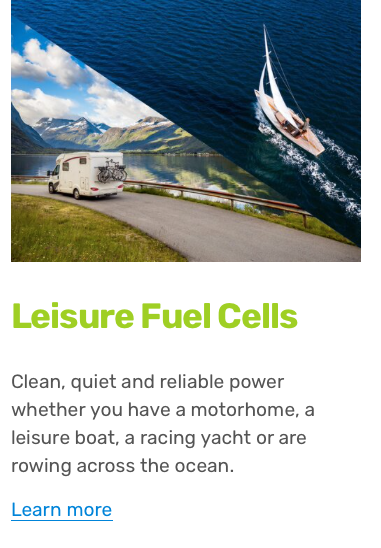
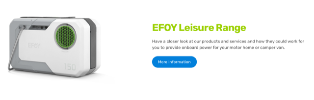
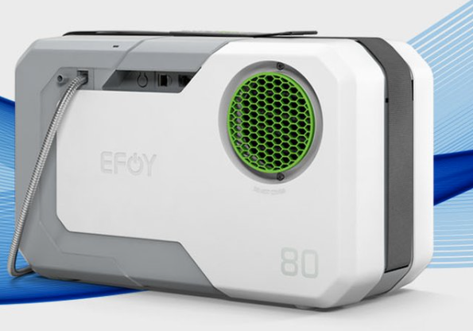
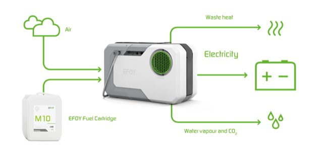
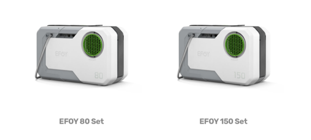
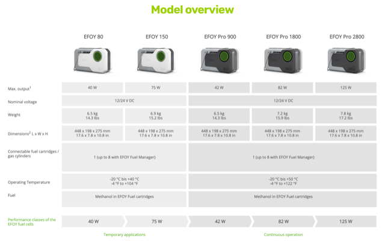
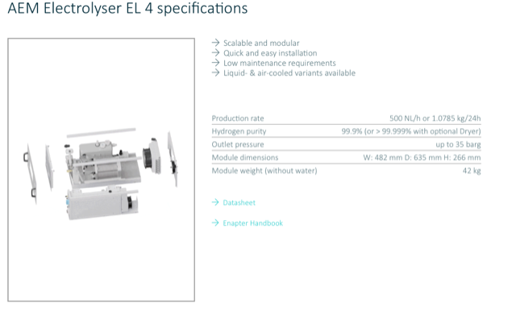

# Todo: Consider the fuels cells provided by  Brittish company "Fuel Cell Systems"

```#4b509a50``` *As of 2024-07-02 13:16*

[mail plain/text](mail.txt)


It would be nice to be able to turn fule like LPG (liquid petroleum gas, e.g., Swedish "gasol"), methanol or hydrogen to electricity with a fuel cell.

1) Consider the products provided by the Brittish company "Fuel Cell Systems" (<https://www.fuelcellsystems.co.uk> )?

==&gt; Consider they seem to have products for recreation vehicles (<https://www.fuelcellsystems.co.uk/leisure> )?



**==&gt; Jag mailade dom 240702!**

==&gt; Consider their motorhome fuel cells (<https://www.fuelcellsystems.co.uk/motorhome-fuel-cells> )?



NOTE: It is a little frustrating that they do not provide any physical parameters like power output, expected life span or maintenance costs?





> *"**EFOY fuel cells are based on DMFC (Direct Methanol Fuel Cell) technology. They convert chemical energy into electrical energy without interim stages and without much loss of efficiency. The methanol in the fuel cartridge is supplemented by oxygen from the air, and is used to produce electricity. In addition to power, all this creates is waste heat and water vapour**"*

==&gt; Consider the number of the product (80 and 150) refers to to max wattage produced?



==&gt; NO - The EFOY 80 Set produces 40W elctricity (<https://www.fuelcellsystems.co.uk/efoy-range/p/efoy-80> )?!

> *"**The EFOY 80 Set is a 40W fuel cell operating at 12 or 24VDC.**"*

NOTE: The price is indicated at £3,070.00!

==&gt; Does this mean the EFOY 80 also produces 4\*40 = 160W of heat (25% efficiency)?

==&gt; It seems the EFOY 150 produces 75W and costs £4,957.00 (<https://www.fuelcellsystems.co.uk/efoy-range/p/efoy-150-bt-methanol-fuel-cell-copy> )?

> *"**The EFOY 150 Set is a 75W fuel cell operating at 12 or 24VDC.**"*

==&gt; Consider the full range of EFOY methanol fuel cells (<https://www.fuelcellsystems.co.uk/efoy-pro> )?



==&gt; It seems I need the EFOY Pro 900 - 2800 for continuous operation?

==&gt; Consider the hydrogen fuel cells from Fuel Cell Systems (<https://www.fuelcellsystems.co.uk/off-grid-solutions> )?

> *Hm... their website is confusing and I had a hard time finding the actual hydrogen fuel cell(s) they sell?!*

2) Consider the UK partner Enapter that seems to provide hydrogen "generators" (<https://www.enapter.com> )?

==&gt; Consider the "small" AEM Electrolyser EL 4 (<https://www.enapter.com/aem-electrolysers/aem-electrolyser-el-4/> )?



> *It seems it is able to produce around 1kg of hydrogen per 24 h.*

> *With an energy density of hydrogen of 142 MJ / kg and 1 MJ is C.a 278 Wh we we store up to around 39 kWh per day?*

> *If the energy efficiency to turn the hydrogen back to electricity is 20% we then get back up to 8 kWh of that.*

> *Hm...to store 1MWh we then need the system to run with peak efficiency for 125 days to fill our storage to 125 kg of hydrogen?*

> *BUT WAIT! Most of what we need to store is for heating! Then the losses are much smaller (the loss for compression 15% adn decompression ??%).*

...


