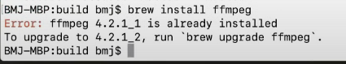

# Todo: Consider youtube video "LIVESTREAM: Setting up FFmpeg and OpenGL in C++ for real-time video processing" to follow to setup a C++ cross platform FFMPeg video player and and OpenGL video viewer basics

```#4c0da55c``` *As of 2022-01-25 16:00*

[mail plain/text](mail.txt)


I want to be able to automate youtube video editing with templates for cut pace and length using clip ranges (frame marks) as inputs.

1) This youtube video "LIVESTREAM: Setting up FFmpeg and OpenGL in C++ for real-time video processing" seems to go through ALL the steps required to configure and build a cross-platform app FROM SCRATCH (<https://youtu.be/MEMzo59CPr8> )?

==&gt; He seems to have a whole playlist with videos of him writing parts of this app (<https://www.youtube.com/playlist?list=PLKucWgGjAuTbobNC28EaR9lbGQTVyD9IS> )?

2) The code seems to be open source and live here on Github (<https://github.com/bartjoyce/video-app> )?

==&gt; The actual state of the code from the video above seems to be this one (<https://github.com/bartjoyce/video-app/tree/96524dd3b9e05099ec8b7e07e58e399354457443> )?

3) Consider to make the code work with latest FFMPeg and GLFW?

==&gt; It seems he installs and uses the FFMPeg provided by Brew (<https://youtu.be/MEMzo59CPr8?t=4927> )?

==&gt; He seems to be using FFmpeg 4.2.1.1?

> 

==&gt; This seems to be the version (1 Nov 2019) of GLFW used in the video (<https://github.com/glfw/glfw/tree/28d850770022afc8b73d88a871fa07e8d35766b3> )?

4) It seems current FFMpeg can be discovered here (<https://www.ffmpeg.org> )?

> January 17th, 2022, FFmpeg 5.0 "Lorentz"  
> April 8th, 2021, FFmpeg 4.4 "Rao"  
> June 15th, 2020, FFmpeg 4.3 "4:3"  
> **August 5th, 2019, FFmpeg 4.2 "Ada" ***(The one used in the video above?)*

...


