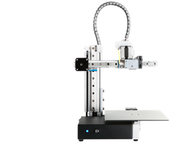

# Todo: 3D Printing - Consider the bare basics and stable cetus3D as my first 3d printer?

```#4c854280``` *As of 2017-11-28 23:41*

[mail plain/text](mail.txt)


It seems to me that the Cetus3D makes a cheap yet stable and accurate 3d printer that could serve as my first to go for?

1) The Cetud3D seems to live here (<https://www.cetus3d.com>)?



==&gt; It seems to be a PLA-printert only (no heated bed means no ABS)?

==&gt; Consider to print and then cast in other materials?

==&gt; Consider the enhanced Cetus MK-II (<https://www.cetus3d.com/shop/index.php?route=product/product&product_id=74>)?

==&gt; It seems to be 399 $ instead of 299 $ (Worth it)?

2) Consider the Cetus3D reviews on the web?

==&gt; Consider this praising review of the upgraded Cetus MK-II (<https://www.youtube.com/watch?v=wZkzFTMyiH0>)?

==&gt; Consider this pre-review (beta) from jan 2017 ()<https://www.youtube.com/watch?v=D_i3vAV7EJ4>)?

==&gt; Consider this good review from november 2017 (<https://www.youtube.com/watch?v=p9pirOBt8TU>)?

==&gt; Consider this good review from november 2017 (<https://www.youtube.com/watch?v=jlI_jugz1dA>)?

==&gt; Unboxing and assemble :)

…

Consider to buy this printer or use it as a lead to the one I should go for as my first 3D printer?


