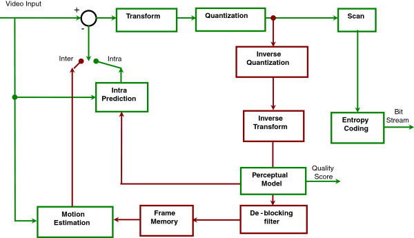
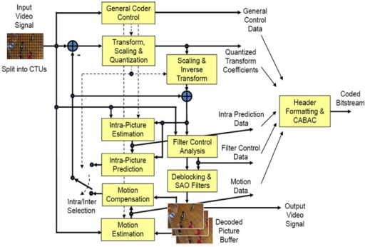
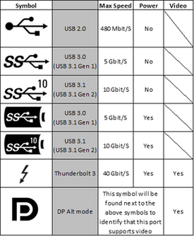

# Todo: Consider a DIY USB-C H.264 and H.265 video encoder device?

```#4cd0ea03``` *As of 2019-02-27 23:04*

[mail plain/text](mail.txt)


It seems it could prove a valuable adventure to scout the available options to put together a video encoder device to extend any computer with such capabilities?

1) Consider SOC-technologies range of MPEG Video/Audio Codec Modules (<https://store.soctechnologies.com/static/docs/Datasheet%20-%20MPEG%20Video-Audio%20Codec%20Modules.pdf> )?

==&gt; Consider this overview of the hardware from SOC-Technologies for hardware codecs (<https://www.soctechnologies.com> )?

Q: Are these streaming only or can we use models for file based encoding?

Hm… It seems they only provide real time streaming encoding?

2) Consider Wikipedia on H.264 (<https://en.wikipedia.org/wiki/H.264/MPEG-4_AVC> )?



*H.264 Encoding (<https://upload.wikimedia.org/wikipedia/commons/8/82/H.264_block_diagram_with_quality_score.jpg> )*

3) Consider wikipedia article on HEVC (H.265) codec (<https://en.wikipedia.org/wiki/High_Efficiency_Video_Coding> )?



*HEVC, H.265, block diagram (<https://en.wikipedia.org/wiki/File:HEVC_Block_Diagram.png> )*

4) Consider we can make Arduino MKR VIDOR 4000 Encode H.264 video files (<https://store.arduino.cc/mkr-vidor-4000> )?

Q: Do we need a license to implement H.264 encoding (see wikipedia article that refers to H.264 being protected by patents and Open Source usage paid for by Cisco) (<https://en.wikipedia.org/wiki/H.264/MPEG-4_AVC> )?

5) Consider we would like an USB-C connected device that can encode to H.264, H.265 in the rate of the allowed bandwidth of the connection?

==&gt; Consider the wikipedia article on USB-C (<https://en.wikipedia.org/wiki/USB-C> )?



*Supported protocols and bandwidth over USB-C (<https://en.wikipedia.org/wiki/File:USB-C_Protocol_Chart.png> )*

==&gt; Consider a thunderbolt 3 connected encoder could encode 4 GB / s (?)

==&gt; Consider there is no use to encode faster than what we can read from and bring back and store to disk (meaning we want to be able to encode up to 1 GB / s)?

==&gt; Consider we can imagine the device itself allows for an USB-C connected hard drive to store encoded video files?

6) Consider hardware acceleration supported by FFMPEG (<https://trac.ffmpeg.org/wiki/HWAccelIntro> )?

==&gt; Consider it seems FFMPEG has grown a little too complicated and chaotic (I mean, we are talking about processing a stream of bytes - how complicated can it get)?

...

...


