# Todo: Consider to document and remember the power tool extensions to enhance their ability and precision as described in youtube video "15 SIMPLEST Woodworking Tools Hacks \| Tips & Tricks"?

```#4f620091``` *As of 2023-08-14 11:46*

[mail plain/text](mail.txt)


I like the idea of enhancing power tools ability and precision with "hacks" you can do yourself using wood, glue and screws :)

1) Consider the power tool enhancements described in youtube video "15 SIMPLEST Woodworking Tools Hacks | Tips & Tricks" (<https://youtu.be/QCnCP1hdg9g> )?

2) Consider the drawings presented of the power tool enhancements described in youtube video "15 SIMPLEST Woodworking Tools Hacks | Tips & Tricks" (<https://youtu.be/QCnCP1hdg9g> )?

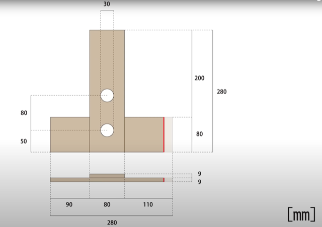

<https://youtu.be/QCnCP1hdg9g?t=44>

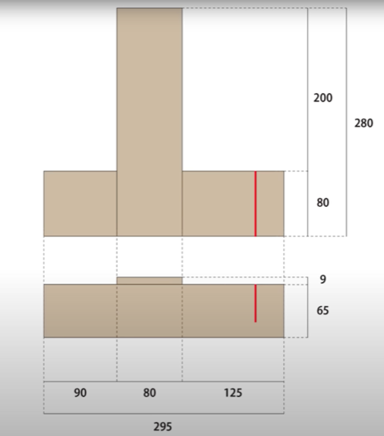

<https://youtu.be/QCnCP1hdg9g?t=140>

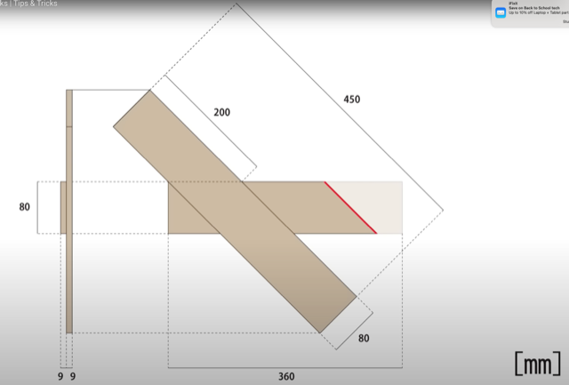

<https://youtu.be/QCnCP1hdg9g?t=174>

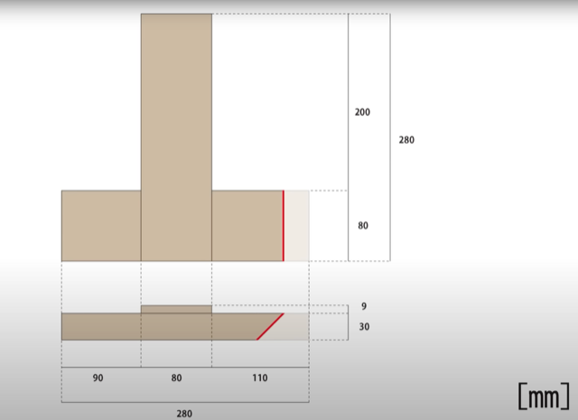

<https://youtu.be/QCnCP1hdg9g?t=238>

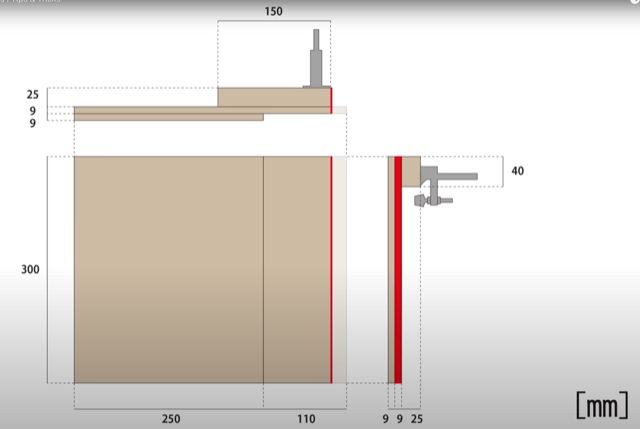

<https://youtu.be/QCnCP1hdg9g?t=312>

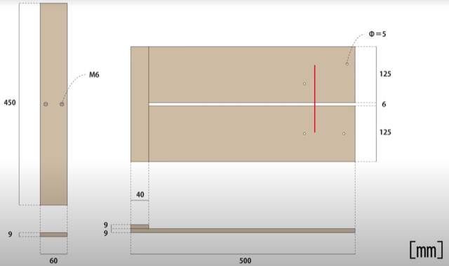

<https://youtu.be/QCnCP1hdg9g?t=380>

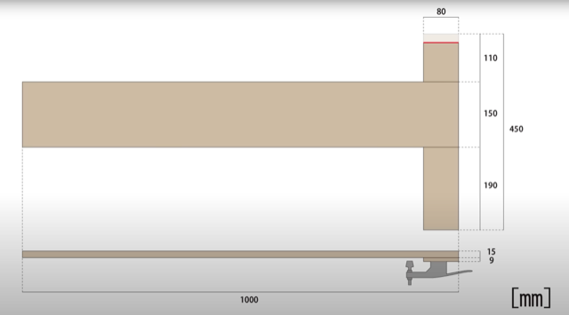

<https://youtu.be/QCnCP1hdg9g?t=433>

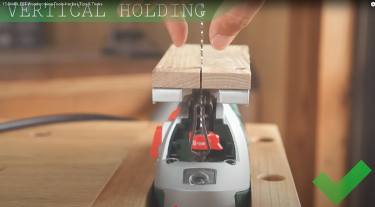

<https://youtu.be/QCnCP1hdg9g?t=473>

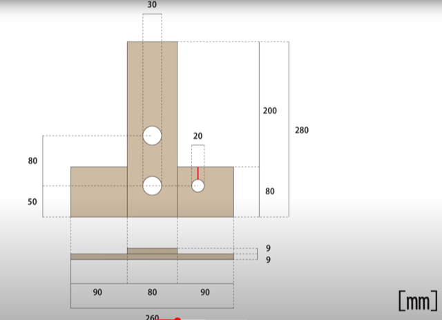

<https://youtu.be/QCnCP1hdg9g?t=559>

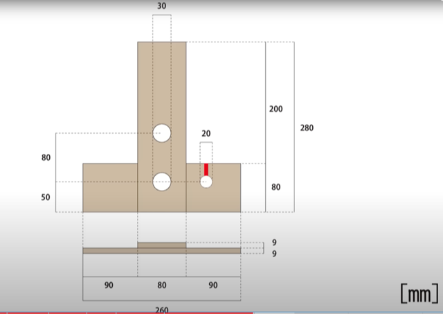

<https://youtu.be/QCnCP1hdg9g?t=680>

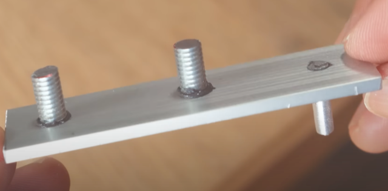

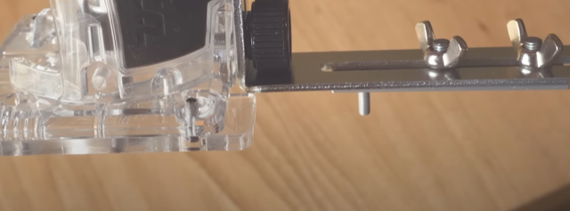

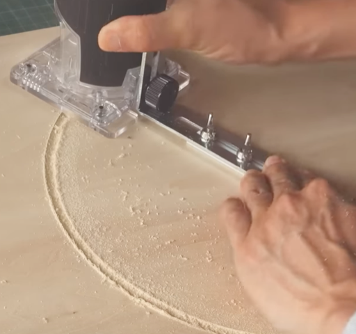

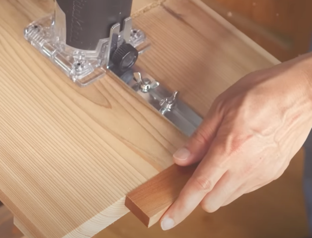

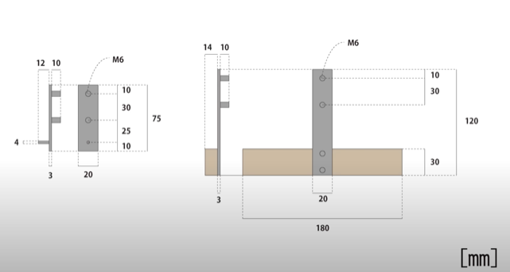

<https://youtu.be/QCnCP1hdg9g?t=825>

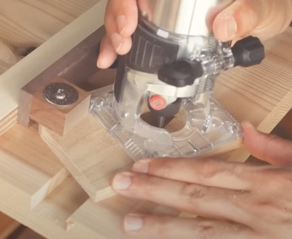

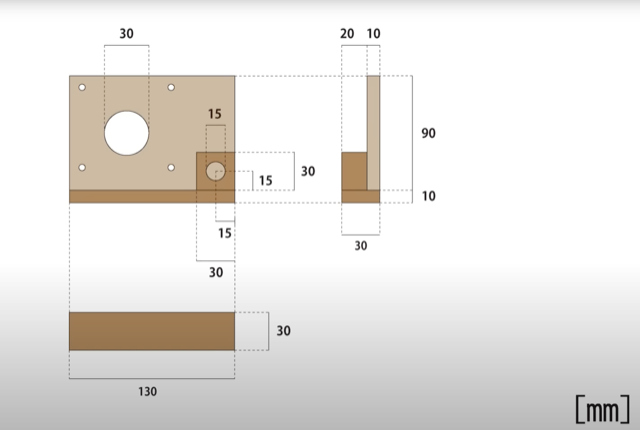

<https://youtu.be/QCnCP1hdg9g?t=969>

...


