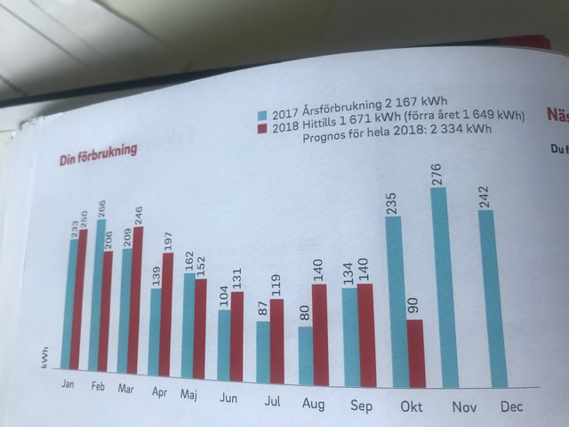
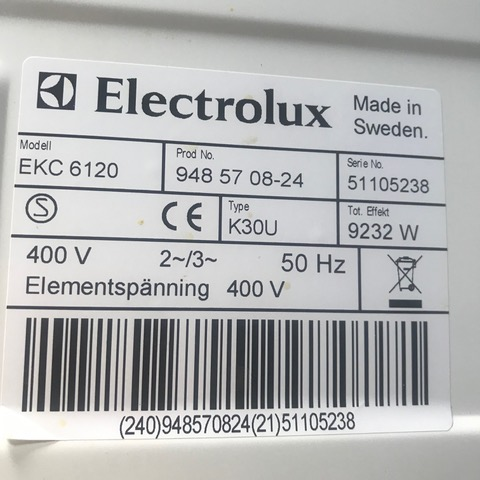
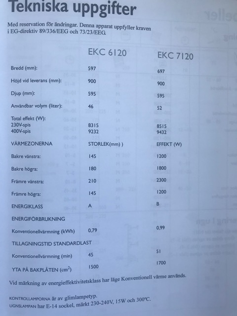
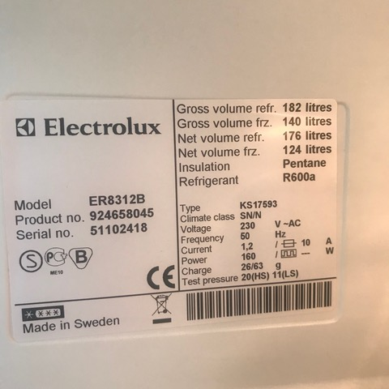
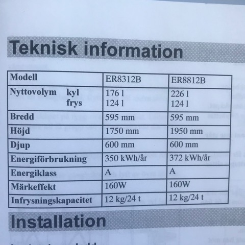

# Todo: Own House - Consider my power consumption I have to cover for my "earth ship" passive house build?

```#4f861fd7``` *As of 2020-02-17 16:12*

[mail plain/text](mail.txt)


How much power do I actually consume to live a comfortable life?

==&gt; Also see "Todo: Private Economy - Consider to understand my electric bill (what are the different fees and tariffs I pay)?"

-1) Consider the abstract of what I have found out so far?

==&gt; It seems my current apartment household electricity is 192 kWh per month (2.3 MWh per year)

==&gt; A passive house seems to require roughly 15 kWh / m2\*year which is 125 kWh / month (1.5 MWh per year)

==&gt; Total house power consumption thus amounts to &lt;= 4 MWh per year (333 kWh / month)

1) Consider in my current apartment I consume between 140 and 260 kWh per month and roughly 2300 kWh per year?


*My electric bill for November 2018 to April 2019 (October is not a full month as I switched to this vendor)*



*My electric bill fro Jan 2017 to Okt 2018 (October is not a full month as I switched from this vendor)*

==&gt; Consider my energy consumption is actually quite low (although heating of water is not accounted for)?

> With a power wall with a 10 kWh capacity available for consumption I would last four winter month consuming 250 kWh a month. Now I would still have to heat water AND heat the house!

2) Consider to explain my current consumption of electricity?

> *From historical bills I can deduce that I consume between 80..280 kWh per month. With the lowest consumption in July. Now I have no electrical heating nor any heating of water on my electrical bill. It covers lighting and the stove and microwave and some additional household machines (hoovering), power tools and my computer and TV. Let assume the 80 kWh for July is the base line consumption over the year for the refrigerator and household machines. Per day we then get 2.6 kWh for July. This would get us **960 kWh per year in base consumption**?*

> *But what is it then I do in a winter month like October to Mars with a consumption of 200..280 kWh? It is a rise of 120..200 kWh per month or 4..6.7 kWh extra per day for the winter months! Is it lighting of my apartment? If we assume I have to light up the apartment more or less all my time awake this is roughly 15 hours a day. If 4 kWh is for lighting this means 266 W per hour to keep the lights on. That is not right? My kitchen lamp is 7W. My room lamp is 5W. My indoor shed LED lights are 12W. And oh, I also have electric heating of my bathroom floor! I wonder how much that is? From the web I get some indications that heating a bathroom floor of 5 square meters from 20 to 25 degrees C consumes around 0.3 kWh per hour. If I left my on for the whole month this would consume 720 hours x 0.3 kWh/h = 216 kWh!!*

> *Now I know I have seldom, if ever, had my bathroom floor heater on for months. It is more like a day each week in conjunction with me cleaning the bathroom and having it dry up nicely using the heated floor. As an estimate I would say I run my bathroom floor heating say four times a month 24 hours each time which would amount to roughly 30 kWh a month. With an additional say 6 weeks when I have kept it on for convenience or by negligence = 43 kWh. A total consumption would then amount to 30 kWh x 12 month + 43 kWh = 403 kWh.*

> ***My Lights** of 7W x 10 hours (kitchen table) + 60W x 7 hours (TV) + 5W x 15 hours (room lamp) + 12W x 10 hours (indoor shed) = 685 Wh per day or 20 kWh per month during the seven darkest month = **140 kWh per year**.*

> *I probably used my **lap top** a lot but more or less evenly over the year. A Macbook Pro 2014 15" power adaptor can deliver 87W which then is a peak value to enable both running and charging the battery. A Macbook Pro is stated by apple to run 10h on its 95 Wh battery. And on the web I found indications of a 90Wh Macbook battery running 6h in normals operation. This would indicate my 15" Retina Macbook Pro mid 2014 could consume around 9.5..15W in mean consumption while I am working on it. With the possibility it actually consumes more when hooked up to my 27" LED Cinema monitor and thus have to drive more graphics and can rely on power from the charge input.*

> *Let assume I work at the **computer** at least 6 hours a day and it consumes 15 watts then this would accommodate for 90Wh a day or 2.7 kWh per month and **33 kWh a year**. This is also not noticeable?*

> ***My TV** is max 96W but brags with a mean power consumption of 60W. If I watch TV (mostly youtube and Star Trek DVD actually) say 6 hours a day this would mean a monthly energy consumption of 10.8 kWh or **130 kWh a year**.*

> *I wonder how much power I consume to cook? I use the oven maybe once a week to bake a cake or fry a pan of chicken legs. The European energy label seems to indicate it consumes 790 Wh "per cycle" (whatever that cycle includes). But if we use that as a minimum and assume two cycles a day plus an additional two oven cycles a week I would consume around 68 cycles a month = 54 kWh and month or 644 kWh a year.*

> *My refrigerator is stated to consume 350 kWh per year. *

> *A rough estimation of my baseline is thus 644 kWh (stove cooking) + 350 kWh (refrigerator) + 430 kWh (bathroom floor heater) + 33 kWh (computer) + 130 kWh (TV) + 140 kWh (lights) = **1727 kWh per year base line**. This would be 144 kWh mean consumption per month over the year.*

> *Now I need more investigation and input information to really understand my electric consumption. The **theoretical base** line energy consumption of around **1700 kWh** per year means we have an **unexplained extra 600 kWh** to get to the **actual** consumption around **2300 kWh** per year I have had during 2017 and 2018.*

==&gt; Consider this Swedish article "Elektrisk golvvärme i lägenhet – Är det dyrt?" on the power consumption of electric heated bathroom floor (<https://golvvarmekungen.se/2015/elektrisk-golvvarme-i-lagenhet-ar-det-dyrt/> )?

> *Bör jag vara orolig över priset när jag värmer upp mitt badrumsgolv till 25 grader i ett par timmar per kväll?*

> *Bara användaren kan värdera vad man tycker komforten är värd. Men säg att du har 25 grader på golvet i badrummet 4 timmar varje kväll. Då blir månadsförbrukningen för det ca 0,26 kWh x 4 timmar x 30 dagar = 31,2 kWh, vilket motsvarar en kostnad på mellan 30 och 45 kronor varje månad.

> Hur många kWh kan golvvärmen tänkas förbruka när den är inställd på 25 grader/timme?  
> 0,26 kWh/timme*

==&gt; Consider this article on Macbook Pro mid 2014 measured battery capacity 90Wh lasts 6h (<https://discussions.apple.com/thread/7012104> )?

> *"**I got my 15 inch retina macbook pro brand-new less than a month ago, this last June. It is mid-2014 top-of-the-line model, A1398. Its full charge capacity started out as 89.3 Wh. Now after 5 load cycles, it takes about 86 Wh which is significantly below the **proposed capacity of 95 Wh** for 2014 models and 99.5 Wh for 2015 models. It could run as short as 4 hours without charge and **normally about 6 hours** according to the battery health app. I didn't do any gaming or other power-hungry operations by far. I wonder whether my battery would be seen by any chance as defective thus covered by 1 year warranty for a replacement, or is it necessary?**"*

3) Consider the technical specifications of my apartment appliances (Refrigerator, Stove ...)?

==&gt; It seems my Stove is a 400V three phase connected Electrolux EKC 6120 with max power output of all heaters together of 9200W?

==&gt; It seems to be rated as consuming 790 Wh "per cycle" according to EU energy label standards (See "konventionellvärmning (kWh)")

**THIS SUCKS!! What an obscure name and how hard it is to get any raw data on the conditions for the 790 Wh consumption!**



*Electrolux 400V Stove EKC6120 marking label*



*Electrolux 400V Stove EKC6120 technical specification*

==&gt; It seems my refrigerator is an Electrolux ER8312B rated for an annual energy consumption of 350 kWh per year (30 kWh per month)



*Electrolux 230V 160W Fridge model ER831B marking label*



*Electrolux 230V 160W Fridge model ER831B technical specification states consumption 350 kWh a year*

4) Consider the wikipedia article on the European Union energy label (<https://en.wikipedia.org/wiki/European_Union_energy_label> )?

==&gt; It seems, for appliances like a washing machine and a stove, the label must report the energy consumption for "one cycle" (as for one standard meal cooking)?

5) Consider my electrical energy consumption requirements to include heating of house, water and powering additional equipment for water cleaning and recycling?

TODO: Try to estimate how much more energy would I require for my house than for my current apartment?

> *I need to add power consumption for heating the house, heating warm water and to power the water treatment and re-circulation systems.*

...


