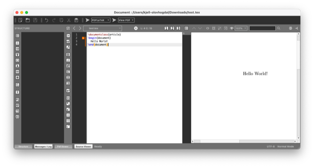

# Todo: Consider to use LaTex on macOS  with the leaner tool chain BasicTex + TexMaker combined with online Overleaf tools (as opposed to full MacTex with included editor TeXShop)?

```#50181298``` *As of 2022-06-07 10:19*

[mail plain/text](mail.txt)


I am getting more and more inspired to learn and use LaTex for document generation (type setting) but feel I want a lean tool chain.

1) Consider I can "uninstall" the Brew installed MacTex with command "brew uninstall mactex"?

> kjell-olovhogdal@Kjell-Olovs-Mac-Pro cratchit % brew uninstall mactex  
> Warning: Use python3.9 instead of deprecated freecad/freecad/python3.9  
> ==&gt; **Uninstalling Cask ****mactex**  
> ==&gt; **Uninstalling packages; your password may be necessary:**  
> org.tug.mactex.gui2022  
> Password:  
> org.tug.mactex.texlive2022  
> ==&gt; **Removing files:**  
> /usr/local/texlive/2022  
> /Applications/TeX  
> /Library/TeX  
> /etc/paths.d/TeX  
> /etc/manpaths.d/TeX  
> ==&gt; **Purging files for version 2022.0321 of Cask mactex**  
> kjell-olovhogdal@Kjell-Olovs-Mac-Pro cratchit %

2) This seems to be the home of TexMaker (<https://www.xm1math.net/texmaker/download.html> )?



3) This seems to be the "home" of the leaner macOS LaTeX package BasciTeX (<https://www.tug.org/mactex/morepackages.html> )?

> *"**BasicTeX is a much smaller alternate TeX Distribution for users who do not want to download the full TeX Live, or have unreliable internet connections. BasicTeX is a subset of TeX Live of size 110 megabytes instead of 2 gigabytes**"*

4) It seems basictex is awailable as a Brew package (<https://formulae.brew.sh/cask/basictex> )?

> kjell-olovhogdal@Kjell-Olovs-Mac-Pro cratchit % brew install --cask basictex  
> Running \`brew update --preinstall\`...  
> ==&gt; **Auto-updated Homebrew!**  
> Updated 2 taps (homebrew/core and homebrew/cask).

> You have **66** outdated formulae installed.  
> You can upgrade them with **brew upgrade**  
> or list them with **brew outdated**.

> ==&gt; **Caveats**  
> You must restart your terminal window for the installation of MacTex CLI tools to take effect.  
> Alternatively, Bash and Zsh users can run the command:

> eval "$(/usr/libexec/path_helper)"

> ==&gt; **Downloading <https://mirror.ctan.org/systems/mac/mactex/mactex-basictex-20220314.pkg>**  
> ==&gt; **Downloading from <https://ftpmirror1.infania.net/mirror/CTAN/systems/mac/mactex/mactex-basictex-20220314.pkg>**  
> ######################################################################## 100.0%  
> ==&gt; **Installing Cask ****basictex**  
> ==&gt; **Running installer for basictex; your password may be necessary.**  
> Package installers may write to any location; options such as \`--appdir\` are ignored.  
> installer: Package name is  
> installer: Installing at base path /  
> installer: The install was successful.  
> 🍺 basictex was successfully installed!  
> kjell-olovhogdal@Kjell-Olovs-Mac-Pro cratchit %

...


