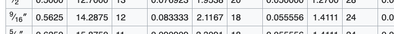
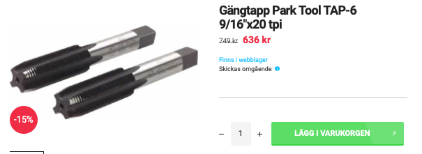
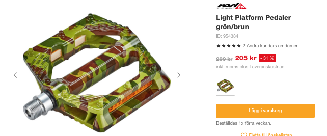
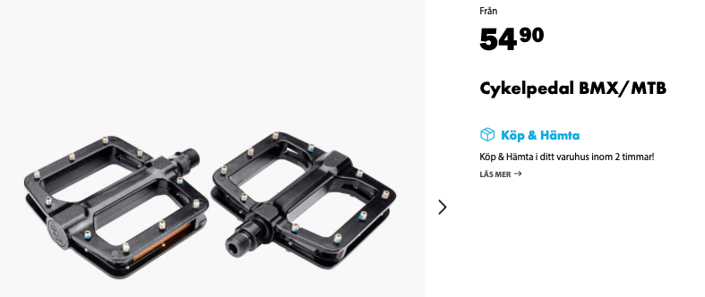

# Todo: Consider to design and build (3D Print) a pair of DIY pedals for MTB bikes 9/16” x 20 tpi (14.28 x 1.27 mm) threads?

```#51a038b6``` *As of 2021-08-07 18:16*

[mail plain/text](mail.txt)


I am building myself an MTB hardtail bike and maybe I will want to build me a pair of custom pedals?

1) It seems the "normal" pedal threads are 9/16” x 20 tpi (14.28 x 1.27 mm) (<https://mtbgearbox.com/bike-pedal-thread-sizes-a-complete-guide-to-pedal-threads/> )?

2) Consider wikipedia on UNC threads (<https://en.wikipedia.org/wiki/Unified_Thread_Standard> )?

==&gt; The table does not seem to list a 20 DPI for the UNC 9/16" threads (only 12 "Coarse", 18 "Fine" and 24 "Ultra Fine"?

> 

3) It seems I can buy threading taps for 9/16" pedal threads (<https://www.cykelkraft.se/gangtapp-park-tool-tap-6-9-16-x20-tpi?gclid=CjwKCAjw3riIBhAwEiwAzD3TidaDRKoxiD8Cle984Ll1gpN6r5XojFVppnHifGJ1p26orw1PLuG5pRoCkHQQAvD_BwE> )?

> 

4) It seems if I can't find a threaded rod or bolt in 9/16" 20 TPI, left and right threaded, then I can't make my own pedals?

> Unless I buy some cheap pedals and re-use the threaded bolt on them?

==&gt; Consider the cheapest pedals on Swedish Bikster for 205 SEK (<https://www.bikester.se/red-cycling-products-light-platform-pedal-M706011.html?vgid=G954384&cgid=37095> )?

> 

==&gt; Consider the even cheaper 60 SEK pedals from Swedish Biltema (<https://www.biltema.se/cykel-elcykel/cykelreservdelar/pedaler/cykelpedal-bmxmtb-2000043567?gclid=CjwKCAjw3riIBhAwEiwAzD3TiaHAFD1x8EX5BmpxMXup_y1b3gttw2Tc-TAXmqRR0pJLJyFMbtuczRoCIEcQAvD_BwE> )?

> 

5) Consider I can make my Pedals with Igur plastic bushings insetad of metal bearings?

...


