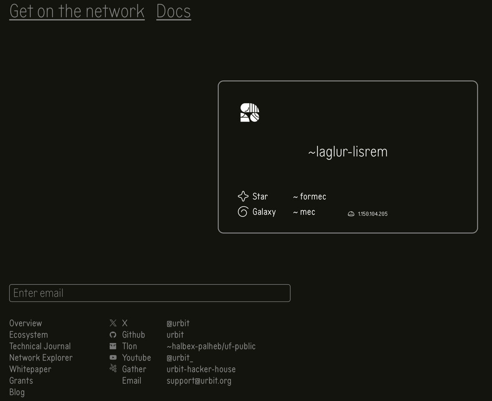

# Todo: Consider to compare the post internet OS and network 'Urbit' with my 'Darwinet', 'Tha' and 'Pyrotha' seeds?

```#524d7582``` *As of 2025-06-12 12:14*

[mail plain/text](mail.txt)


I want an interplanetary shared immutable data model and OS and Urbit seems to head in the 'same' direction.

1) 'Urbit' seems to live here (<https://urbit.org> )?

==&gt; It seems to expose technical aspects and not any semantics or usability?

> 

...


