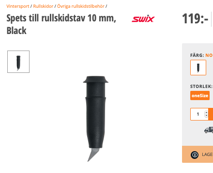
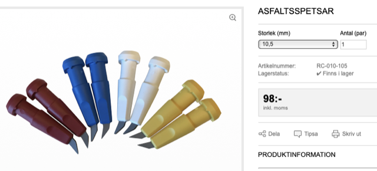
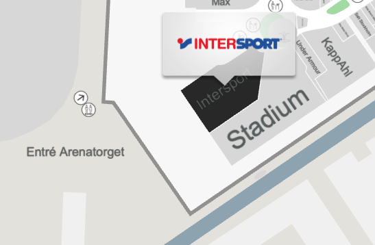
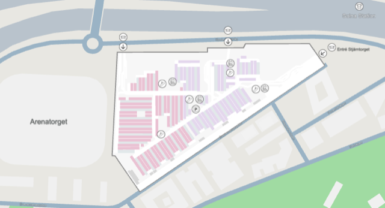

# Todo: Consider to replace the tip of my broken inlines / roller ski pole?

```#527132c6``` *As of 2019-09-25 15:35*

[mail plain/text](mail.txt)


I broke the steel tip of my asphalt inlines pole and I need to repair it.

1) It seems the tip is hot glued to the pole so I can remove it by heating the end of the pole as in youtube video "Hur du byter stavspetsar" (<https://www.youtube.com/watch?v=qHEJHtkizVk&feature=youtu.be> )?

2) It seems my pole ends are 10,22 mm in diameter so I should buy 10.5 mm pole tip (or tips declared for 10 mm poles)?

==&gt; Consider this tip for 10 mm Swix pole (<https://www.xxl.se/swix-spets-till-rullskidstav-10-mm-black/p/1012689_1_style> )?

>   
> *It is not clear if this tip fits a 10mm pole or has a hole of 10mm?*

==&gt; Consider these tips and choose 10.5 mm ones (<https://www.rullskidcenter.se/asfaltsspetar-4> )?

>   
> *These pole tips seems to state their size so 10.5 mm tip will fit to glue to my 10,22 mm pole end?*

3) Consider to first try the 10 mm tips sold by Intersport or Stadium (e.g. mall of Scandinavia)?

>   
> *Intersport and Stadium at the far end of Mall of Scandinavia in Solna, Stockholm.*

> 

...


