# Todo: Consider to document my experience and gathered knowledge from doing the Youtube tutorial "FreeCAD 2025 BIM - Architecture - Complete Beginner Tutorial"?

```#527b7c78``` *As of 2025-02-27 22:24*

[mail plain/text](mail.txt)


I need a CAD tool to design my house and produce the required documents for permits and build.

==&gt; Also see "Todo: Consider the youtube video "FreeCAD 2025 BIM - Architecture - Complete Beginner Tutorial" as a guide to using Freecad for my house design?"

1) Consider the youtube video "FreeCAD 2025 BIM - Architecture - Complete Beginner Tutorial" (<https://youtu.be/IV-nv9ygZPM> )?

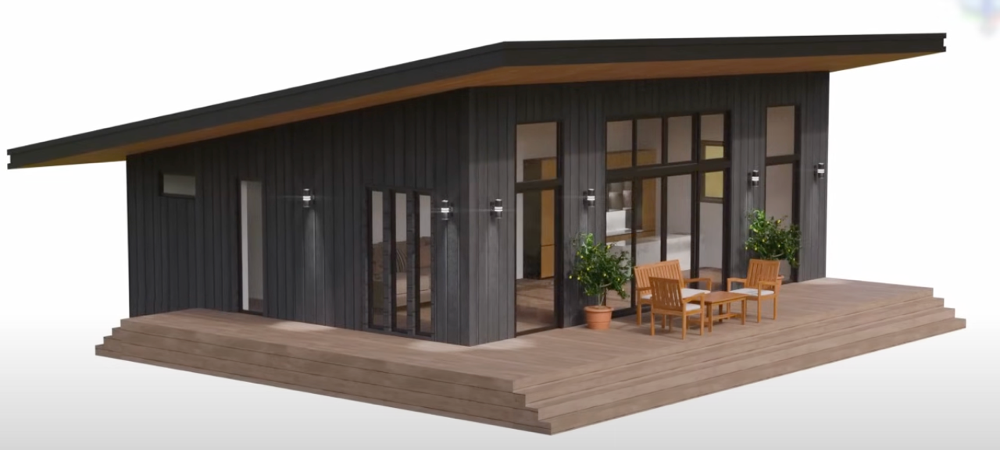

2) Consider my experience and 'good to know' from doing the tutorial om my Macbook Pro M3 14" 18 GB?

==&gt; Zooom in and out is 'two fingers up or down on the trackpad" (Touchpad navigation setting)

> 

> Zooom in and out: 'two fingers up or down on the trackpad"  
> Translate view: &lt;Shift&gt; + one finger on track pad  
> Rotate view: &lt;Option&gt; + one finger on trackpad

==&gt; 'Create Building' starts a new tree structure with 'Building' as the root

> 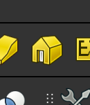 --&gt; 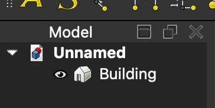  
> Note: I renamed the Budiling to 'House' by editing its 'Label'

==&gt; 'Create Level' is used to create a 'floor' and I need to drag-and-drop it under the 'Building' root

> 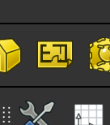 --&gt; 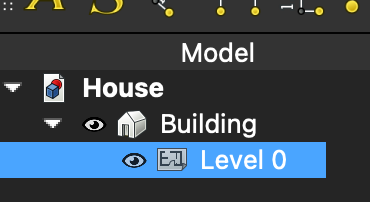  
> Note: I renamed the Level by editing its 'Label'.

==&gt; 'Split Edge' is required to actually split (a line point does not automatically split an edge / line)

> 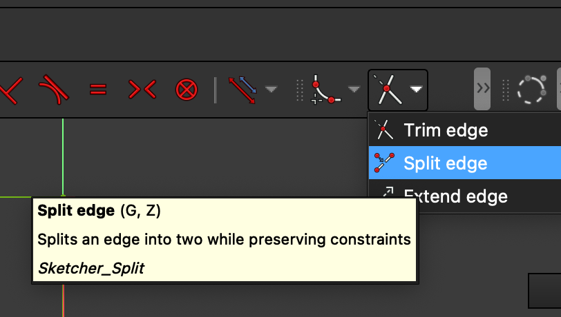  
> Note: 'Slit Edge' is a submenu of 'Trim Edge' in &lt;Sketcher Tools&gt;.

==&gt; Consider to Select items before clicking on a 'Constraint'?

> *I tried to click 'Constraint Coincident' and then two 'points' but had a hard time making the constraint take effect.*

> 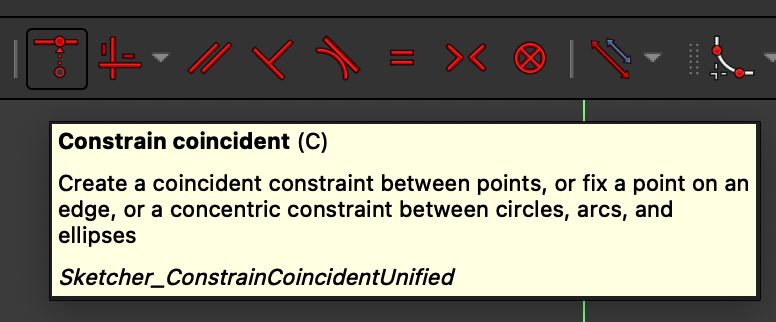

> *Maybe it works better if I first select the two points and then click the constraint (like the presenter does in the video)?*

==&gt; 'Close sketch' seems to be in the upper right corner?

> 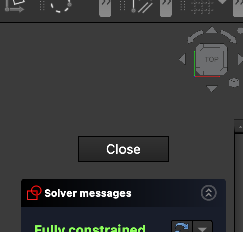

> Note: The &lt;Close&gt; button seems to be in the 'Tasks' panel BUT: The 'Tasks' header shows only when hovering with the mouse over this panel (possible confusion).

> 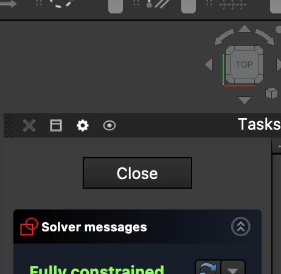

> The 'Tasks' panel header as shown when hovering over it with the mouse.

==&gt; Click on an Edge to select a 'Planar Shape' for use with the 'Create Slab' tool

> 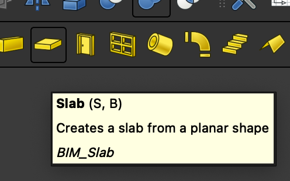

> Note: It does not seem to work to click inside a shape to select it (like in Fusion 360)?

==&gt; It seems we need to drag-and-drop the created 'Slab' into the 'Level' container to impose our project topology?

==&gt; It seems the 'Sketch' used for the 'Slab' gets put under the 'Slab' in the tree?

> 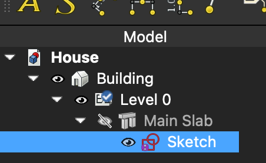

> *Note: I did not expect this and wondered where the sketch went?*

==&gt; I wonder why the presenter draws the wall 'from scratch' without referencing the 'Slab'?

==&gt; The 'Offset' tool looks like an old ink pen?

> 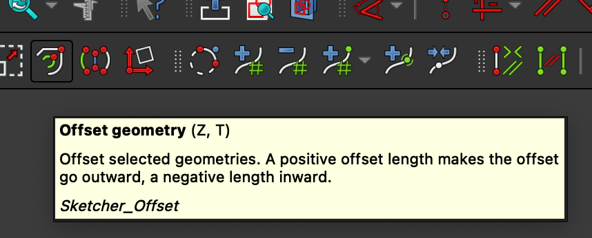

==&gt; The 'Add offset constraint' of the 'Offset Geometry' tool parameters is a little opaque (and unexpected)?

> 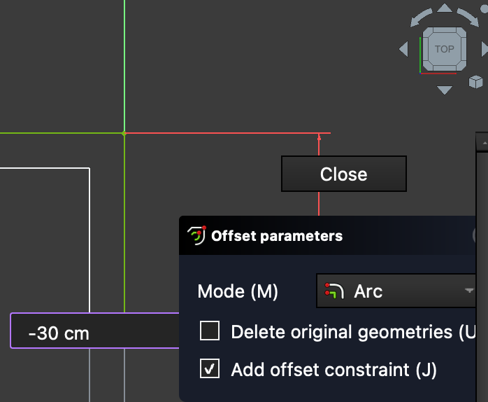

> *It seems the 'Add offset constraints' inserts something that looks like construction lines that allow us to later change (access) the set constrains?*

> 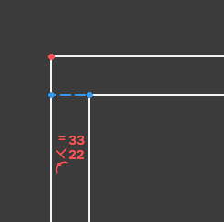

> *Question is why this is an option and not always there (like in Fusion 360 where you can always access previous operations parameters)?*

==&gt; It seems a 'Symmetric constraint' between a line and a point is to place the point at the center of the line?

> *I expected a 'symmetric constraint' to involve three items. The two items to be 'symmetrically constrained' and the item two witch the two items are symmetric. Why is this not so here? A 'symmetric constraint' between an end point of the construction line of the offset constraint on one hand, and the edge line or the other, does not translate to placing the end point at the center of the edge in my head?*

==&gt; It seems after closing the sketch all construction lines and measurements are made invisible (only plain lines show)

> *I am confused so much of the sketch 'disappears' when I close it?*

==&gt; The 'Wall' tool operates on the whole sketch (not a shape like in Fusion 360)

==&gt; The presenter in the video does NOT extrude a sketched wall, but a sketch inner perimeter + a wall widths

> *I wonder why he did not sketch the wall cross section and then extrude it like I would have done in Fusion 360?*

> *Also, By applying the Wall tool to the inner perimeter we have to repeat the 20 cm wall thickness we already sketched. What if we change the sketch to indicate a thicker wall? Then this will NOT affect the actual Wall created by the tool? This kind of rubs me the wrong way?*

==&gt; The tutorial requires the user to have the exterior wall plans to place them 'unguided' (on their own)

> 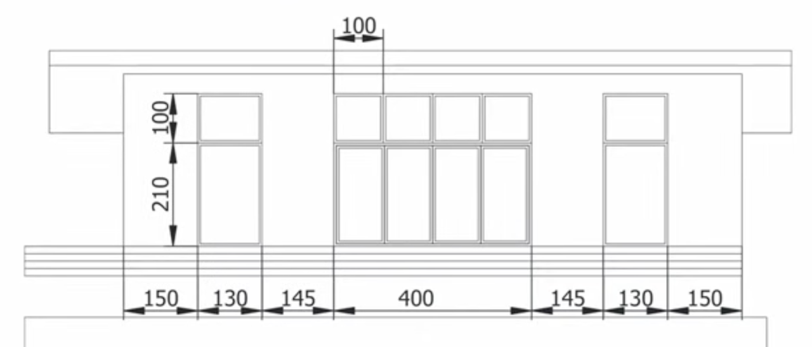

> This is the front exterior wall plan

> 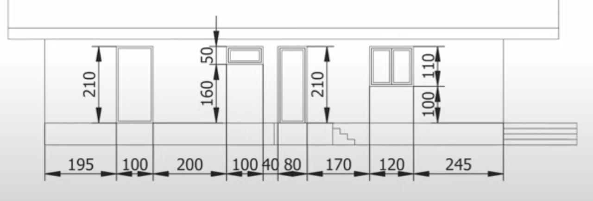

> This is the back side exterior wall plan

> 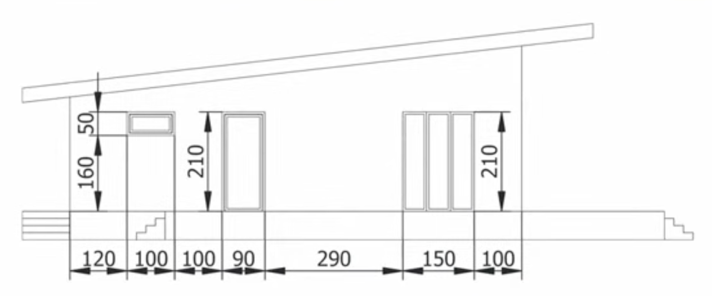

> This is the right exterior wall plan

> 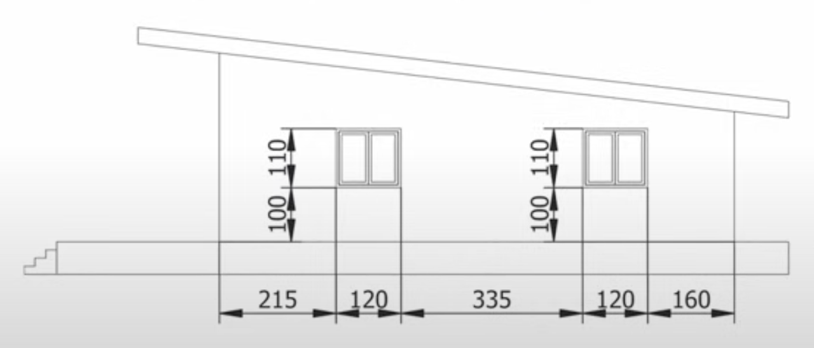

> This is the left exterior wall plan

> 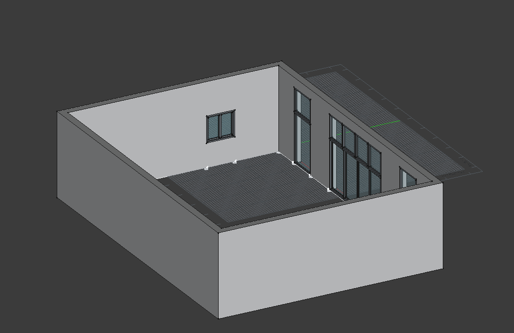

> The House I had created up to the point of guided in detail by the presenter in the video

==&gt; To add the remaining windows and doors was like struggling with an annoying puppy...

> *Although you select to create a 'door' you get an option pane for a 'window' which seems how it is supposed to be?*

> *Editing the width and height of a 'window' is a bit tricky. If you try to scroll the option pane you often accidentally change some other value by having the cursor placed over the value edit box (scrolling inside a value box 'scrolls' the value). Also, the value is not selected when clicking in the value box. And if you hit &lt;Ctrl&gt;-A to select 'all' and enters a value it will be interpreted as millimeter. You have to remember to re-add 'cm' for centimeters to have the value be correct. This is a bit strange as we have set the 'default' in the FreeCad 'Preferences' to 'cm'?*

> *I also managed to get a lot of 'garbage' sketches and windows outside the container where I was working (the EXT WALL container). I am not sure why but it seems any failure to commit any window creation leases 'half baked' or 'residue' windows and sketches? Well, I was able to delete them manually at least.*

> *The 'type' of window or door to create was confusing. Looking at the video it seems all doors should be of 'glass' which seems to correspond to the type 'fixed'? I am not sure. It seemed like a guessing game.*

> *The placing of 'windows' (doors and windows) was tricky. Sometimes I managed to align with an existing window or door upper frame by enabling 'snap endpoint' in the 'Draft' tool pane plus pressing 'z' to lock the movement to the z-axis. But it was not easy and often ended with a failure (and the residue sketches and windows was created in the items tree). *

==&gt; Still, with some patient I was able to create doors and windows that at least looks like the ones in the video?

> 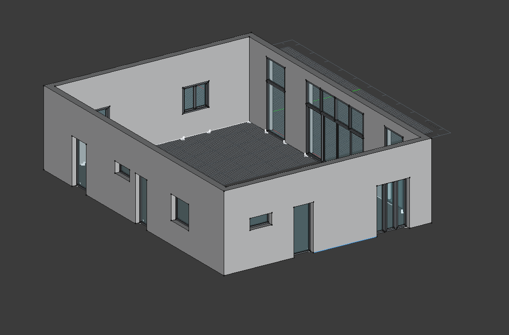

> My house after having created and placed all remaining windows and doors (all glass).

==&gt; A 'Hole Depth' for a door may cut through more than the wall the door is placed on (s t r a n g e)!

> *The video points out we need to address this problem by changing the 'Hole depth' from 0,00 cm to 10 cm! And in this way (somehow) the 'Hole Depth' is reduced?! Now this is of course totally unprofessional behaviour of a CAD tool...*

> 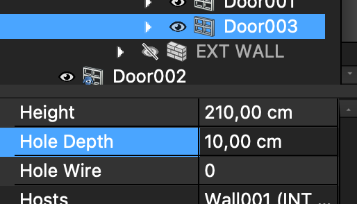

> *Note: The presenter explains that this behaviour comes from 'the walls' not being separate walls. But in fact a 'single wall'. I suppose this comes from us creating the interior walls from a single sketch? Still, for some reason this behaviour was not observed when I created the doors to the side rooms? Why did those doors not cut also the opposite walls? Strange...*

==&gt; I had a problem with the first opening (the 115 cm wide one to the left)

> *The internal wall plan sketch had the correct width of 115 cm from the inside wall to the internal wall center line.*

> 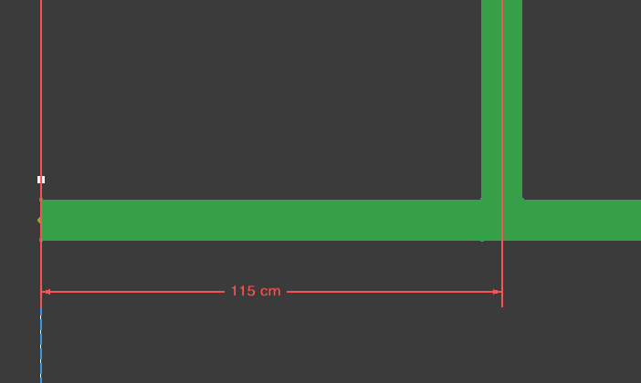

> *But this means the actual opening is 110 cm in my drawing. I failed to figure out why the presenter does not mention that a 115 cm opening is 5 cm to large? That is, if I have somehow generated the internal walls incorrect as 'centered'. Still, the other larger opening fits with my opening so centered walls seems ok there? Anyhow, I changed my 'left opening' to 110 cm.*

==&gt; It seems selecting an 'opening' does not show in the view (that is, I fail to see any highlighting of the selected opening)?

> *Maybe a plain opening has 'no substance' and therefore has nothing to be highlighted? Still, it is confusing...*

==&gt; The 3D/BIL tool ribbon 'Roof' tool applies to a whole sketch.

==&gt; It seems if I enter a bad formatted value in the 'Roof' properties dialog its contents disappear?

> *I am in Sweden so I tried entering '6,5' degrees roof slope (but I needed to enter '6.5' with '.' decimal separator otherwise the content disapperaed).*

> *I tried entering '30 cm' for roof thickness (but this seems invalid as the dialog content went invisibale).*

> *Note: The fix was to close and open (double click) the 'Roof' item again.*

==&gt; On macOS &lt;Command&gt; + &lt;click&gt; allows for selecting multiple items in the items tree.

==&gt; I succeeded to cut the external and internal walls to the roof.

> 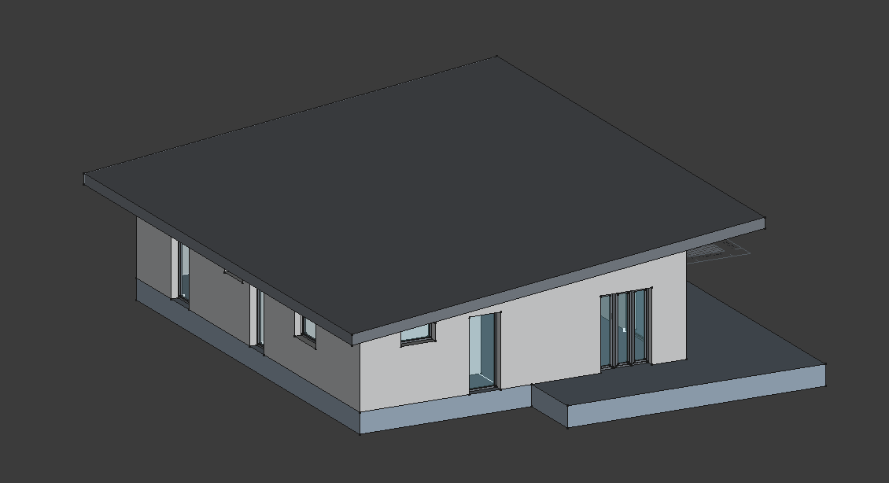

> My house looked like this after having finished the roof (before adding backside slab and front and back stairs)

==&gt; It seems we should create a flight of Stairs with NO sketch or other item selected?

> *I had folder 'INT WALLS' selected. Then when I clicked the 'Stairs' tool in the '3D/BIM' tool bar a 'Stairs' folder was created outside the folder. BUT - no stair could be seen in the view of the house? But if I clicked the 'Stair' tool with no item selected, then a default stair was created at origo.*

> 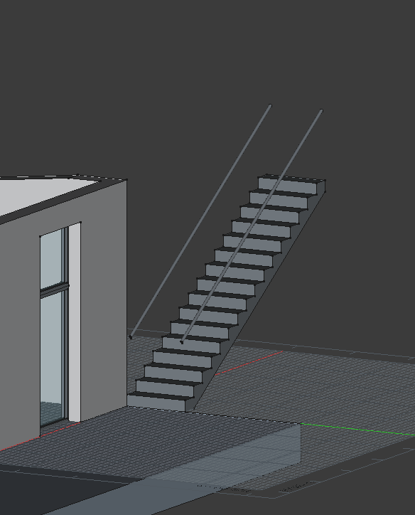

> *The default flight of stairs created at origo when clicking the 'Stair' tool in '3D/BIM' tool bar while NO item in the items tree was selected.*

==&gt; It seems a flight of stairs with 'Number of steps' set to 4 shows 3 steps?

> 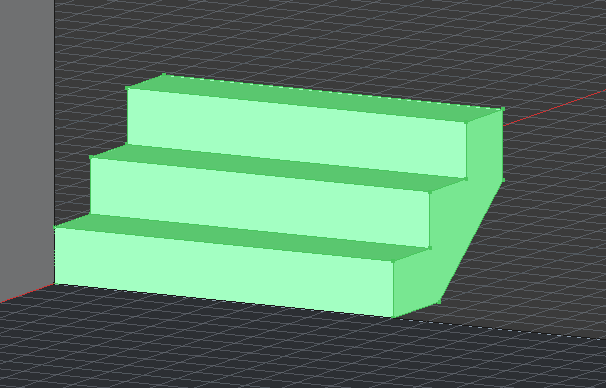

> A 'Stairs' object with 'Number Of Steps' set to 4 shows a flight of stars with 3 steps?

==&gt; Command+C and Command+V on macOS works for 'copy-and'paste' on the 'Stairs' object in the tree view.

==&gt; AHA! Objects are NOT 'Dragged and Dropped' but 'Selected-and-moved'!

> *Until this point I had tried to 'drag-and-drop' objects when using the 'Move' tools. But this is NOT how to use them. You have to 1) Select the object to move. 2) Click the 'Move' tool button. 3) Click a reference point on the object to move. 4) Then select the reference point on the target where to move to. That is, you shall NOT hold down the mouse button while moving the object! Took me a while to figure out...*

==&gt; I now have the whole 3D house modelled and organised into a top folder '3D MODEL'

> 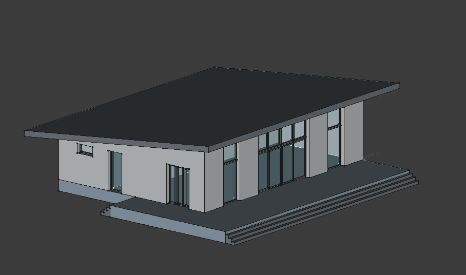

> My house 3D model so far.

> 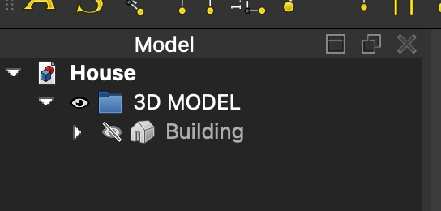

> The 3D model as a top folder with the root folder 'House' in it.

==&gt; It seems the 'Section Plane' tool is in the 'Annotation Tools' tool bar?

> 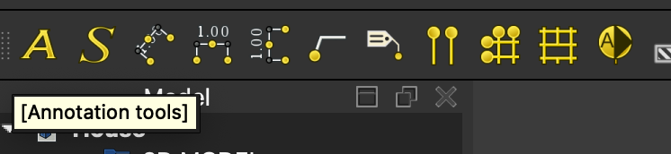

> The 'Annotation tools' tool bar

> 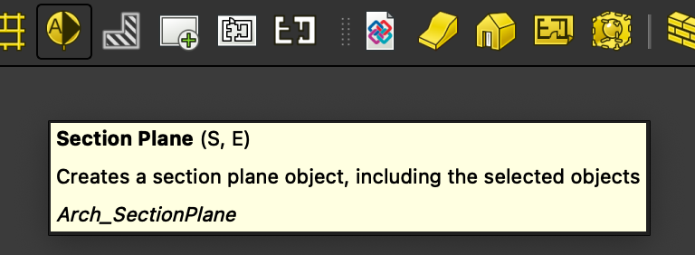

> The 'Section Plane' tool in the  'Annotation Tools' tool bar.

==&gt; It seems the 'Section Plane' is shown in the view as a green plane?

> 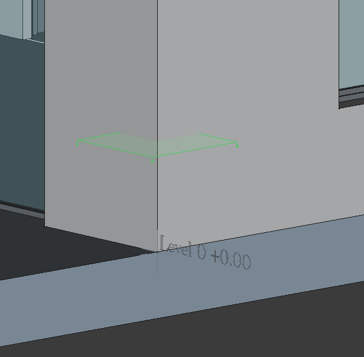

> A created section plane at z-height 100 cm.

==&gt; It seems the presenter sugests we projekt the selected objects to the XY-plane (as opposed to create a 'cross section')?

> 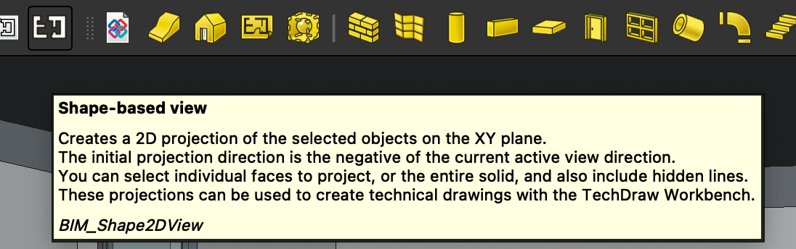

==&gt; It seems we move the created 'Shape2DView' with right click and then click 'Transform' (NOT use the 'Move' tool)?

> 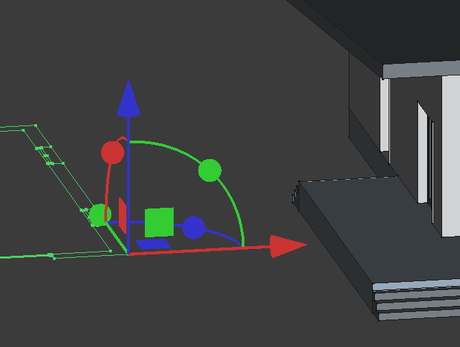

> The 'Transform' tool to translate the created 'Shape2DView'.

> Note: The semantics is a little opaque to me here. Why is this a 'view' and not 'a thing' like a drawing or a projection or what have you. A 'view' indicates it will change with changes to the 3D model? Maybe?

==&gt; AHA! At 45:27 the presenter discovers the error in width of the left inner wall opening (that I already fixed above) :)

> 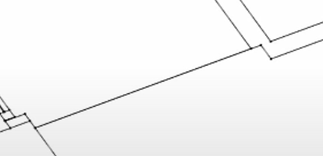

> In the generated floor plan the presenter discovers the notch into the wall due to the 'too wide' opening (that I already fixed in my model above) :)

==&gt; It seems 'showing the swing plan' of doors is a property of the door itself (and not of the generator of the floor plan)?

> 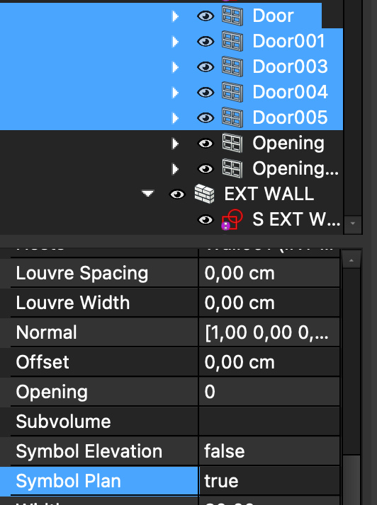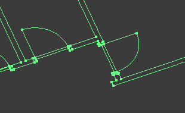

> By setting 'Symbol Plan' of each door property it shows up on the created 'Shape2DView' with an accompanying a 'swing path'

> AHA! They show up also in the 3D model! So that is way they show also on this 2D 'view'?!

==&gt; The presenter sugests I draw the floor plan in the 'TechDraw' workbench.

> 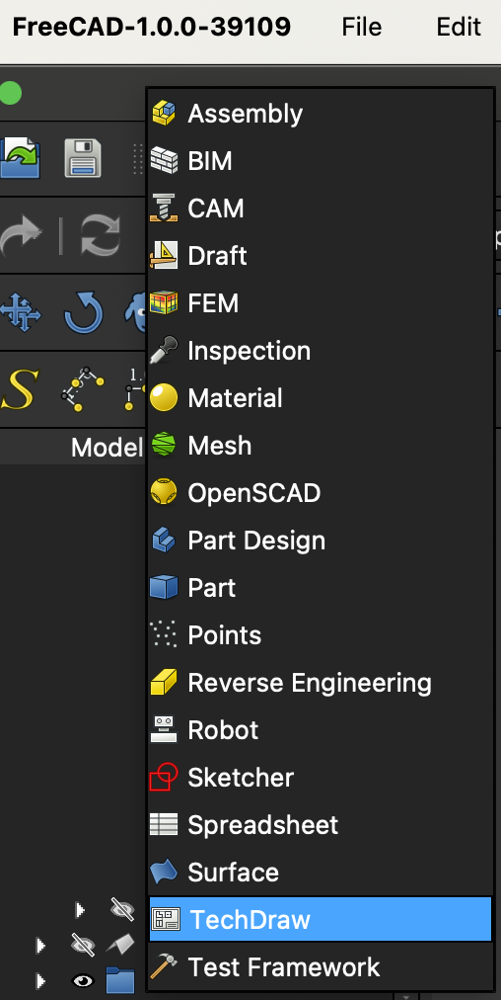

> The 'TechDraw' workbench in the Workbench drop down.

> Note: At this stage it is a bit strange that we have the 'view' just sitting around beside the 3D model...?

> Why is the work flow not to create a 'drawing' directly. That is, have the 'view' project directly into a separate 'thing'?

==&gt; It seems we now finally actually create a 'page' for the floor plan drawing?

> 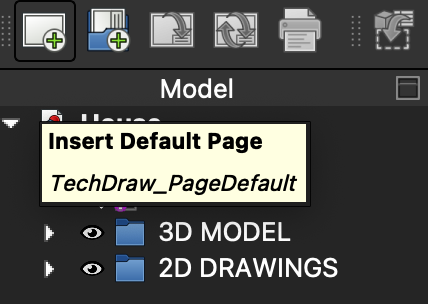

> The 'Insert Default Page' in the 'TechDraw' workbench.

> Note: The semantics here seems to be that we first have a 'view' created in the 3D view. Then we create a 'Page' to put the view on? Well, lets see...

==&gt; It seems we use the 'Insert View' with the 'Shape2DView' selected in the model tree?

> 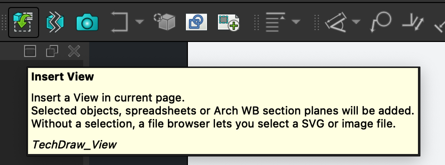

> The 'Insert View' in the 'Techdraws Views' tool pane.

> 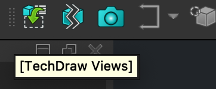

> Note: The semantics is again a bit vague? The 'Insert View' tool is a member of the 'TechDraw' workbench that takes a 'Shape2DView' as an argument? But where is it inserted? I imagine we can have several 'Pages' created in (by?) the 'TechDraw' workbench?

> Also, the 'Shape2DView' is still some strange unknown thing sitting around in the 3D view...

> Well, let's continue!

==&gt; It seems the font size for 'Dimensions' are set to 20 cm by default?

> 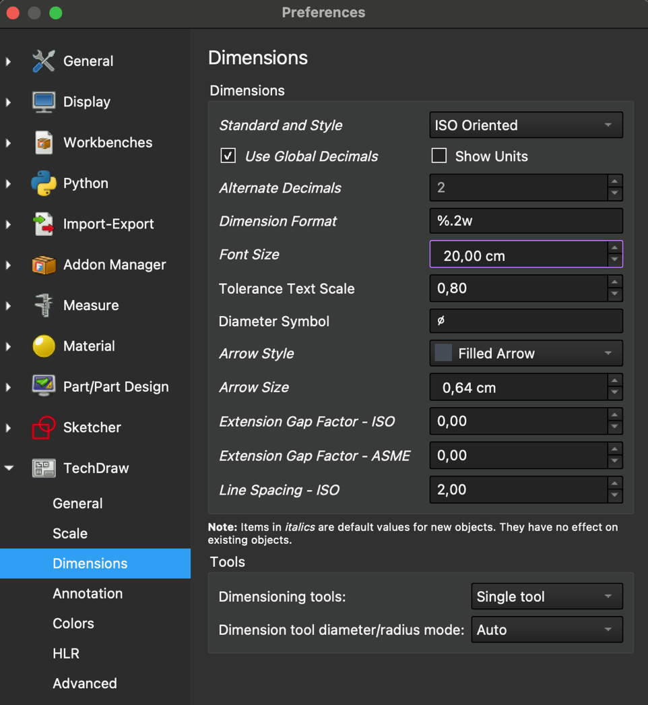

> The presenter showed how inserted dimensions in the 'Page' with the 'View' is by default HUGE!

> And they were also for me. This is unprofessional!

> Is the semantics here that the font is measured in the same scale as the thing we are viewing? That is, the 3D model of the house is many meters. So a label with a font size of 20 cm will look just fine in 'real life'? Well, I find this confusing? I mean, we are 'drawing' a 'view', not the real object?

==&gt; It seems to be several Issues with the Font and Stability of the 'Page' Dimensions?

> My font for Label and Dimensions looked strange and was clipped.

> 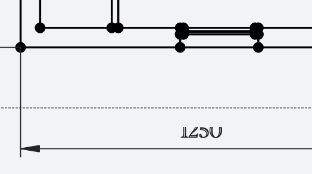

> It turned out that my macOS FreeCad 1.0 came with a 'TechDraw' workbench default font was 'Academy Engraved LET' (and that made measurement text be clipped).

> 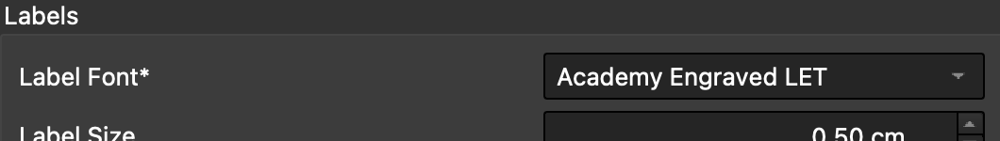

> I changed to 'Arial'

> 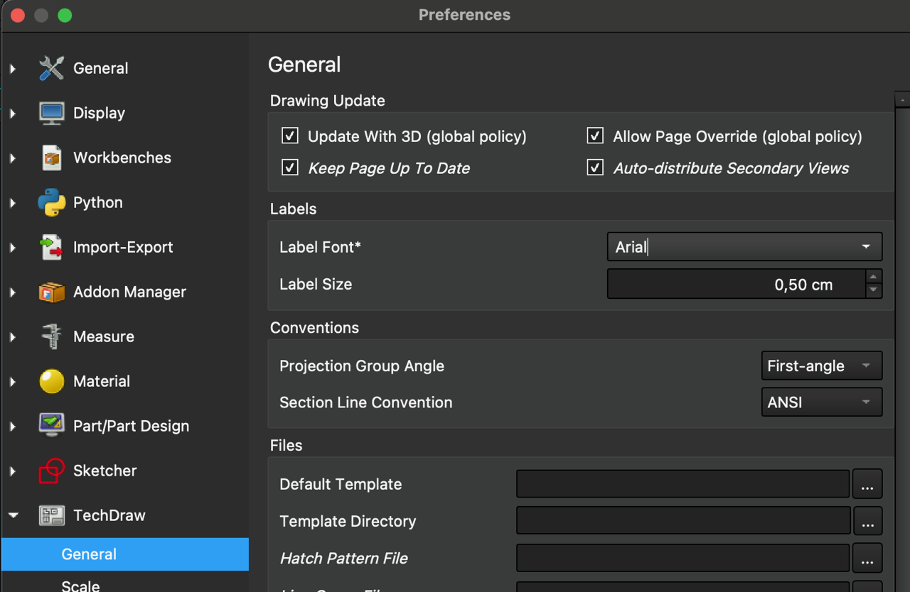

> ...

==&gt; OK - My FreeCad on macOS (Apple Silicone) is really unstable in 'TechDraw' and 'Page' edit!

> Dimensions become 'inactive' and uneditable (although I can continue creating new ones)

> Often the all the tools in 'TechDraw' workbench (or is it tools for the 'Page') gets inactive (and I have to restart FreeCad to get them usable again)

> The 'Apply Geometric Hash to Face' often refuses to show a dialog.

> 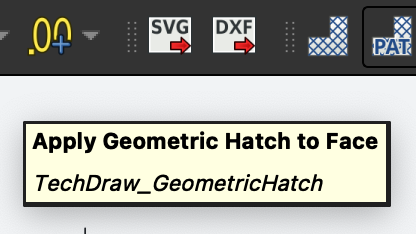

> For now this feature in FreeCad 1.0 on macOS Apple Silicone is BROKEN! ...

...


