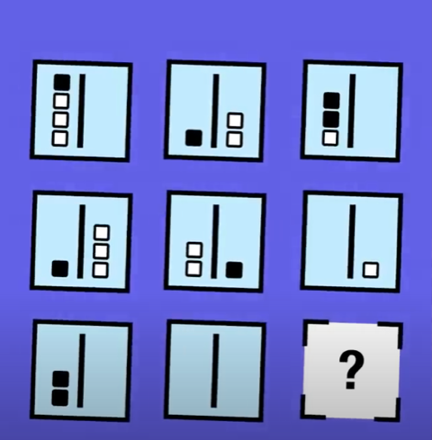
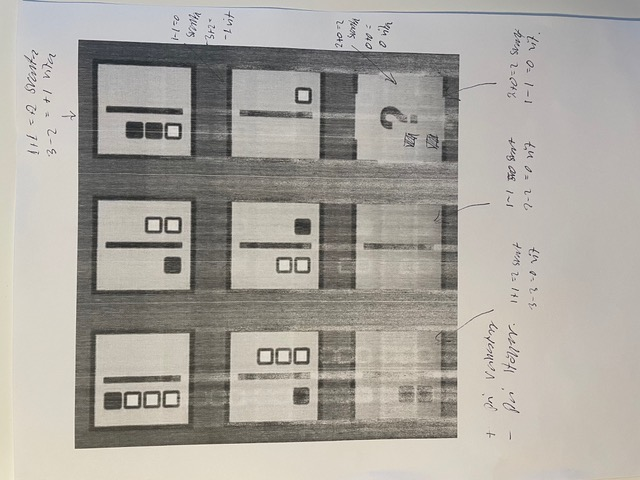

# Todo: Consider to make a youtube video on the IQ test question with +/- white/black squares?

```#53eda8ef``` *As of 2021-03-28 13:57*

[mail plain/text](mail.txt)


I solved this IQ test and thought it could be interesting to "go meta" on this one to try and frame what an IQ test is about?

1) Consider the youtube video "" where I heard about this OQ test question (<https://youtu.be/CIQWe4XWggM?t=94> )

> 

2) Consider my notes to my solution and what it tells us about what to look for when solving IQ tests?

> 

> I found the pattern that for each of the nine "configurations" the squares to the left of the divider signifies positive counts while the squares to the right of the divider signifies negative counts. So for row one we have one positive black square in the first configuration, one positive black square in the second configuration which adds up to two positive squares in the rightmost configuration.

> The same is true for white squares and also for each column! The bottom column configuration represents the sum of the two configurations above.

...


