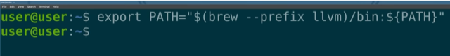

# Todo: Clang with gnu libstdc++ - Consider to see what updating the macOS PATH correctly can accomplish to make LLVM tool chain find the gnu libstdc++?

```#549a014f``` *As of 2022-07-26 17:11*

[mail plain/text](mail.txt)


I have so far been unsuccessful to compile with clang but link with gcc (gnu) libstdc++ on macOS.

1) Consider the export command in youtube video "" showing how to have brew update the path with installed LLVM (<https://youtu.be/QRUK9ylS4ho> )?

==&gt; It seems at around 2:11 he shows how to have brew create a path to installed LLVM and export it to macOS PATH (<https://youtu.be/QRUK9ylS4ho?t=131> )?



export PATH="$(brew ..prefix llvm)/bin:${PATH}"

==&gt; It seems the command adds ... to my PATH?

> kjell-olovhogdal@Kjell-Olovs-Mac-Pro cratchit % env | grep PATH  
> **PATH=/usr/local/bin:/usr/bin:/bin:/usr/sbin:/sbin:/Library/TeX/texbin:/Library/Apple/usr/bin:/Users/kjell-olovhogdal/Documents/Github/nudge:/usr/local/Cellar/llvm/13.0.1_1/bin**  
> kjell-olovhogdal@Kjell-Olovs-Mac-Pro cratchit %

> kjell-olovhogdal@Kjell-Olovs-Mac-Pro cratchit % **export PATH="$(brew --prefix llvm)/bin:${PATH}"**  
> kjell-olovhogdal@Kjell-Olovs-Mac-Pro cratchit % env | grep PATH  
> **PATH=/usr/local/opt/llvm/bin:/usr/local/bin:/usr/bin:/bin:/usr/sbin:/sbin:/Library/TeX/texbin:/Library/Apple/usr/bin:/Users/kjell-olovhogdal/Documents/Github/nudge:/usr/local/Cellar/llvm/13.0.1_1/bin**  
> kjell-olovhogdal@Kjell-Olovs-Mac-Pro cratchit %

> PATH=  
> /usr/local/bin  
> :/usr/bin  
> :/bin  
> :/usr/sbin  
> :/sbin  
> :/Library/TeX/texbin  
> :/Library/Apple/usr/bin  
> :/Users/kjell-olovhogdal/Documents/Github/nudge  
> :/usr/local/Cellar/llvm/13.0.1_1/bin  
> PATH=  
> **/usr/local/opt/llvm/bin**  
> :/usr/local/bin  
> :/usr/bin  
> :/bin  
> :/usr/sbin  
> :/sbin  
> :/Library/TeX/texbin  
> :/Library/Apple/usr/bin  
> :/Users/kjell-olovhogdal/Documents/Github/nudge  
> :/usr/local/Cellar/llvm/13.0.1_1/bin

...


