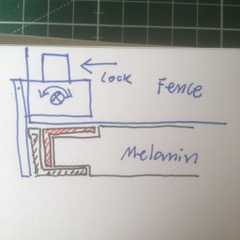

# Todo: Consider to build a table saw rip fence using materials available at bauhaus, K-rauta etc. ?

```#561802cd``` *As of 2018-04-16 13:21*

[mail plain/text](mail.txt)


Consider what I can buy from local retailers to build me a simple and workable rip fence för my Einhell 2025 table saw?

-1) Consider to use 16mm melanin board as base?


1) Consider a melanin board with aluminium profiles?

==&gt; Consider this Corner extrusion (Swedish “kantprofil") ?


==&gt; 1) Plane down melanin board (16mm) to fit the 15,9 mm slot?

==&gt; 2) Then have fence slide in the remaining slot?

==&gt; MOTE: I need a **7 mm plane router bit** to make the grooves in the melanin board to fatsten this profile?

==&gt; Consider to use this T extrusion (Swdish “T-Profil”)?


==&gt; MOTE: I need a plane **7 mm router bit** to make the groove in melanin board to fasten it?

==&gt; Consider this H extrusion (Swedish “H-profile”)?


==&gt; Consider this L shaped extrusion (Swedish “vinkelprofil” or “L-profil”)?


==&gt; NOTE: I need a plane 15mm router bit to cut the groove in the melanin board to fasten this?



==&gt; Consider stainless steel L shaped profile (stiffer but much more expensive)?


2) Consider C rails for curtains?

==&gt; Consider this C shaped rail for curtains?


==&gt; Consider to use these runners for the C rail?



