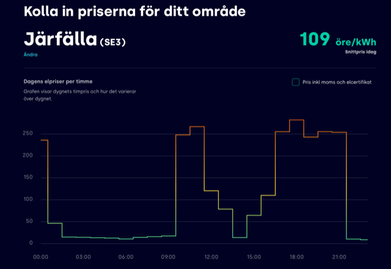
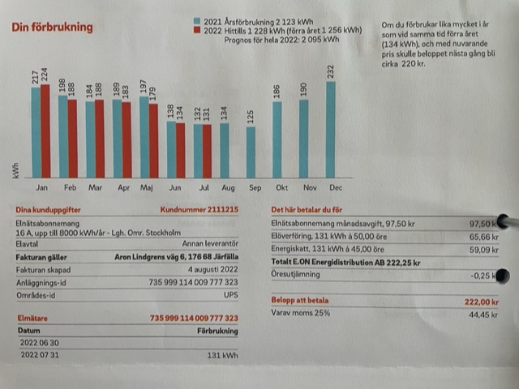
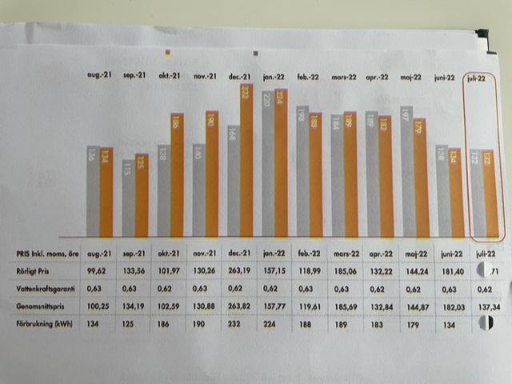

# Todo: Consider to study the possibilities to switch to hour-by-hour electrical billing agreement and what benefits I can expect when living in my apartment?

```#578d07c7``` *As of 2022-08-28 17:55*

[mail plain/text](mail.txt)


Is it time to change to hour-by-hour electrical consumption billing?

==&gt; Also see "[Todo: Own House - Consider my power consumption I have to cover for my "earth ship" passive house build?](../4f861fd7/chime.md)"

1) Consider this service provider that seems to indicate a price for electricity that changes between as low as 20 cents / kWh at night and 220 cents / kWh mid day (<https://tibber.com/se/elpriser/dagens?utm_source=googleadwords_int&utm_medium=cpc&utm_content=18004437329_142975263594_597673126985&utm_id=g_&keyword=aktuella%20elpriser&gclid=CjwKCAjwpKyYBhB7EiwAU2Hn2YhhJWJIcCmfARnaPMk4ARXOSsHTe32wdJuqcafOK4aeplpCuXr7OhoCJxUQAvD_BwE>)?



2) Consider the net price for consumed electricity with added cost for distribution and taxes in Sweden?

==&gt; It seems the con sumer is billed for the three parts electricity price, delivery price and taxes on the forst two (<https://www.energiforetagen.se/energifakta/elsystemet/elhandel/for-dig-som-elkund/kundens-elkostnader/> )?

> *"**Konsumentpriset består i huvudsak av tre delar:*

> *• En elhandelskostnad för använd el. Det är denna del av elräkningen som påverkas av konkurrens mellan elhandelsföretagen på elmarknaden.  
> *  
> *• En elnätskostnad för överföring av el till användaren via elnätet.  
> *  
> *• Skatter och avgifter: energiskatt, moms och avgifter till myndigheter."*

> *"...**Skatterna som kunden betalar är dels en energiskatt på el, dels moms med 25 procent på det totala priset för elnät plus elhandel plus energiskatten."*

==&gt; Consider this video "Vad är vad på elräkningen?" that seems to explain how the price of electricity is aggregated to the final consumer price (<https://youtu.be/Xbo6COyIyI4> )?

> *He states the tax is 34 cents / kWh (which is 36 cents Sug 2022) and that it is the delivery vendor that bills this amount?*

> *He states an additional cost for certificates is added and billed by the electricity producer / provider?*

> *He states that in Sweden we pay 25% in VAT on the total billed amount (price for electricity, price for delivery and price for tax and certificates) *

3) It seems in Sweden the current tax on electricity is 36 cents / kWh (<https://skatteverket.se/foretag/skatterochavdrag/punktskatter/energiskatter/skattpael.4.15532c7b1442f256bae5e4c.html> )?

> *"**Skattesatsen på el är 36,0 öre per kilowattimme.**"*

4) It seems the cost for certificates can be expected to be 3-4 cents / kWh in Sweden over a normal year (<https://www.energimarknadsbyran.se/el/dina-avtal-och-kostnader/elrakningen/elcertifikat-priser-och-kostnader/> )?

> *"*  
> Energianvändning per årElcertifikatsprisKostnad/år2000 kWh/år3,2 öre/kWh64 kr/år5000 kWh/år3,2 öre/kWh160 kr/år20000 kWh/år3,2 öre/kWh640 kr/år  
> *"*

> *"**Eftersom inköpen av elcertifikaten är kopplade till energianvändningen kommer kostnaden naturligt variera över året, då en bostad förbrukar mer el på vintern. Dina kostnader för elcertifikat är därför ofta högre på vintern.**"*

> *"**Om du har ett elavtal med rörligt elpris kommer priset för elcertifikat att variera. En del företag har också ett påslag för hanteringen av elcertifikaten, det ska i så fall regleras i elavtalets villkor. **"*

5) Consider to estimate to what degree we can affect the consumer gross price for electricity given that there are "fixed" costs in the form of delivery costs, taxes and certificate costs?

> *From my own bills it seems I consume roughly 2100 kWh per year in my apartment?*

> 

> *From my bill for distribution it seems I pay a fixed cost 97,50 SEK / month, 50 cents / kWh for distribution and a tax of 45 cents / kWh (all prices including VAT)*

> *So regardless of the actual cost for the electricity I consume I pay 105 cents / kWh plus the 100 SEK / month fixed fee.*

> *From my bill from my producer I seem to have paid between 100 and 263 cents / kWh the last year?*

> *And I assume these prices are including teh cost of certificates (which I have learned is billed to me by the producer)?*

> 

> production cost (cents) 20 250

> Gross price / kWh 125 355

> 200 kWh price 250 710

> ----------------------------- ----- -----

> Yearly cost 2100 kWh 3825 16 110

> (incl. 1200 SEK yearly fee)

> *A potential to save around 12 000 per year?*

> *If this is true I can easily pay for a battery bank to charge at the lowest price and consume around the day?*

> *To cover my highest consumption of 230 kWh per month I need to cover around 8 kWh per day?*

> *Hm... that's a large and expensive battery bank? And to charge it say on 5 hours during night at the lowest price I need a charging capacity of 1.6 kWh / hour?*

> *Now, I should get away with a smaller bank as for one, I don't have to charge the amount I consume during the low price hours which is, give or take, 6 - 7 hours a day?*

> *Hm... how do we estimate this?*

> *I suppose every kWh of battery storage means I get that kWh at the low price per day?*

> *So a 1 kWh battery bank gets me 30 kWh to the low price and the rest 170 kWh to some medium price (depending on when I consume it)?*

> *==&gt; Consider to write some small program to simulate different scenarios?*

6) Consider one wash of clothes consumes around 1 kWh (<https://telgeenergi.se/nyheter/artiklar-nyheter/sa-mycket-kostar-tvatten-i-el/> )?

> *"**En någorlunda energisnål tvättmaskin drar ca 1 kWh per tvätt i 60 grader.**"*

...


