# Todo: Router bushings - Consider to understand how to use inlay router bushings to make recess and inlay or hole and inset with snug fit?

```#57faffba``` *As of 2019-02-08 14:25*

[mail plain/text](mail.txt)


It seems the way to make a piece of wood fit perfectly into a routed hole or recess is to use specially made bushings that are matched so that routing with the bushing makes the inside of the recess while routing without the busing makes the outline of the piece that fits?

-1) 190208 Current “bet” on how to equip my Makita RT0700C with a bushing inlay kit?

==&gt; It seems I may need 1 Makita Router Guide Adapter + a “standard” 30 mm brash busing set?

NOTE: I may need the Makita adapter to fit my 70 mm plunge router base adapter opening?

==&gt; It seems the 1-3/16” USA Standard guide bush set is in fact the “same” as the 30 mm “standard” (They just insist to use imperial system in US)?

1-3/16” = 1.1875 \* 25.4 mm = 30.2 mm (i.e., 30 mm)?

==&gt; Consider this Makita Router Guide Adapter (<https://www.amazon.com/Makita-321492-3-Template-Guide/dp/B0007SXH78> )?


==&gt; I may then buy any “standard” 30 mm set of bushings?

==&gt; It seems in Swedish the fixed base “templet guide 10” is called “Styrhylsa” and the plunge base templet guide is called “Schablonhylsa” (<https://www.makita.se/product/drt50zjx5.html>)?


1) Consider this part of youtube video “Wood Router Bushings and Router Bit Speeds” (<https://youtu.be/ce4oqPSlHC8?t=300> )?


*A router bushing inlay kit*

==&gt; He seems to be using this MLCS kit (<https://www.amazon.de/MLCS-9177-Brass-Router-Inlay/dp/B01N55WVTZ/ref=sr_1_4?ie=UTF8&qid=1549630831&sr=8-4&keywords=router+inlay+kit> )?


==&gt; Consider the article “Wood Router Bushings and Router Bit Speed Settings” that corresponds to the youtube video (<https://www.woodworkweb.com/woodworking-videos-1/woodworking-tools-videos/782-wood-router-bushings-and-router-bit-speed-settings.html> )?


2) Consider the measurements of my Makita RT0700C fixed base bushing and fixed and plunge base openings?

==&gt; It seems the fixed base comes with a one-size-fit-all 10 mm wide templet dude (callee the "templet guide 10")?

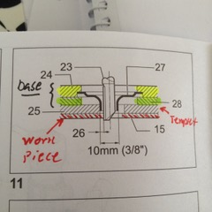

*Makita RT0700C manual fixed base templet guide mount (templet guide 10)*

=&gt;= It seems the plunge base can be equipped with different templet guides?

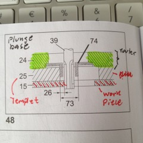

*Makita RT0700C plunge base temple guide mount*

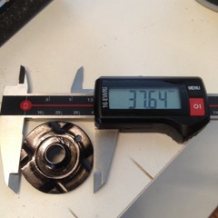 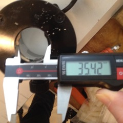

*Makita RT0700C fixed base templet guide diameter 37,5 mm and base opening 35,5 mm*

==&gt; It seems I can confirm that my RT0700C fixed base has a 35 mm recess that will accept Porter Cable 1-3/8” router bushings?

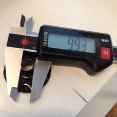 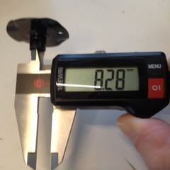 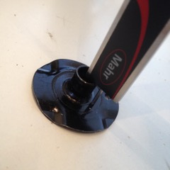 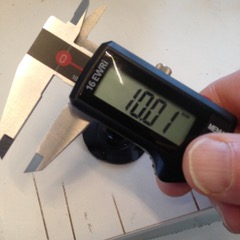

*RT0700C “standard” bushing is inner 8.3 mm outer 10 mm and depth 10 mm*

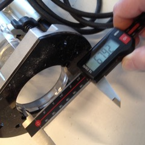 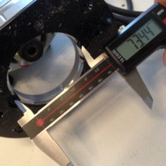 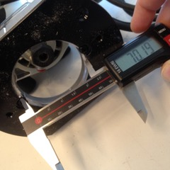

*Makita RT0700C plunge base busing opening outer 70 mm with recess diameter 68 mm *

**NOTE: My Makita RT0700C plunge base templet guide opening of 70 mm does suggest it will NOT fit the “standard” 60 mm (Porter Cable) adaptor?**

3) Consider where to buy a set of inlay router bushings for my Makita RT0700C trim router (fixed and plunge base)?

==&gt; Consider the Router Inlay Kit for CMT from UK based Scot & Sergeant (<https://www.scosarg.com/universal-phenolic-router-base-for-cmt-inlay-kit> )?


==&gt; Consider this article “Router Basics: Guide Bushings” where he seems to use bushings for Makita RT0700C (<http://www.projectguitar.com/tutorials/tools-and-workshop-tips/router-basics-guide-bushings-r74/> )?

==&gt; It seems the author states that Makita snd several competitors has adopted a “standard” expressed by the Porter Cable brass bushing set?

> “Several manufacturers (notably, DeWALT/ELU, Hitachi, Black & Decker and Makita amongst others) have adopted an unofficial standard in the Porter-Cable bushing style for many of their routers. They also happen to fit Porter Cable routers. Fundamentally, a Porter-Cable style bushing is a threaded flange with a knurled lock nut that fits into a 35mm (1-3/8") recess with a 30mm (1-3/16") through hole. Larger bases have either a 60mm (2-3/8") adaptor plate or a base-specific adaptor insert. Being a mostly US-based standard, Porter-Cable style bushings are overwhelmingly available in Imperial sizing only. This is in spite being originally based on a Metric fitting \*cough\*. "


==&gt; It seems to be what is called a “USA Standard guide bush set” like this one on eBay ([https://www.ebay.co.uk/itm/USA-Standard-Guide-Bush-Set-10pce/312288673967?_trkparms=aid%3D333200%26algo%3DCOMP.MBE%26ao%3D1%26asc%3D20180409081753%26meid%3D9d0da605b21544968383e0bdf7c744f5%26pid%3D100008%26rk%3D1%26rkt%3D12%26sd%3D143098107026%26itm%3D312288673967&_trksid=p2047675.c100008.m2219](https://www.ebay.co.uk/itm/USA-Standard-Guide-Bush-Set-10pce/312288673967?_trkparms=aid=333200&algo=COMP.MBE&ao=1&asc=20180409081753&meid=9d0da605b21544968383e0bdf7c744f5&pid=100008&rk=1&rkt=12&sd=143098107026&itm=312288673967&_trksid=p2047675.c100008.m2219) )?


==&gt; It seems there is (was?) a Porter Cable bushing system that fitted the Makita RT0700C fixed base perfectly?


> “The Porter-Cable system is a straight drop-in solution for my Makita RT0700C router. The fixed base was designed to accept a bushing with zero modifications. Drop the bushing into the baseplate and screw on the knurled lock ring from the other side"

> “The plunge base of my Makita RT0700C has a wider opening in the baseplate, designed to accept the "standard" adaptor plate. The plate is held in place by the two screws either side whilst the guide bushing mates with the adaptor itself.”


*The Porter Cable adaptor plate fits the Makita RT700C plunge base opening?*

==&gt; Consider this thread “Makita RT0700 Router Template Guides” discussing bushings for Makita RT0700C fixed base and plunge base (<https://www.routerforums.com/guide-bushings-templates/45843-makita-rt0700-router-template-guides.html> )?


