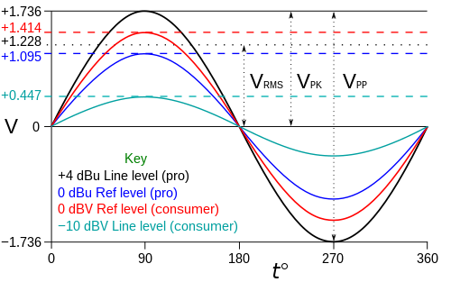
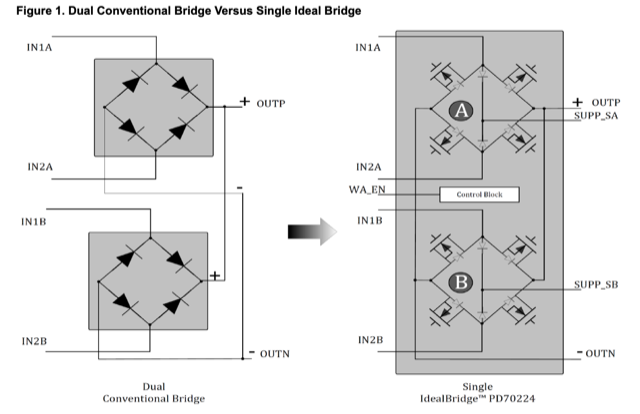
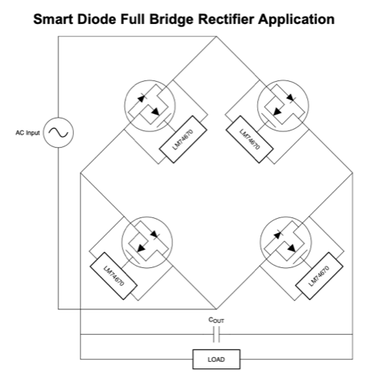
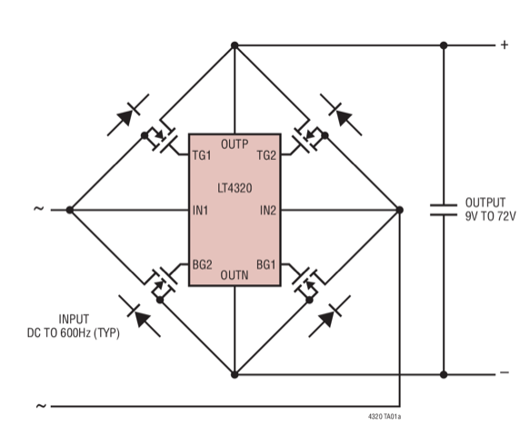

# Todo: Consider a line level mixer that is driven by the energy of the input audio signals?

```#58608978``` *As of 2024-02-16 00:30*

[mail plain/text](mail.txt)


0) Consider the bottom line for what I have learned about harvesting energu from an audio line level input?

> *From what I have learned so far it seems I can NOT use a MOSFET full bridge rectifier on a sub 1V AC signal? The input swing is just not enough to turn on the MOSFETs? It seems a MOSFET requires at least 3 to 4 volts to turn on and even more to reach the full saturation conditions.*

> *So this may be the reason the PD70224 has something called a "charge pump"? Or maybe it is used to be able to turn the MOSFETs off?*

> *Still, although MOSFETs once ON has very little forward voltage drop, I still need something like 5V or more to turn them on? *

> *So I am in a bit of a "bootstrap" situation here? To efficiently rectify a sub 1V AC signal I need a 5V drop voltage.*

> *Hm... I need to transform the input voltage to higher voltages!*

1) Consider web site "5 Simple Audio Mixer Circuits Explained" for templates on different pre-designed audio cusrcuits (<https://www.homemade-circuits.com/4-channel-dj-audio-mixer-circuit-part-1/> )?

2) Consider a way to actually power a line level mixer from the energy in the input audio signals?

> *So the main idea is that the energy provided by the line level input signals should be enough to drive low power OP-amps to mix the input to a single stereo output?*

> *I suppose we could expose an input impedance within the limits of a Line level input to feed a full bridge rectifier based on MOSFETs to be able to harvest the low signal levels. I mean, a diode full bridge rectifier would have a forward voltage of 0,7V which could prove to be too high?*

3) Consider the wikipedia article on "Line Level" (<https://en.wikipedia.org/wiki/Line_level> )?



==&gt; It seems the Line level input impedance should be in the 10k ohms range?

> *A typical line-out connection has an output impedance from 100 to 600 Ω, with lower values being more common in newer equipment. Line inputs present a much higher impedance, typically 10 kΩ or more.&#91;7&#93;*

4) Consider if I can use a "Power over Ethernet" chip that seems to have a CMOS full bridge but unclear if it works for sub 1V 10k ohm current circumstances (<https://www.mouser.se/datasheet/2/268/PD70224_IdealBridge_Dual_MOSFET_Based_Bridge_Recti-2853840.pdf> )?



5) Consider the Texas Instrument "Smart Diode" driver for ([https://www.ti.com/lit/ds/symlink/lm74670-q1.pdf?ts=1708035531118&ref_url=https%253A%252F%252Fwww.google.com%252F](https://www.ti.com/lit/ds/symlink/lm74670-q1.pdf?ts=1708035531118&ref_url=https%3A%2F%2Fwww.google.com%2F) )?

> *The LM74670-Q1 controller provides a gate drive for external N-Channel MOSFET and a fast response internal comparator to pull-down the MOSFET Gate in the event of reverse polarity. This device can support an AC signal frequency up to 300Hz. *

> 

==&gt; It is unclear if it can be used with sub 1V AC input under 10k impedance conditions, and it is limited to 300 Hz?

6) Consider this EEVblog post that seems to indicate that MOSFET full bridge rectifier is NOT efficient for low voltages due to "slow turn on" (<https://www.eevblog.com/forum/projects/bridge-rectifier-made-with-mosfets/> )?

==&gt; It seems to mention the LT4520 used for driving MOSFETS as "ideal diodes" in full bridge rectifiers?


==&gt; It seems one commentator is quite sure that an input of 12-48V AC is too low to drive the MOSFETs efficiently?

> *"I understand that the peak value of the AC must be above some level to drive the MOSFET gates"*

> 

> *"...In your circuits, the MOSFET's go on very slowly, because of the slow rising of the sinus. They will get very, very hot "*

==&gt; It may be the case that the LT4320 still can drive MOSFETs in a full bridge rectifier also for low input AC signals?

7) Consider Analog Devices LT4320 Ideal Diode Bridge controller (<https://www.analog.com/en/products/lt4320.html> )?



==&gt; It seems LT4320 can handle up to 60 Hz and LT4320-1 up to 600 Hz but even higher frequencies are possible by selecting appropriate MOSFETs?

> *"**The LT4320 is designed for DC to 60Hz typical voltage rectification, while the LT4320-1 is designed for DC to 600Hz typical voltage rectification. Higher frequencies of operation are possible depending on MOSFET size and operating load current.**"*

**NOTE: LT4320 DOES NOT WORK BELOW 9V AC!**

8) Consider I need an audio frequency transformer 1:10 or more to raise the voltage of the sub 1V signal to 10V or more to be able to apply a MOSFET full bridge rectifier?

> *I have so far failed to understand what component to look for to get a 1:10 small PCB mount transformer suitable for audio signals.*

> *Almost all "Audio Transformers" are 1:1 but I found "**VIGORTRONIX VTX-101-003**" (*<https://se.farnell.com/vigortronix/vtx-101-003/transformer-audio-1-1-6-45-6-45/dp/1674302> *) which I presume if way to luxurious for my needs but I simply do not know how to search.*

> *Also - do I have to consider losses in the the transformer? At least I presume I need a signal up to say 10 kHz to pass without to much dampening. Which I can't fully wrap my head around at this stage. I mean, I want the signal source to "feel" an impedance of 10 k Ohm while I at my side want to loose as little as possible ove any passive resistance in my energy harvesting circuit! How do I square these parameters?*

...


