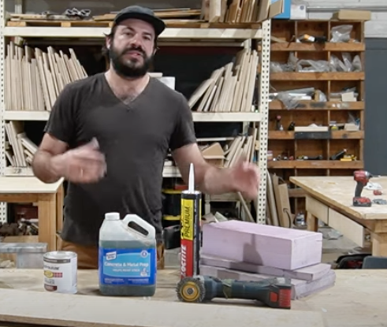
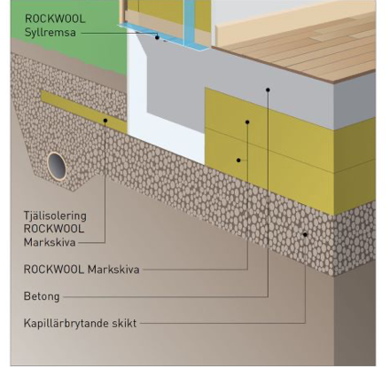
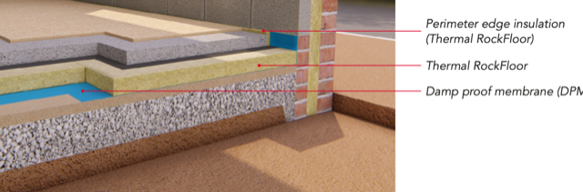
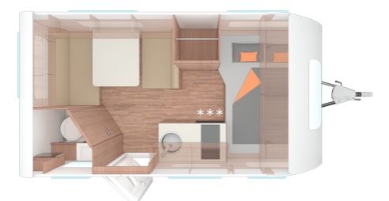

# Todo: Consider designing a camper caravan or movable cabin with 'only' Rockwool Rockfloor shell between outer and inner shell?

```#5a107472``` *As of 2024-06-29 21:12*

[mail plain/text](mail.txt)


I imagine we should be able to design a very simple caravan or small cabin with some stiff-enough isolation sheet material like Rockwool Thermal Rockfloor?

1) Consider youtube video "Framing your bus conversion subfloor is a mistake, do this instead" (<https://youtu.be/us4WejejFWE> )?

==&gt; At around 6:24 he seem to recommend using "rigid foam board" (that is used under concrete slabs as isolation)?



<https://youtu.be/us4WejejFWE?t=384>

2) Consider Rockwool Swedish product "Markskiva" (<https://www.rockwool.com/se/produkter-och-konstruktioner/golvisolering/platta-pa-mark/> )



3) Consider Rockwool Thermo Rockfloor (same as swedish "markskiva"?) (<https://www.rockwool.com/siteassets/rw-uk/downloads/datasheets/rockfloor.pdf> )?

> *"**Construction 1: Ground bearing slab*

> *Thermal RockFloor can be installed below the concrete slab or below screed."*



4) Consider what the weight and volume would be if we made a 50 mm shell of Rockwool "markskiva" as the construction material between the inner and outer shell of a small caravan?

==&gt; It seems 1 m2 of 50 mm "markskiva" weighs 7,25 kg and costs around 290 SEK (<https://www.bygma.se/produkter/byggmaterial/isolering/stenull/markskiva-stenull/?entryCode=013011208> )?

==&gt; Consider the size like the "CaraCito" (<https://weinsberg.se/husvagnar/caracito/390-qd> )?



> *it seems to be 593 cm lång but the width and height they keep a secret?*

==&gt; Imagine a caravan that is 6m long, 2,5 m wide and is 2,3 m high? This is an inside shell area of 27,6 + 11,5 + 30 m2 = 70 m2

> *70 square meters would then weigh 70 \* 7,25 kg = 507 kg*

> *Is this a lot or OK?*

> *Also, we shall of course cut out for the windows (but keep the isolation on the door)*

5) Consider how we can understand the "lambda value" for heat conductivity?

==&gt; It seems "lamda" is the amount of Energy that flows under 1h though a 1 m2 area of the material of 1 m thickness for one kelvin temperature difference (<https://info.rockwool.se/sv/isolera-ratt/bra-att-veta/produktegenskaper/> )?

> *"**Ett materials lambda-värde anger, hur stor värmemängd, mätt i Wh som under loppet av 1 h leds genom 1 mmaterial med en tjocklek av 1 m, när temperaturskillnaden mellan de två ytorna är 1°C.**"*

...


