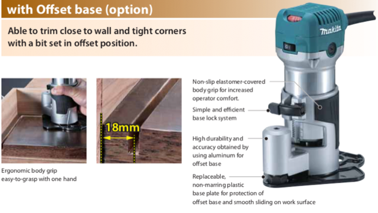
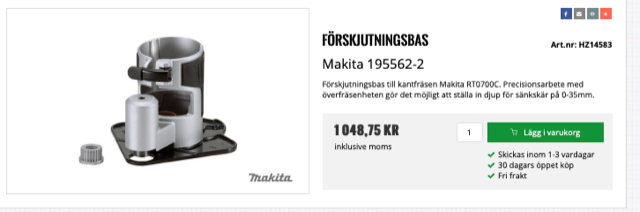
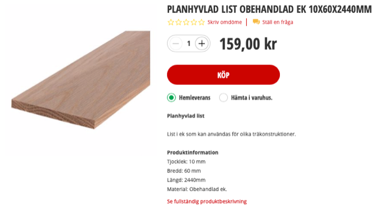
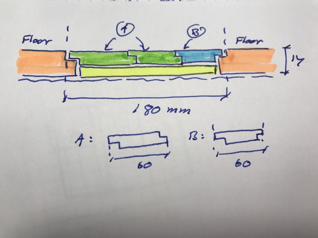
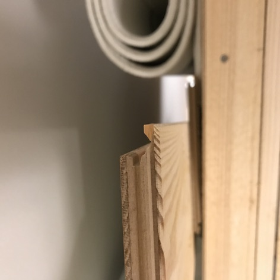
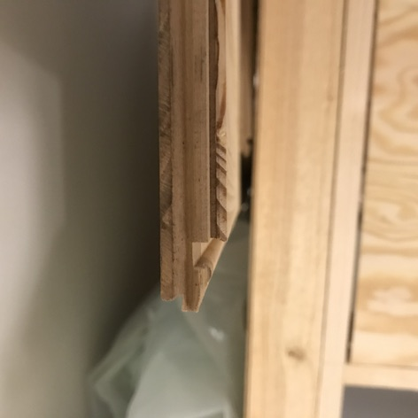
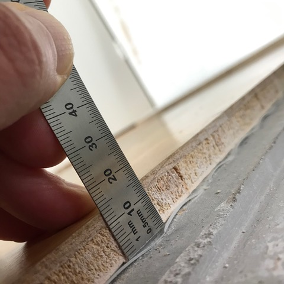
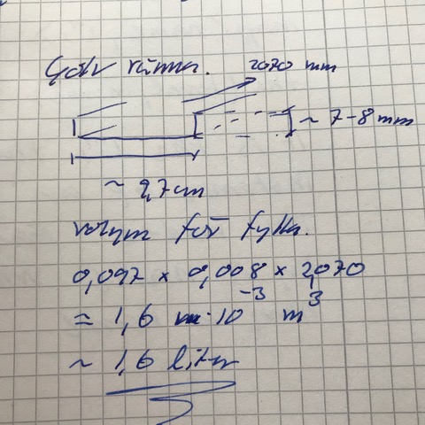
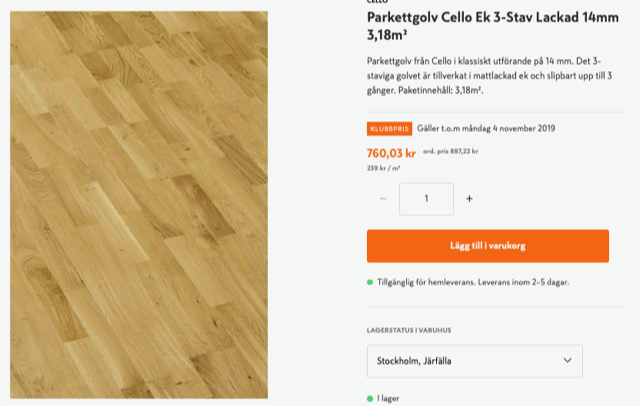
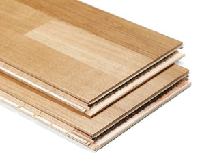

# Todo: Consider to investigate what I need to fill in the groove where the wall has been in my oak laminate parquet floor between my bedroom and living room?

```#5a4a0ecb``` *As of 2019-10-02 19:35*

[mail plain/text](mail.txt)


I am to rebuild the wall between my bedroom and living room but I also wonder if I should not also fill in the old wall groove in the laminate parquet floor.

1) Consider inserting a new parquet laminate board and solve how to make a snug a good looking fit?

> *However I do it I need to route two recesses on each side that are parallel and with a distance that fits the material I insert there.*

> *So problem number one is to imagine how to route these recesses!*

> *Q: How do I make the recesses parallel and of exact distance?*

> *A: It seems if I can just route one straight recess on one side I then can use that edge to route an equidistance recess on the other side using the edge guide on the router.*

> *Q: How do I rout the recess all the way up to the walls on each end of the groove to cover?*

> *The problem here is that the router itself gets in the way so I can only route to about 4-5 cm (?) from the wall on each side?*

> *Q: Is there some accessory I can use to get the router bit to operate away from the router in such a way that the but can get closer to the wall?*

> *A: It seems I can buy the Makita Offset Base and be able to route as close as 18 mm center distance to any vertical surface?*

>   
> [*http://www.makita.biz/product/category/planing/rt0700c/rt0700c_view.pdf](http://www.makita.biz/product/category/planing/rt0700c/rt0700c_view.pdf) *

>   
> *An example of a price in Sweden on Makita Offset Base for the RT0700*

2) Consider to bridge with actual oak boards (or oak laminate boards)?

> *It may prove to be easier to fit actual oak boards in to bridge the 15 cm width of the existing floor groove. I then have fo focus on routing resting tenons on each side of the existing flooring. Making sure the final distance between the existing flooring surface is the distance of the oak boards I am to insert.*

> *Now with the width of the routed tenons I will get a distance of at least 17 cm if I route 1 cm recesses on each side of the existing flooring?*

> *If I route so the width to bridge is 180 mm I will be able to fit three of these 60 mm wide oak boards.*

>   
> *I can bridge an 180 mm flooring groove with three 60 mm oak boards side by side*

> *==&gt; I will then need to find some 4 mm base board to make the 10 mm oak boards rest on the final 14 mm height!*

> *==&gt; I also would need to route tenons in the oak boards to ensure I can glue them together to make a stable flat top surface?*

>   
> *Example of floor bridging with three tounge-in-groove 60 mm oak boards*

3) Consider how to create a snug fit between the bridging board and the existing parquet flooring on both sides of the floor groove?

> *So the problem I have is to make the bridging flooring fit snuggly to the existing parquet flooring. Not only Do I need to make the distance between the existing flooring on each side of the grove of exact consistent width. I also have to get the width to be almost exactly the width of the bridging board!*

> *So say I will insert the new oak laminate parquet board I bought from K-rauta. This board is specified to be 207 mm wide.*

> *First I would have to cut off the lips on the new parquet board. As it in fact has "strange" lips or tenons on practically all sides!*

> *I could then imagine to route a recess in the existing floor on the living room size to accept the tenon of the new parquet board. With a final distance between the flooring top surface of the 207 mm of the bord to fit.*

> *Q: How do I make the tenon of the new parquet laminate board to fit the recess I route in the existing floor? Seems very hard to do?*

> 

> *I actually need to route my own tenons on the new parquet boards to be able to have them fit any recess I rout in the existing flooring?*

> *I fail to see how I could in any way re-use the existing tenons on the new parquet boards!*

4) It seems my existing flooring are 14 mm thick oak laminate parquetry and I need at least 15,5 mm wide board to cover the parquet groove?

>   
> *It seems my existing floor boards are 14 mm (10 mm floor board with 4 mm laminate oak on top)*

5) Consider to fill the wall grove in the concrete sub-flooring and then insert one 207 mm laminate parquet floor board strip?

==&gt; It seems I need about 1.6 liter of concrete to fill the actual groove?

> *I measure the groove in the concrete to be about 7..8 mm deep, 9,7 cm wide and 2070 mm long. This would amount to about 1.6 liters of volume to fill.*

>   
> *A groove with 8 mm depth, 9,7 cm width and 2070 mm length amounts to around 1.6 liters in volume*

6) It seems I can buy concrete and oak laminate parquet flooring from K-rauta?

>   
> *K-rauta sells 20 kg (!) of concrete for 40 SEK*

>   
> *K-rauta sells 7 strips of 2200 x 207 mm and 14 mm thick oak parquet laminate floor for 890 SEK (about 127 SEK for one strip)*

> *NOTE: As it turns out I could buy single boards for 150 SEK each (not so bad).*

==&gt; Can I suspect that the flooring I have uses the seemingly "standard" tongue-in-groove system to interconnect?

>   
> *An example of the seemingly "standard" tongue-in-groove system for interconnection?*

...


