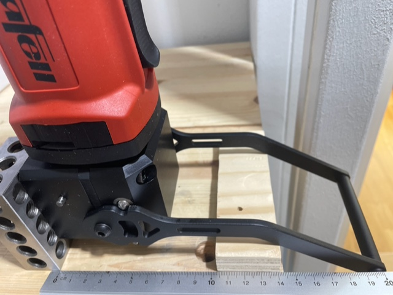
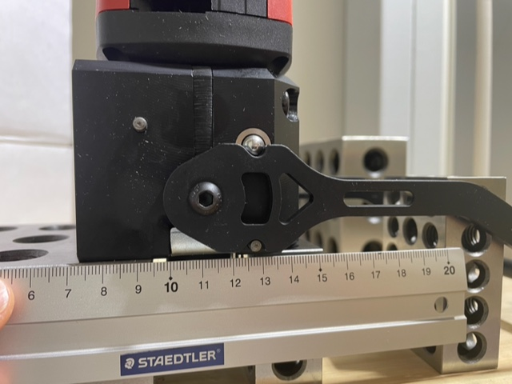

# Todo: Consider how to mount my Quick Tool Change (QTC) Mafell milling motor  FM 1000 PV-WS to a some router table plate?

```#5a57c4f7``` *As of 2022-08-01 15:42*

[mail plain/text](mail.txt)


I want to mount my Quick Tool Change (QTC) Mafell milling motor FM 1000 PV-WS so that I can use the QTC (Quick Tool Change) without having to dismount it.

==&gt; Also see "[Todo: Consider to make a printable drilling template for the Mafell QTC ("Quick tool change" like e.g., FM 1000 PV-WS) mounting plate?](../1288de3b/chime.md)"

==&gt; Also see "[Todo: Consider the "best" way to buy a Mafell Milling motor FM 1000 PV-WS (100W with PV control and quick tool changer)?](../a2f20a72/chime.md)"

==&gt; Also see "[Todo: Consider the Mafell tools lineup and prices for my indoor or future woodworking needs and requirements?](../cbb23bdf/chime.md)"

==&gt; Also see "[Todo: Consider an Ooznest Workbee CNC with a Mafell milling motor?](../b0d4214c/chime.md)"

==&gt; Also see "[Todo: Consider to create linear motion using threaded rods and a bicycle chain driven hex-nuts (e.g., for a router lift or super strong rip fence adjustment)?](../e7c7fec9/chime.md)"

0) Consider some thoughts on how to mount mount my Quick Tool Change (QTC) Mafell milling motor FM 1000 PV-WS to a some router table plate?

> *The most important consideration is to be able to use the QTC (Quick tool change) with the router mounted to the router table plate!*

> *The lever seems to protrude above the plane of the milling motor to face in its released position?*

> *From the preliminary measurements the distance from the milling side mounting plate it is 127 mm to the bend of the lever?*

> *Now the distance to where the arm engages with the table top depends of the heigh of the milling motor.*

> *I suppose we will never extend the motor more than so that the "chuck" is flush with the table top?*

> *Questions:*

> ***Q1: Do I want to mount the milling motor to the side or to the face?***

> 

> *The Mafell milling motor FM 1000 PV-WS side mount (Note the six stronger M6 mounting holes)*

> 

> *Mafell milling motor FM 1000 PV-WS face mount (Note the only four and weaker M5 mounting holes)*

> ***Q2: How do I make room for the QTC lever when the milling motor is mounted to a router table top?***

> *I imagine we can make a "notch" in the table top with a removable inlay to allow router bit change? We can then just cover the notch with the inlay after the router bit change and get a larger table top for the worked material to run on?*

> *...  
> *

1) Consider how the QTC lever may be obstructed by the table when I mount the milling motor from the under side?



*It seems with an 18 mm thick table top I need to allow for the handle in open position at max 140 mm from the front of the mounting plate?*



*It seems the distance from the front mounting plate to where the lever bends is about 127 mm?*

1) It seems the M6 mounting holes are 15 mm deep?

> *I tried an M6 screw in all the size M6 mounting holes and they all seem to bottom out just after 15 mm?*

> *So if I want to mount the milling motor to a 2 mm thing nail plate I must use M6 screws shorter than 15 + 2 = 17 mm.*

> *==&gt; Either I use 3 mm washers + 20 mm M& screws?*

> *==&gt; Or I use 15 mm M6 screws?*

> *==&gt; Or I buy longer M6 screws and cut them to length?*

> *I assume I should use tapered screw heads as they make for self centering into the 6,5 mm holes I drilled?*

2) It seems the M5 face mounting holes are 12 mm deep?

> *I tried an M5 bolt in all the four M5 face mounting holes and they all bottom out at just above 12 mm.*

> *So to mount a 2 mm nail plate to the mill motor face I must use 12 + 2 = 14 mm M5 screws.*

> *Here A 15 mm M5 screw with a 1,5 mm washer seems they way to go?*

> *NOTE: The motor shaft house is 35 mm in diamer.*

...


