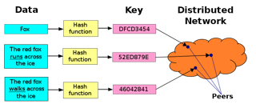
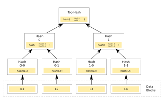

# Todo: Darwinet - Consider to have Darwinet blobs implement the Joe Armstrong vision of a Hash addressed data world wide web?

```#5b5d7589``` *As of 2017-11-04 11:20*

[mail plain/text](mail.txt)


It seems we should try out having Darwinet support storing of Blob (big lump of data) data blocks that are identified by their hash value and thus ”easily” distributed and retrieved on any global network domain?

==&gt; Also see ”Todo: Darwinet - Consider distributed computing on Darwinet may be used for easy scalability and stability baed on the motivation behind Erlang design?"

1) Consider this talk "The Mess We're In" by Joe Armstrong (<https://www.youtube.com/watch?v=lKXe3HUG2l4>)?

==&gt; At 34:00 he seems to state we should ”Abolish names and places” (<https://youtu.be/lKXe3HUG2l4?t=2040>)?

==&gt; At 35:25 he seems to state that ”URIs are bad” (<https://youtu.be/lKXe3HUG2l4?t=2125>)?


==&gt; He seems to give some nice arguments to why hashes instead of names is a good idea?

==&gt; The name must match the hash so the receiver may validate the received data (calculate the hash and just compare)!

==&gt; Thus, encryption not required to protect against middle man tampering?

==&gt; Encryption required only to protect middle man from data access?

==&gt; At 37:11 he seems to refer to existing addressing schemes to map sha values to IP addresses (<https://youtu.be/lKXe3HUG2l4?t=2231>)?


==&gt; In effect data may be distributed on nodes in a network organized as a merkel tree?

==&gt; Consider the wikipedia article on Distributed Hash Table (<https://en.wikipedia.org/wiki/Distributed_hash_table>)?



==&gt; Consider the Wikipedia Article on Mrkle Tree (<https://en.wikipedia.org/wiki/Merkle_tree>)?



2) Consider Darwinet to store Blobs using their hash as their identity?

==&gt; It seems in this way the Blob ID will also be its ”state” (i.e. revision or version)?

...

3) Consider Darwinet to be able to split Blobs into Merkle Trees?

==&gt; Consider by splitting Blobs into Merkle Trees we may have Darwinet be able to detect smaller grains of change to blobs (not having to store the whole blob when changes are made to it)?

==&gt; Consider how this closely resembles how Git handles revision trees (each revision is the hash och the commit organized into DAGs of commits)?

...

4) Consider good algorithms to store known file types as Merkle Tree blobs?

==&gt; It seems to effectively detect file changes as changed and unchanged blobs we need to understand the file topology (encoding structure)?

==&gt; Consider changes to a paragraph in a word file will result in an isolated change to a specific part in the stored word file?

==&gt; Thus, We should be able to map the word file into a Merkle Tree in a way so that only the ”paragraph blob” changes (leaving the rest of the tree nodes intact)?

==&gt; Consider word files stored as XML are good candidates for mapping as Merkle Trees?

...

5) Consider to try out algoritms that turn known data structure encodings into Merkle Tree maps?

==&gt; Consider an algorithm that maps an XML file as a Merkle Tree (each composite node mapped as the node content Hash value)?

==&gt; Consider an algorithm that maps JSON data as a Merkle Tree (each composite node mapped as the node content Hash Value)?

==&gt; Consider an algorithm that maps HTML documents as Merkle Tree (each composite node mapped as the node content Hash Value)?

…

Consider to delve deeper into this idea of having Darwinet implement mechanism to map Blobs (files) as Merkle Trees to gain the benefits of being able to ”easily” store, retrieve and isolate sub-changes to known an unknown data structures?


