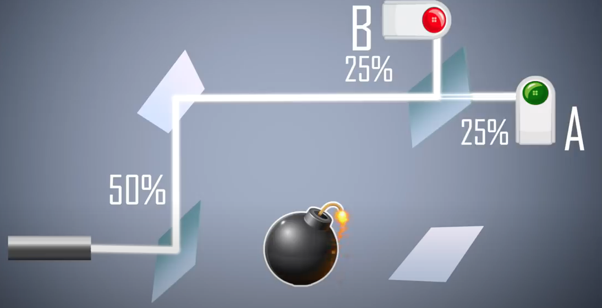

# Todo: Consider to delve into the "weirdness" of quantum mechanics as described by "The Bomb Experiment"?

```#5c32ebe1``` *As of 2021-08-29 18:30*

[mail plain/text](mail.txt)


I want to wrap my brain around what quantum experiments actually can be said to reveal to us about how reality "works"

==&gt; Also see "Todo: Consider to delve into the "Delayed-choice quantum eraser" experiment and what this can tell us about "Reality"?"

==&gt; Also see "Todo: Consider if the "quantum measurement" is in fact when some part of the universe becomes "about" the quantum system?"

==&gt; Also see "Todo: If we accept the many-world model of quantum theory, what then stops us from assuming each observation creates a new now but in fact a new past, now and future?"

==&gt; Also see "Todo: Consider to follow up on lead in youtube video "Why Everything You Thought You Knew About Quantum Physics is Different - with Philip Ball"?"

1) Consider Sabine Hossenfelder youtube video "Why is quantum mechanics weird? The bomb experiment" (<https://youtu.be/RhIf3Q_m0FQ> )?

> 

2) Consider the quantum Bomb Experiment is a more colourful way of describing the "path taken" observation effect?

> *The basic idea with this experiment is that the bomb acts as a "detector" in that is the bomb is NOT a stud (does not work) is will be ignited by any photon that hits it. So if the bomb does NOT go off, then we KNOW the photon took the upper path.*

> *In the case the photon took the upper path we have a 50/50 chans it splits and hit detector B.*

> *But here is the twist in this experiment! If the photon hits detector B, then the bomb MUST be active, i.e., not a Stud!*

> *This follows from the quantum "reality" that if we do not measure what path the photon takes then it takes "both path" and hits detector A.*

> *If we put a Stud Bomb in the lower path nothing changes. The system does not reveal the photon path so it "happily" passes the system "as if" both pathways at once, recombines at the second splitter mirror and hits detector A.*

> *BUT, if the bomb is live, then the path of the photon will be revealed by the system by the bomb going off or not.*

> *So, if we send a photon, the bomb does NOT go off, AND detector B i hit - THEN this can only mean the photon took ONLY THE UPPER PATH!*

> *Consider to delve deeper into this observation and what can be said about reality in relation to what this experiment reveals?*

> *Consider for example to compare this with the "Delayed-choice quantum eraser" experiment?*

...


