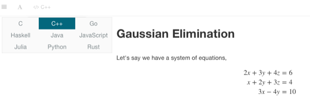
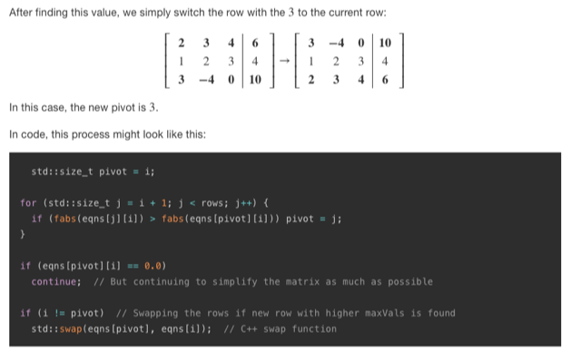

# Todo: Consider to delve into the collaborative effort "Arcane Algorithm Archive" for visualisations and explanations of a large set of common computer algorithms?

```#5cd7feb1``` *As of 2023-01-16 12:50*

[mail plain/text](mail.txt)


1) The "Arcane Algorithm Archive" seems to live on this web site (<https://www.algorithm-archive.org>)?

> *"**The Arcane Algorithm Archive is a collaborative effort to create a guide for all important algorithms in all languages**"*

==&gt; It seems the "project" lives on several social medias?

- Book / website: <https://www.algorithm-archive.org/>
- GitHub repository: <https://github.com/algorithm-archivists/algorithm-archive>
- YouTube channel (LeiosOS): <https://www.youtube.com/user/LeiosOS>
- Twitch livestream: <https://www.twitch.tv/leioslabs>
- Discord server: <https://discord.gg/Pr2E9S6>

==&gt; It seems code examples can be chosen to be in a set of available languages through the web-site UI?

>   
> *Example of the language option available on the Gaussian Elimination page <https://www.algorithm-archive.org/contents/gaussian_elimination/gaussian_elimination.html> *

>   
> *Example of one of the C++ code examples on the Gaussian Elimination page <https://www.algorithm-archive.org/contents/gaussian_elimination/gaussian_elimination.html> *

2) It seems the "Arcane Algorithm Archive" lives here on Github (<https://github.com/algorithm-archivists/algorithm-archive> )?

==&gt; NOTE: There seems to be no source code here (code examples seems to be exposed on the book web site )?

...


