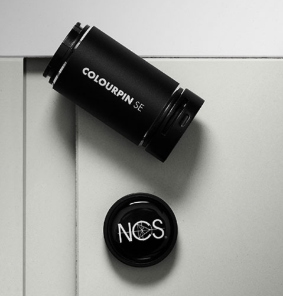
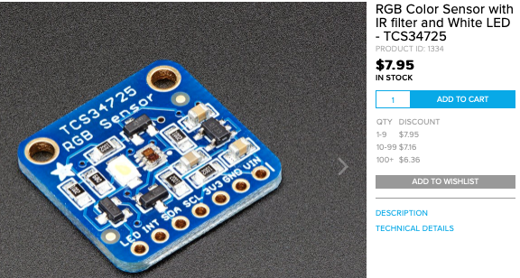
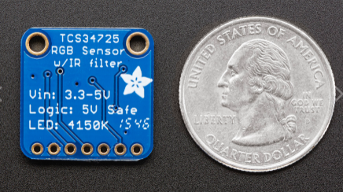

# Todo: Consider to design a DIY "Color Reader" that can tell the NCS code of a surface like a wall, a fabric or some other (non glossy?) surface like the "NCS Colourpin SE"?

```#5d2946e4``` *As of 2020-10-25 18:16*

[mail plain/text](mail.txt)


I have started to understand colour perception and systems to choose and purchase paint to produce specific colours for home decoration (indoor and outdoor)

1) Consider the NCS Colourpin SE device that can measure the colour of a surface and report it as an NCS code and some other encodings (<https://ncscolour.com/product/ncs-colourpin-se/?currency=eur> )?

>   
> *The [ncscolour.com](http://ncscolour.com) "Colourpin SE" device that paired with a smart phone app can measure and encode surface colours in NCS, CMYK, RGB, L\*a\*b\* and lightness values*

> *"**Identify any colour instantly from real life settings and turn your inspiration into colour! Get the closest NCS Notation, translations to CMYK, RGB, L\*a\*b\* and lightness values.**"*

2) Consider this article "What’s the Difference Between a Colorimeter and a Spectrophotometer?" as good source of information on nomenclature relevant to "colour measurements" (<https://www.datacolor.com/whats-the-difference-between-a-colorimeter-and-a-spectrophotometer/> )?

==&gt; It seems a "Colorimeter" measures Red, Green and Blue colour intensities reflected from a surface while a "SpectroPhotoMeter" measures the sample absorption of all the wavelength in a spectrum interval?

> *"**Colorimeter*

> *A colorimeter is a tristimulus color measurement tool that provides an objective evaluation of color characteristics based on light passing through the primary filters of red, green, and blue. It simulates how the human eye perceives color.*

> *...*

> *• The sample is illuminated at a 45° angle by an internal light source.  
> *  
> *• Light passes through the tristimulus filters, representing the amount of red, green, and blue light reflected from the sample.  
> *  
> *• Measurements from the filter are quantified into RGB values, which simulate the way human eyes are sensitive to light."*

> *"**Spectrophotometer*

> *... color measuring instrument that factors in light intensity as a function of the color. It performs full-spectrum color measurement, ...

> *  
> *• An internal light source strikes the diffraction grating, which acts as a prism that separates the light into different wavelengths of the full color spectrum.  
> *  
> *• As the grating rotates, only one specific wavelength of light reaches the exit slit at a time and interacts with the sample.  
> *  
> *• The detector measures the sample’s light intensity, transmittance and absorbance.  
> *  
> *• The spectrophotometer displays this information digitally."*

3) Consider some possible designs of a DIY "colour reader" that can encode the colour of a surface in NCS, CMYK, RGB, L\*a\*b\* and lightness values (same capabilities as the "NCS Colourpin SE "?

> *It seems to me that we need some way of measuring the absorption of Red, Gren and Blue light of a surface. With these values quantified in some unit we can convert them into NCS encoding or any other encoding of choice related to home decoration coloration?*

> *I suspect the NCS Colourpin SE has a built in light source and sensors to detect the intensity and colour of the reflected light. I imagine we can try two approaches.*

> *1) Use a white light source combined with three light sensors behind a Red, Green and Blue passs-through light filter so we can measure the RGB intensities.*  
> *2) Use a Red, Greem and Blue light diode with a single light sensor and illuminating the surface with one colour of light at a time we can measure the reflected intensity of Red, Green and Blue.*

> *Finally we can program the device with a translation table to turn the measured RGB intensities into the encoding of the perceived colour we want.*

> *For example, I have bought the NCS Index Colour Palette so I should be able to use the device I build to measure selected reference NCS colours and in this way create a translation table to have the device tell the NCS colour code of a measured surface?*

4) Consider an RGB Color Sensor ready for use?

==&gt; Consider Adafruit "" (<https://www.adafruit.com/product/1334> )

>    
> *Adafruit TCS34725 RGB Color Sensor with IR filter and White LED*

...


