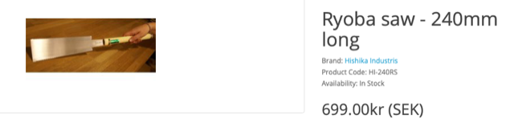
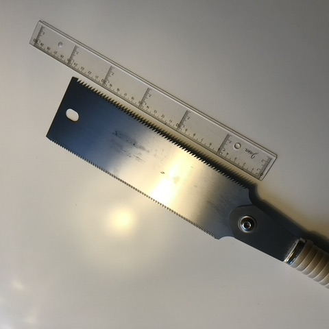
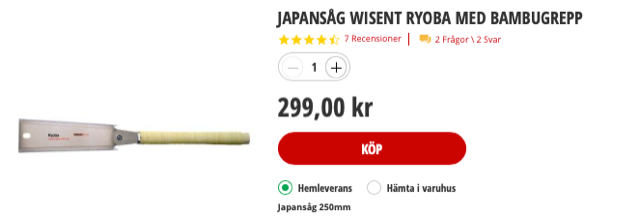
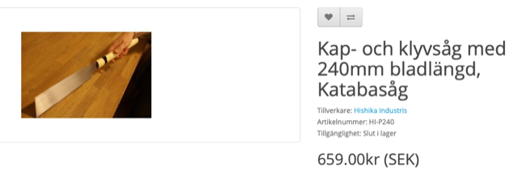
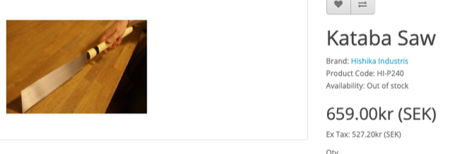
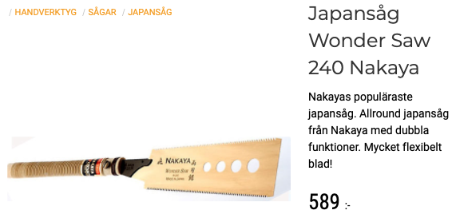
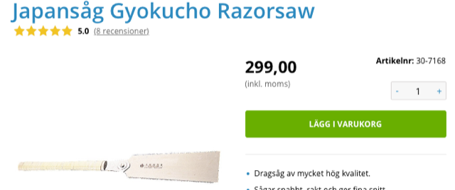
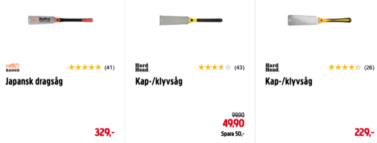

# Todo: Consider to upgrade my (cheap) Wisent Ryoba saw (24 cm lång and 8 cm wide) to a quality Japanese one?

```#5d60c8fb``` *As of 2020-11-10 11:57*

[mail plain/text](mail.txt)


I want to try a higher quality Ryoba (Kataba?) saw to see what the difference is from my most appreciated and well used Wisen Ryoba saw.

==&gt; Also see "[Todo: Consider a motorised hand held saw like a European push saw or a Japanese nokogiri pull saw (e.g. the double blade Ryoba saw)?](../eb9bd655/chime.md)"

-1) I ordered the Hishika Industris 240 mm Ryoba Rip and Cut saw (<https://www.rubank.se/en/ryoba-saw-240mm-long> )

>   
> *The Hishika Industris 240 mm Ryoba Rip and Cut saw I ordered from <https://www.rubank.se/en/ryoba-saw-240mm-long> *

**TODO: How does this saw compare to my (cheap) wisent ryoba saw?**

1) Consider the size and brand of the Ryoba saw I have used the last three years?

>   
> *My well used, three years old, 24 cm x 8 cm (300 SEK) wisent Ryoba saw*

2) It seems this is where I can buy a new Wisent Ryoba (Kataba?) saw of the same quality and brand as the one I have (<https://www.bauhaus.se/japansag-ryoba-med-bambugrepp?gclid=CjwKCAiAkan9BRAqEiwAP9X6UZGq4sZLZfgDxuKvTiw_I5Ii_HrWTZ7hGFqP1psIH00uwMFdLCwlRRoC6hIQAvD_BwE> )?

>   
> *The 300 SEK Wisent 25 mm Ryoba saw at Swedish store Bauhaus*

3) Consider where I can buy Japanese saws to be delivered to me here in Sweden?

==&gt; Consider this Hichika Industris cut and split Ryoba (Kataba) saw from Swedish web site [hyvlar.se](http://hyvlar.se) ([https://www.hyvlar.se/kap-och-klyvsåg-med-240mm-bladlängd,-katabasåg](https://www.hyvlar.se/kap-och-klyvs%C3%A5g-med-240mm-bladl%C3%A4ngd,-katabas%C3%A5g) )?

>   
> *The Kataba (Cut and Split blade) saw from [hyvlas.se](http://hyvlas.se)*

> Rubank Verktygs AB - Hyvlar  
> Fryksdalsbacken 12, 7tr  
> 123 43 Farsta

==&gt; Consider this Hichika Industris cut and split Kataba saw from Swedish web site [Rubank.se](http://Rubank.se) (<https://www.rubank.se/en/kataba-saw> )?

>   
> *The Kataba (Cut and Split blade) saw from [rubank.se](http://rubank.se)*

> *Rubank Verktygs AB - Rubank  
> Fryksdalsbacken 12, 7tr  
> 123 43 Farsta*

==&gt; AHA - [hyvlar.se](http://hyvlar.se) and [rubank.se](http://rubank.se) is the SAME company :)

==&gt; Consider the Japanese saws from [verktygshandlarn.se](http://verktygshandlarn.se) (<https://www.verktygshandlarn.se/category/japansag> )?

>   
> A cut and split Japanese saw from Nakya <https://www.verktygshandlarn.se/product/japansag-wonder-saw-240>

==&gt; Consider the Japanese saws from clas ohlson ([https://www.clasohlson.com/se/Japansåg-Gyokucho-Razorsaw/p/Pr307168000](https://www.clasohlson.com/se/Japans%C3%A5g-Gyokucho-Razorsaw/p/Pr307168000) )?

>   
> *A cut and split Japanese saw from Gyokucho [https://www.clasohlson.com/se/Japansåg-Gyokucho-Razorsaw/p/Pr307168000](https://www.clasohlson.com/se/Japans%C3%A5g-Gyokucho-Razorsaw/p/Pr307168000) *

==&gt; Consider the Japanese saws from Jula (<https://www.jula.se/catalog/verktyg-och-maskiner/handverktyg/sagar/japansagar/> )?

> 

4) Consider Japanese saw brands of interest and available in Sweden?

==&gt; Consider Gyokucho japanese saw brand ([https://www.clasohlson.com/se/Japans%C3%A5g-Gyokucho-Razorsaw/p/Pr307168000](https://www.clasohlson.com/se/Japansåg-Gyokucho-Razorsaw/p/Pr307168000) )?

==&gt; Consider Kijima Seikou Japanese saw brand (<https://www.hyvlar.se/kijima-seikou>)?

==&gt; Consider Hishika Industris Japanese saw brand (<https://www.hyvlar.se/en/hishika-industris> )?

4) Consider this article on Japanese saws (<https://knowledge.axminstertools.com/japanese-saw/> )?

==&gt; It seems the Japanese saws are called Nokogiri with sub categories single-edged Kataba and double-edged Ryoba?

> *"Japanese saws or **Nokogiri** fall into three basic styles. The **single edged** backless saws referred to as a **Kataba**, the **double-edged **or **Ryoba** and the single edged with a stiffening back or spine known as a Dozuki. There are slight variations within each category for more specialist functions."*

5) Consider the wikipedia article on Japanese saw (<https://en.wikipedia.org/wiki/Japanese_saw> )?

> *"**Douzukinoko (胴付鋸、胴突鋸)*  
> *A type of backsaw. The Japanese means "attached trunk", thus a saw with a stiffening strip attached, i.e., a backsaw.

> *

> *Ryoba (両刃)  
> Multi-purpose carpentry saw with two cutting edges. The Japanese means "double blade". There is a cross-cutting (yokobiki) 横挽き blade on one side and a ripping (tatebiki )縦挽き blade on the other.

> *

> *Kataba (片刃)  
> A saw with teeth along only one edge, like a Western saw. These are supplied as either rip saw or cross-cut type blades. An advantage of this saw is that it is easy to use with a saw guide.

> *

> *Azebiki (畦挽、あぜびき)  
> A small ryōba saw used for cutting into the flat surface of a board rather than from the edge. The blade has a convex curve which can begin the cut anywhere on the surface.

> *

> *Mawashibiki (回し引き)  
> A thin saw used for cutting curves, the Japanese version of a keyhole saw. The name means "turning cut".**"*

...


