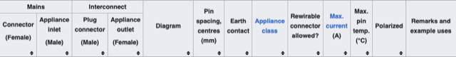
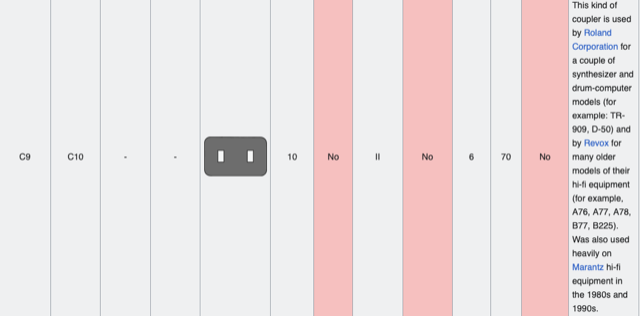
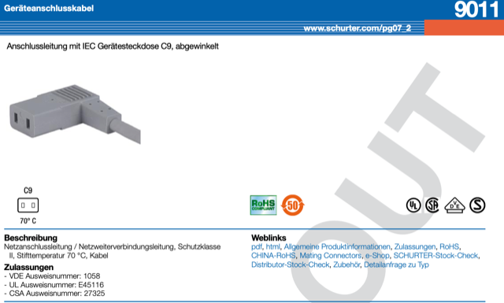
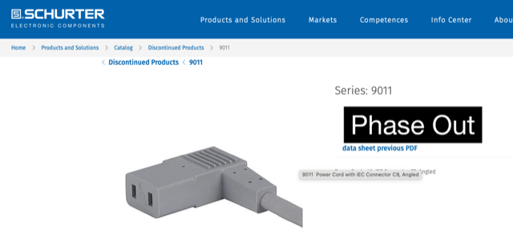

# Todo: Consider to document that the AC connector to my Roland D50 is an IEC 302 C9 female plug?

```#5eccfb5e``` *As of 2024-03-16 17:20*

[mail plain/text](mail.txt)


I wanted a longer and angled AC connector to my Roland D50 and it seems it uses a "special" IEC 302 C9 plug.

1) Consider the wikipedia article "IEC 60320" (<https://en.wikipedia.org/wiki/IEC_60320> )?

==&gt; It seems when I compare the images with my Ronald D50 plug that it is a C9 (female connector)?

>   
> ...  
>   
> ...

2) Consider how hard it seems to be to buy a cable or a plug of IEC 60320 C9?

==&gt; It seems I can google "IEC 320 C9" and get some good results?

==&gt; Consider one actual hit for an angled C9 female (but with no apparent way of buying it)?

>   
> <https://www.schurter.com/de/datasheet/typ_9011.pdf>

> Aha, it is discontinued!

> 

...


