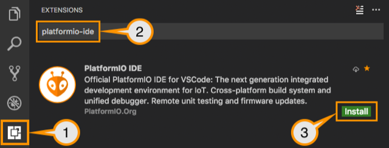

# Todo: Consider to use the PlatfromIO with VScode instead of the Arduino IDE for micro controller development projects?

```#5f1696b0``` *As of 2019-04-14 14:18*

[mail plain/text](mail.txt)


From a video by Andreas Spiess I got to know about PlatformIO plugin for VScode and got the impression I would like to use it as better alternative for micro controller development than the Arduino IDE?

1) The Andreas Spiess youtube video “PlatformIO for Arduino, ESP8266, and ESP32 Tutorial” seems to live here (<https://www.youtube.com/watch?v=0poh_2rBq7E> )?


2) Consider the PlatformIO plugin for VSCode (<https://docs.platformio.org/en/latest/ide/vscode.html#ide-vscode> )?

==&gt; It seems one can install PlatformIO plugin directly as “platform-ide” from within the VSCode Package Manager (<https://docs.platformio.org/en/latest/ide/vscode.html#installation>)?

1. [Download](https://code.visualstudio.com/) and install official Microsoft Visual Studio Code. PlatformIO IDE is built on top of it
2. **Open** VSCode Package Manager
3. **Search** for official `platformio-ide` [extension](https://marketplace.visualstudio.com/items?itemName=platformio.platformio-ide)
4. **Install** PlatformIO IDE.

> 

3) The PlatformIO open source initiative seems to live here (<https://platformio.org> )?

==&gt; It seems PlatformIO is a commercial product that provides an entry level free framework (<https://platformio.org/pricing> )?


==&gt; It seems the PlatformIO IDE integrates with a large number of well known editors and IDEs (<https://docs.platformio.org/en/latest/ide.html#desktop-ide> )?

> In our experience, [PlatformIO IDE for VSCode](https://docs.platformio.org/en/latest/ide/vscode.html#ide-vscode) offers better system performance, and users have found it easier to get started

> ## Cloud IDE<https://docs.platformio.org/en/latest/ide.html#cloud-ide>


- [Cloud9](https://docs.platformio.org/en/latest/ide/cloud9.html)
- [Codeanywhere](https://docs.platformio.org/en/latest/ide/codeanywhere.html)
- [Eclipse Che](https://docs.platformio.org/en/latest/ide/eclipseche.html)

  
> ## Desktop IDE<https://docs.platformio.org/en/latest/ide.html#desktop-ide>


- [Atom](https://docs.platformio.org/en/latest/ide/atom.html)
- [CLion](https://docs.platformio.org/en/latest/ide/clion.html)
- [CodeBlocks](https://docs.platformio.org/en/latest/ide/codeblocks.html)
- [Eclipse](https://docs.platformio.org/en/latest/ide/eclipse.html)
- [Emacs](https://docs.platformio.org/en/latest/ide/emacs.html)
- [NetBeans](https://docs.platformio.org/en/latest/ide/netbeans.html)
- [Qt Creator](https://docs.platformio.org/en/latest/ide/qtcreator.html)
- [Sublime Text](https://docs.platformio.org/en/latest/ide/sublimetext.html)
- [VIM](https://docs.platformio.org/en/latest/ide/vim.html)
- [Visual Studio](https://docs.platformio.org/en/latest/ide/visualstudio.html)
- [VSCode](https://docs.platformio.org/en/latest/ide/vscode.html)


...


