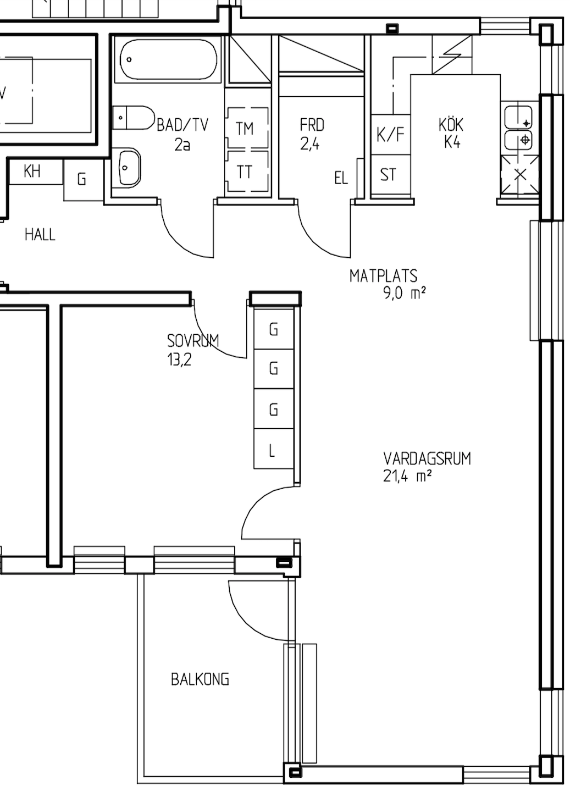
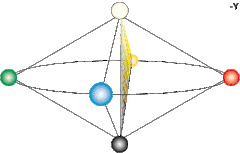

# Todo: Consider to document how I have painted my Apartment?

```#5fa12dff``` *As of 2020-10-24 23:08*

[mail plain/text](mail.txt)


==&gt; Also see "Todo: Wall Painting - Consider to use Lime Wash (Swedish Kalkfärg) on my tv-room wall to get a more "alive" texture?"

==&gt; Also see "Todo: Wall Painting - Consider to what degree the NCS Colour System is a colur coding system I can use to define colour of paint I buy from different vendors?"

==&gt; Also see "odo: Wall Painting - Consider to delve into sponge and faux painting options to optionally try out to have my painted walls look more "alive"?"

==&gt; Also see local computer "/Users/kjell-olovhogdal/Resilio Sync/Dropbox/Kjell-Olov/Privat/Snickerier Egen Lägenhet 2017"

==&gt; Also see "Todo: Wall Painting - Consider ideas and observations after paining the hall way wall?"

1) This seems to be a Tiff format image of the floor plan of my apartment?

> .tiff>)

==&gt; It seems I have stored floor plans of my computer in my shared folder structure?

> kjell-olovhogdal@Kjell-Olovs-Mac-Pro Snickerier Egen Lägenhet 2017 % pwd  
> **/Users/kjell-olovhogdal/Resilio Sync/Dropbox/Kjell-Olov/Privat/Snickerier Egen Lägenhet 2017**  
> kjell-olovhogdal@Kjell-Olovs-Mac-Pro Snickerier Egen Lägenhet 2017 %

2) Consider a suitable A4 perspective of the floor plan of my apartment?

> 

3) Consider the colour recipes of the colours I have painted my apartment in?

==&gt; I have painted the living room in Flügger "Blue Shade 1" with recipe (IN-730 / RE000.5 SS004)?

>   
> *Flügger seems to only sell the darker "Blue Shade 2" while I have the "Blue Shade 1" ([https://www.flugger.se/i-gång-snabbt/goda-ideer/grå-kulörer/](https://www.flugger.se/i-g%C3%A5ng-snabbt/goda-ideer/gr%C3%A5-kul%C3%B6rer/) )?*

==&gt; I have painted the bedroom window wall in Jotun Lady Balance "Tender Green" with recipe (Jot 6351 / BW 5,1 CH 2,2 YX 2,3)?

> 

> *It seems Jotun still selles "Tender Green" (<https://www.jotun.com/se/se/b2c/colour-inspiration/colours/interior/6351-tender-green-interior.aspx> )?*

> ==&gt; It seems Jotun "Tender Green" (Jot 6351) is NCS code 2405-B72G (<https://www.jotun.com/no/no/b2c/professional/jotun-proff/ncs-codes.aspx> )?

4) Consider the wikipedia article on the NCS colour system (

>   
> *Copyright Wikipedia <https://en.wikipedia.org/wiki/File:Animation_of_the_NCS_Colour_System.gif>*

...


