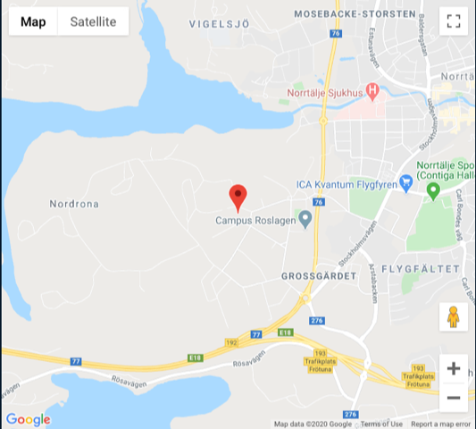

# Todo: Bygga i Smara, Norrtälje - Överväg avloppslösningar (besök Vattencentrum Roslagen)?

```#614790f1``` *As of 2020-02-11 13:36*

[mail plain/text](mail.txt)


Om jag skall bygga i Smara på den höga bergstomten behöver jag en avloppslösning.

1) Överväg att besöka "Vattencentrum Roslagen" i Norrtälje (<http://www.vattencentrum.se/vattencentrum/> )?

> 

> Utvecklingscentrum för vatten  
> Kaserngatan 11  
> 761 46 Norrtälje  
> Telefon: 0176-28 61 00

==&gt; Det verkar som om man kan boka gratis rådgivning?

> ## Rådgivning

> #### Vi har fått i uppdrag att erbjuda fastighetsägare kostnadsfri vatten- och avloppsrådgivning.

> Rådgivningen är opartisk och syftar till att underlätta för fastighetsägaren att fatta ett informerat beslut kring åtgärder eller nyinvesteringar i enskilda VA-lösningar. Vi visar och förklarar hur olika anläggningar ser ut och fungerar. Rådgivningen ges i våra lokaler på Kaserngatan 11 där vi kan använda vår permanenta utställning för enskilda VA-produkter.

> Boka tid för rådgivning via länkarna nedan:

  
> [Eget avlopp](<https://boka.se/avloppsradgivning/boka/avloppsradgivning--(pdibcank)>)[Eget vatten](<https://boka.se/varadgivningdricksvatten/boka/dricksvattenradgivning--(fwidrywd)>)

...


