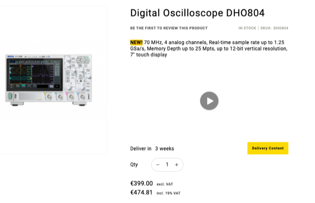

# Todo: Consider the Rigol DHO804 12 bit oscilloscope as reviewed by EEVblog 1566?

```#61954b11``` *As of 2023-09-27 16:06*

[mail plain/text](mail.txt)


1) Consider the EEVblog 1566 "EEVblog 1566 - Rigol DHO800 12 Bit Oscilloscope FULL REVIEW" youtube video (<https://youtu.be/S8jrpCoZyx8> )?

> *Cons: Boots in 46 seconds...*

> *Pros: 12 bit, €399 + shipping, hdmi, VESA mount, USB-C powered, small and light,...*

2) Consider to order it from Rigol EU-shop (<https://rigolshop.eu/dho804.html> )?



...


