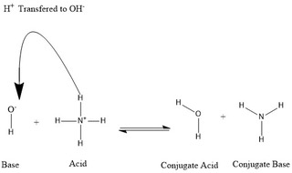

# Todo: Paint wastewater treatment - Consider to understand alkalinity in water and how it relates to coagulation and flocculation in colloids?

```#62a03f0d``` *As of 2019-06-02 19:17*

[mail plain/text](mail.txt)


It seems I need to understand alkalinity to get a better grip on the chemical behaviour of coagulants and flocculants of colloids?

1) Consider this youtube vide "Water Chem Alkalinity Part 1" (<https://www.youtube.com/watch?v=FVhR1wAj1Dg> )?

==&gt; It seems Acids release protons while Bases associate with protons (<https://youtu.be/FVhR1wAj1Dg?t=19> vs <https://youtu.be/FVhR1wAj1Dg?t=64> )?

==&gt; It seems Acids release protons, which in water are hydrogen cations (positive ions) H+ (<https://youtu.be/FVhR1wAj1Dg?t=19> )?


*Acids release (dissociate?) protons *

==&gt; It seems chemical processes sometimes goes to completion or stop at an equilibrium defined by the "K-factor" (note double-arrow to indicate some equilibrium state)?


*Strong acid associations have the "power" to go to completion in water (Nitric Acid is fully separated into protons and nitric anions)*


*Weak acid association often stop at an equilibrium in water defined by a "Kw-factor" (here Water molecules in balance with Hydrogen cations (protons) and hydroxide anions)*

==&gt; It seems a Base associates (hooks up with) protons (<https://youtu.be/FVhR1wAj1Dg?t=64> )?


*Bases associates (binds to or consume) protons*

**Q: Why and how does bases by attracting protons create acids (they should neutralise acids)? **

**A: It seems bases can form a "Conjugate Acid" by receiving a proton (H+)?**


*Bisulfate (anions) in water forms sulphuric acid (a strong acid)?*

==&gt; It seems it is the left side that is the acid (it has formed free protons H+ in water)?

==&gt; Also see "Conjugate Acid" below?


*Carbonate (cations) in water forms Bicarbonate (a weak acid)?*

==&gt; It seems water on earth forms a buffering solution by absorbing carbon dioxide from the atmosphere into equilibrium as modelled by "The carbon System"?


*The Carbonate System model of how water becomes a natural buffer in equilibrium with absorbed atmospheric carbon dioxide?*


*Extracting carbonate as Calcium Carbonate by adding Calcium will shift the carbonate system reaction to compensate (buffer)*


*A graphical presentation of the Carbonate System in nature*

==&gt; Consider to understand the graph showing how the "three phases" of the Carbonate System shifts depending on pH?


*The carbonate System shifts between "CO2 species" of 100% Carbonic Acid (H2CO3), 100% Bicarbonate (HCO3) and at high pH 100% Carbonate Anions (CO3 -2) *

==&gt; I am confused about pH somehow being referred to as something we can change to affect the Carbon System CO2 species present (when in fact the pH is the result of what CO2 species that are present)?

> *From what I understood so far pH is a measurement of the presence of OH- anions in the water. And the more H+ there are, the less OH- there should be?*

==&gt; It seems alkalinity of water is its ability to resist drops in pH in exposure to acids (<https://youtu.be/FVhR1wAj1Dg?t=654> )?


*Alkalinity is a laboratory measured value based on how much acid you need to add to get down to pH 4.5*


*In practice, for water its alkalinity is a measure of the amount of mg per litre of Calcium Carbonate (at pH 4.5)?*

2) Consider the wikipedia article on pH (<https://en.wikipedia.org/wiki/PH> )?

> *"The pH scale is logarithmic and approximates the negative of the base 10 logarithm of the molar concentration (measured in units of moles per liter) of hydrogen ions in a solution. More precisely it is the negative of the base 10 logarithm of the activity of the hydrogen ion."*

==&gt; I am still confused by pH seems strongly correlated to the "Activity" of hydrogen anions (H+) in water?


*pH is a logarithmic measurement of Hydrogen cation "Activity"*

==&gt; Relate this with the definition of "Activity" and it seems we get a correlation of the

> *So if "Activity" is the exponential expression . Then the 10-logarithm of this expression will cancel out to e to a factor ln(e)*

3) Consider the wikipedia article on Thermodynamic Activity (<https://en.wikipedia.org/wiki/Thermodynamic_activity> )?

==&gt; It seems "Activity" in chemistry is a dimensionless measure of the "effective concentration" of a species (as in parts-of-the-whole)?

> *"In chemical thermodynamics, activity (symbol a) is a measure of the "effective concentration" of a species in a mixture,..."*

> *"Activity depends on temperature, pressure and composition of the mixture,..."*

> *"...activity is treated as a dimensionless quantity, although its value depends on customary choices of standard state for the species."*

**Note: This obscurity and context dependent semantics (dimensionless rubbish) of terms and models in chemistry is why I became a physicist!**

==&gt; I am a little confused but it seems "Activity" and "Relative Activity" is the same thing?


In chemistry *"Activity" and "Relative Activity" seems to be the same thing?*

==&gt; Consider to do a dimension analysis of the exponent?

> *So the gas constant R has the dimension Joule per Kelvin and Mol which means RT becomes Joule per Mol. For the exponent to become dimensionless we would like the molar chemical potential to also be Joule per mol? And YES, it is (See wikipedia article on Specific Energy Joule per Kg that also defines Molar energy as joule per mole). So everything is good!*

==&gt; Consider how confusing this language is to me as a physicist?

> *What on earth is "Molar chemical potential"? I though mole was a mass measurement to deal with how atomic masses relates to actual mass in kg? And what is "thermodynamic temperature" if it is not temperature? So many confusing and obscuring facts here. And it seems to never end? How deep is this rabbit hole?!*

> *Ok, at least thermodynamic temperature is just plain temperature in Kelvin. I am relieved!*

4) Consider the wikipedia article on Thermodynamic Temperature (<https://en.wikipedia.org/wiki/Thermodynamic_temperature> )?

> *"Thermodynamic temperature is the absolute measure of temperature and is one of the principal parameters of thermodynamics.*

> *Thermodynamic temperature is defined by the third law of thermodynamics in which the theoretically lowest temperature is the null or zero point. At this point, absolute zero, the particle constituents of matterhave minimal motion and can become no colder.&#91;1&#93;&#91;2&#93;*  
> *"*

> *"**Thermodynamic temperature is often also called absolute temperature, for two reasons: one, proposed by Kelvin, that it does not depend on the properties of a particular material; two that it refers to an absolute zero according to the properties of the ideal gas.**"*

5) Consider the wikipedia article on Specific Energy and indirect "molar Energy" (<https://en.wikipedia.org/wiki/Specific_energy> )?

==&gt; It seems Specific Energy is Joule per Kg while Molar energy is Joule per Mole?

> *"Specific energy is energy per unit mass."*

> *"The concept of specific energy is related to but distinct from the chemical notion of molar energy, that is energy per mole of a substance, which uses units of energy per mole"*

6) Consider the wikipedia article on the gas Constant (<https://en.wikipedia.org/wiki/Gas_constant> )?

==&gt; It seems the (molar) Gas Constant has the unit J per kelvin and mol ([J](https://en.wikipedia.org/wiki/Joule)⋅[K](https://en.wikipedia.org/wiki/Kelvin)−1⋅[mol](<https://en.wikipedia.org/wiki/Mole_(unit)>)−1)

> "The gas constant is also known as the molar, universal, or ideal gas constant, denoted by the symbol R or R and is equivalent to the Boltzmann constant, but expressed in units of energy per temperature increment per mole, i.e. the pressure–volume product,"

7) Consider the wikipedia article on Chemical Potential (<https://en.wikipedia.org/wiki/Chemical_potential> )?

==&gt; It seems the Chemical Potential in thermodynamics is the energy change related to particle count change (thus having the dimension Joule)?

> *"In thermodynamics, chemical potential of a species is energy that can be absorbed or released due to a change of the particle number of the given species, e.g. in a chemical reaction or phase transition. The chemical potential of a species in a mixture is defined as the rate of change of free energy of a thermodynamic system with respect to the change in the number of atoms or molecules of the species that are added to the system."*

8) Consider the wikipedia article on Chemical Thermodynamics (<https://en.wikipedia.org/wiki/Chemical_thermodynamics> )?

==&gt; It seems the reason I am confused is because in chemistry we seem to use energy, temperature, potential and so on as defined by a model called "Chemical thermodynamics"?

> *"Chemical thermodynamics is the study of the interrelation of heat and work with chemical reactions or with physical changes of state within the confines of the laws of thermodynamics. Chemical thermodynamics involves not only laboratory measurements of various thermodynamic properties, but also the application of mathematical methods to the study of chemical questions and the spontaneity of processes."*

9) Consider the wikipedia on Bisulfate (hydrogen sulfate) forming its conjugate base Sulfuric Acid (<https://en.wikipedia.org/wiki/Sulfate#Hydrogen_sulfate_(bisulfate)> )?

> "  
> The [conjugate base](https://en.wikipedia.org/wiki/Conjugate_acid) of [sulfuric acid](https://en.wikipedia.org/wiki/Sulfuric_acid) (H2SO4)—a dense, colourless, oily, corrosive liquid—is the **hydrogen sulfate** ion (HSO−  
> 4), also called the **bisulfate** ion.  
> "

10) Consider the wikipedia article on Conjugate Acid (<https://en.wikipedia.org/wiki/Conjugate_acid> )?

==&gt; I am confused but it seems an Acid is a solution able to release protons (not absolutely required to have free protons around)?



*Hydroxide anions and Ammonium cations in equilibrium with their conjugate acid (water H2O) and conjugate base (ammonia H3N) <https://en.wikipedia.org/wiki/File:Conjugate_base_reaction.jpg> *

==&gt; It seems I am right to be confused as conjugate acids and bases "make sense" only in the context of the actual chemical reaction?

> "  
> We say that the water molecule is the conjugate acid of the hydroxide ion after the latter received the hydrogen proton donated by [ammonium](https://en.wikipedia.org/wiki/Ammonium). On the other hand, [ammonia](https://en.wikipedia.org/wiki/Ammonia) is the conjugate base for the acid ammonium after ammonium has donated a hydrogen ion towards the production of the water molecule. We can also refer to OH- as a conjugate base of H  
> 2O, since the water molecule donates a proton towards the production of NH+  
> 4 in the reverse reaction, which is the predominating process in nature due to the strength of the base NH  
> 3 over the hydroxide ion. Based on this information, it is clear that the terms "Acid", "Base", "conjugate acid", and "conjugate base" are not fixed for a certain chemical species; but are interchangeable according to the reaction taking place.  
> "

11) Consider the wikipedia article on Sulphuric Acid, also called Vitriol (<https://en.wikipedia.org/wiki/Sulfuric_acid> )?

> "  
> **Sulfuric acid** ([alternative spelling](https://en.wikipedia.org/wiki/Sulfur#Spelling_and_etymology) **sulphuric acid**), also known as [**vitriol](https://en.wikipedia.org/wiki/Vitriol)**, is a [mineral acid](https://en.wikipedia.org/wiki/Mineral_acid) composed of the elements [sulfur](https://en.wikipedia.org/wiki/Sulfur), [oxygen](https://en.wikipedia.org/wiki/Oxygen) and [hydrogen](https://en.wikipedia.org/wiki/Hydrogen), with [molecular formula](https://en.wikipedia.org/wiki/Molecular_formula) [H2](https://en.wikipedia.org/wiki/Proton)[SO4](https://en.wikipedia.org/wiki/Sulfate). It is a colorless, odorless, and syrupy liquid that is soluble in [water](https://en.wikipedia.org/wiki/Water) and is synthesized in reactions that are highly exothermic.[&#91;5&#93;](https://en.wikipedia.org/wiki/Sulfuric_acid#cite_note-ds-5)  
> "

12) Consider the wikipedia article on Conjugate acid (<https://en.wikipedia.org/wiki/Conjugate_acid> )?

> "  
> A **conjugate acid**, within the [Brønsted–Lowry acid–base theory](https://en.wikipedia.org/wiki/Br%C3%B8nsted%E2%80%93Lowry_acid%E2%80%93base_theory), is a chemical compound formed by the [reception of a proton](https://en.wikipedia.org/wiki/Protonation) ([H+](<https://en.wikipedia.org/wiki/Hydron_(chemistry)>)) by a [base](<https://en.wikipedia.org/wiki/Base_(chemistry)>)—in other words, it is a base with a [hydrogen](https://en.wikipedia.org/wiki/Hydrogen) ion added to it. On the other hand, a **conjugate base** is what is left over after an acid has donated a proton during a chemical reaction. Hence, a conjugate base is a species formed by the [removal of a proton](https://en.wikipedia.org/wiki/Deprotonation) from an acid.[&#91;1&#93;](https://en.wikipedia.org/wiki/Conjugate_acid#cite_note-1)  
> "

...


