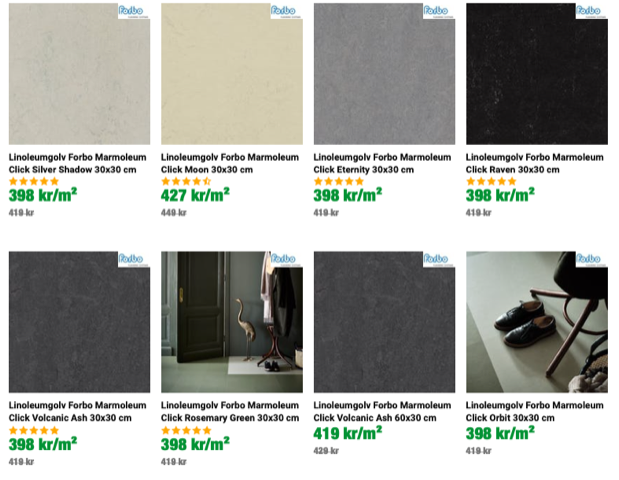

# Todo: Eget Hus - Överväg att bygga med linoleum och förstå materialets egenskaper, pris och hantering?

```#6399a676``` *As of 2020-04-05 11:39*

[mail plain/text](mail.txt)


Jag vill bygga med hållbara och naturliga material.

1) Linoleum verkar vara korkmjöl eller sågspån bundet i linolja och harts (<https://sv.wikipedia.org/wiki/Linoleum> )?

> "*Det framställs av sågspån eller ett mjöl av kork, kokt linolja, harts, diverse sickativ (torkmedel) samt färgpigment.*

> *Genom att i linolja tillsätta blyoxid eller annat oxidationsbefrämjande medel under det att man inblåser luft i den till 250 °C upphettade linoljan skapas linoxyn, som fungerar som bindemedel i linoleumet. Linoxynet lagras en tid och sammansmälts därefter med ungefär 50% harts till så kallad linoleumcement.&#91;1&#93;*"

2) Försök förstå de vikigaste egenskaperna för läggning och skötsel av linoleum-golv?

==&gt; Det verkar som om linoleum-golv (<https://www.forbo.com/flooring/sv-se/laeggning-skoetsel/linoleum/piqnl2> )?

> *"**Rum, material och undergolv måste hålla minst 18 °C. Låt allt material acklimatiseras under minst en natt före läggningen. Forbo erbjuder specialdesignade läggningsverktyg.**"*

==&gt; Det verkar som om linoleum främst skall torr-torkas men kan våt-torkas med neutrala medel (<https://www.forbo.com/flooring/sv-se/laeggning-skoetsel/linoleum/piqnl2#panel_42> )?

> *"**Använd i första hand torra rengöringsmetoder (dammsugning, sopning, moppning). Gör till daglig rutin att avlägsna synlig smuts. Vid ev fukttorkning används vatten tillsatt med ett neutralt rengöringsmedel (pH 6–8, typ handdiskmedel). Använd inte hett vatten, starkt alkaliska rengöringsmedel eller starka lösningsmedel.**"*

3) Försök få en uppfattning över pris och tillgänglighet av linoleum-golv?

==&gt; Linoleum-golv verkar kosta mellan 400-500 SEK per kvadratmeter (<https://www.golvpoolen.se/golv/linoleumgolv/> )?

> 

...


