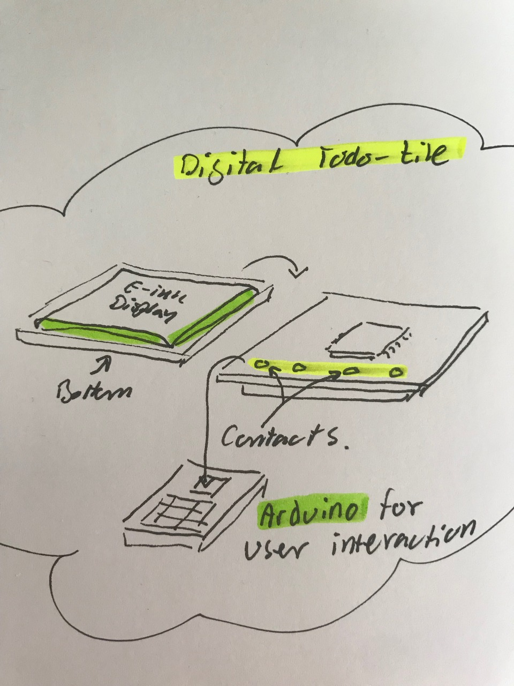
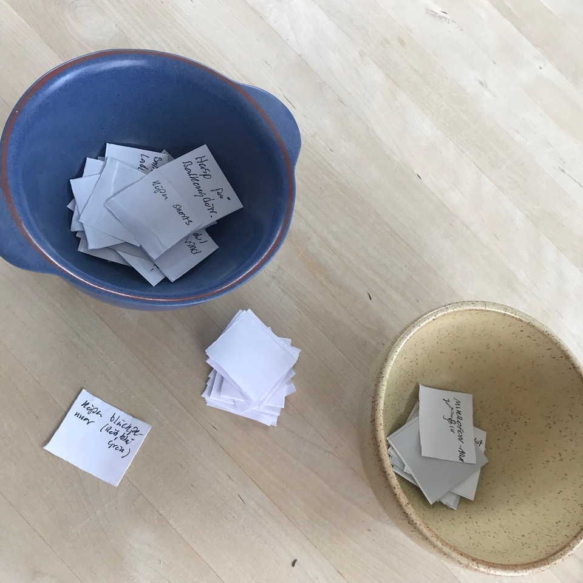

# Todo: Digital TODO tiles - Consider to make "tiles" with a micro controller that hosts a Todo and is pluggable into an Arduino SBC for interaction and progress update?

```#66917b72``` *As of 2019-06-11 13:19*

[mail plain/text](mail.txt)


It juts feels like a fun idea to have digital todo tiles that I can plug into an Arduino for interaction and update?

1) Consider each digital Todo-tile to have a small e-ink display and some micro controller with memory but no battery?

> *The idea here is to manifest Todo:s as physical tiles that carry the information of the Todo in digital form. I suppose we should be tempted to store data in a persistent data structure to preserve the history of progress. maybe we should also have an e-ink display on the tile to have it present some readable information about "what" it is? Although. I wonder how much each tile may end up costing if it is to have borth an e-ink display and a micro controller on a specially designed PCB?*



*A possible design of a digital Todo-tile?*

2) Consider to base the idea on my existing paper based "tiles" I am trying as a Todo-tombola?



Consider these paper Todo tiles as digital ones pluggable into an Arduino for processing, interaction and update?


