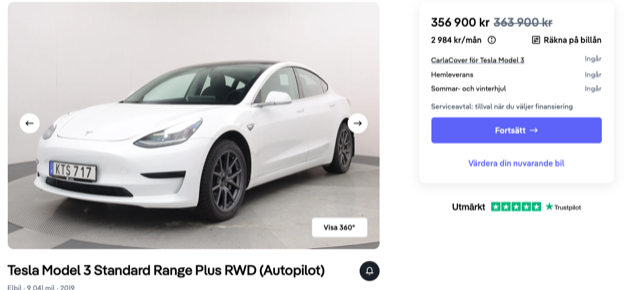
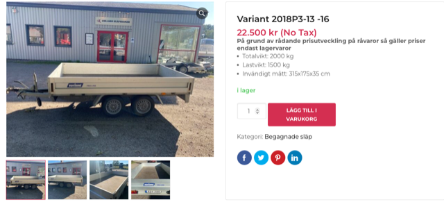
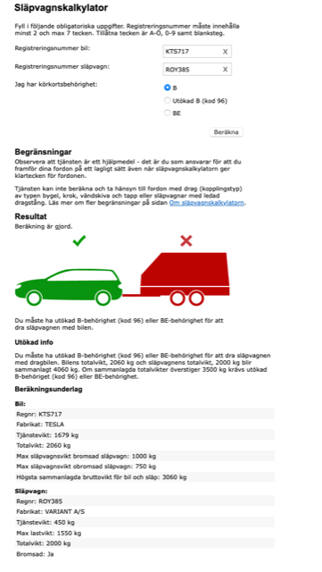

# Todo: It seems I can buy a used Tesla Model 3 with tow hitch and a used trailer for 357 000 + 22500 = 380 000 and tow 990 kg?

```#67618e92``` *As of 2023-11-28 15:06*

[mail plain/text](mail.txt)


I think a used electric car and trailer is the way to go for me.

1) Consider the used Tesla Model 3 "KTS 717" (<https://www.carla.se/bil/tesla-model-3-2019-ckog0si9io6g00flu3v0> )?



2) Consider the used trailer "ROY 385" (<https://www.gullaboslapvagnar.se/product/grey-854/> )?



3) Consider Trafikverkets släpvagnskalkylator (<https://slapvagnskalkylatorn.transportstyrelsen.se/Slapvagnskalkylator/Slapvagnskalkylator.aspx> )?



==&gt; It seems this shows I can tow up to 990 kg for a total wight of car+trailer of 3500 kg?

> *The car gross weight 2020 kg and the trailer empty weight 450 kg leaves 3500 - 2060 - 450 = 990 kg? *

> *It also seems the car itself limits its allowed towing weight to 1000 kg so 990 kg is within the range of the car and tow hitch?*

...


