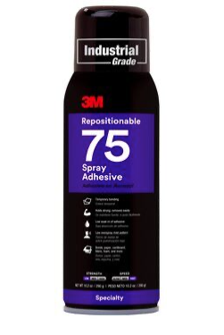
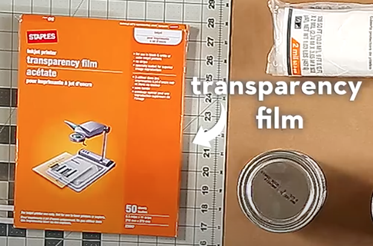
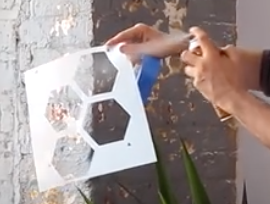
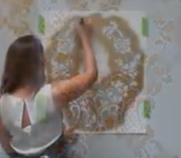
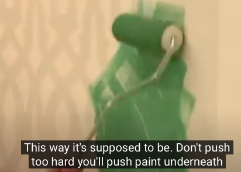

# Todo: Consider how I can paint patterns on the wall using stencils (Swedish "Schabloner")?

```#6b1ff034``` *As of 2020-10-31 12:00*

[mail plain/text](mail.txt)


1) Consider to use the 3M spray adhesive 75 (<https://www.3msverige.se/3M/sv_SE/company-ndc/all-3m-products/~/3M-Omflyttningsbart-Spraylim-75-500-ml-12-st-fp/?N=5002385+8709313+3292300005&preselect=8709325+8710676+8710815+8713605+3293786499&rt=rud> )?

>   
> *3M Spray Adhesive 75, a "*reposition-able" *tacking spray*

2) Consider youtube videos showing tips and tricks on how to paint a wall with stencil patterns?

==&gt; Consider youtube video "Modern Wall Stenciling 101" (<https://youtu.be/M7ogqO0GU60> )?

>   
> *It seems you can use overhead transparency film with a reposition-able tacking spray to make wall paint stencils?*

>   
> *It seems we should use low tack spray adhesive to make the wall stencil stick to the wall*

==&gt; Consider youtube video "How to Stencil a Feature Wall in Only an Hour" (<https://www.youtube.com/watch?v=4Y__eXo8Mjk> )?

> 

==&gt; Consider youtube video "How To Reduce Bleed While Stenciling" (<https://youtu.be/CAKksLM9So8> )?

> 

...


