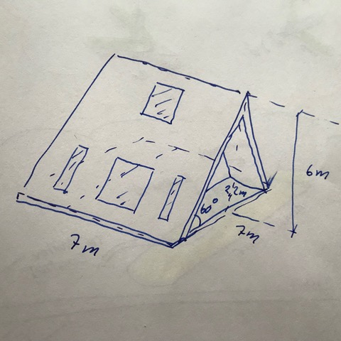

# Todo: House Build - Consider to build a 7x7 m A-frame house with two floors and south facing solar panel side?

```#6bb00f41``` *As of 2019-09-30 09:56*

[mail plain/text](mail.txt)


My neighbour tipped me about A-frame house designs and proposed a 7x7 m house with 60 degrees sides and sought facing solar panel side.

1) It seems a symmetric A-frame house with 7 meter sides?

>   
> *An example of a 7x7 meters A-frae house that will get 6 m height that will allow for two floors*

2) Consider the wikipedia article on A-frame house history (<https://en.wikipedia.org/wiki/A-frame_house> )?

...


