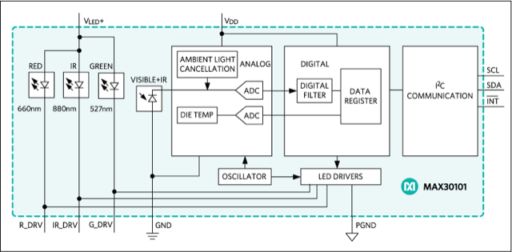

# Todo: Consider the OpenHAK (Health Activity Kit) arm-watch-form-factor heart rate sensor equipped open hardware and source (Arduino compatible Simblee 32bit BLE/MCU based using Maxim 30101 heart rate sensor)?

```#6cba69c6``` *As of 2019-07-20 13:47*

[mail plain/text](mail.txt)


It seems it should be worth following this project and possibly try and build it to get a wrist watch micro controller with heart rate sensor and open source hardware and software?

1) Consider this youtube video "OpenHAK Beta" (<https://www.youtube.com/watch?v=5upg70COM_k> )?

> *"OpenHAK is the Open-source Health Activity Kit, now in beta from Joel Murphy and Leif Percifield! They've instructed us to "tweet the &#91;bleep&#93; out of it", so we're sharing this sneak peek with you... Catch the full badge at DEFCON Hacking Conference Biohacking Village, and stay informed on GitHub: <https://github.com/OpenHAK>*

> *// Official OpenHAK website: <https://www.openhak.com/> *

> *// And here's that DIY mouse by BioMurph: <https://www.hackster.io/videos/224> "*

2) It seems the OpenHAK lives on this site (<https://www.openhak.com> )?

> "**Open, Open, Open**
- BLE: Using the [Simblee 32bit BLE/MCU](https://www.simblee.com/) module allows for awesome features, and is fully Arduino compatible. It enables long battery life, and easy use, including wireless programming
- IMU: The [Bosch BMI160](https://www.bosch-sensortec.com/bst/products/all_products/bmi160) is the same IMU that is integrated into the Arduino 101 - 6-Axis IMU
- PPG: [Maxim 30101](https://www.maximintegrated.com/en/products/analog/sensors-and-sensor-interface/MAX30101.html) offers high sensitivity, adjustable LED output power and multiple wavelengths. Designed specifically for wearables, and can capture PPG, and SpO2
- Breakout: In addition to 3V3, GND, and the Simblee Reset pin, 5 unused pins on the Simblee are broken out including TX and RX.
- Lights: RGB LED for full color blinky blinks
- Battery Charging: USB input provides Lipo/Li-ion charging to a battery connected via JST
- Wrist Strap: Includes velcro wrist strap
- Protected: The entire PCB is conformally coated to provide protection from moisture and sweat"


3) It seems OpenHAK provides all required hardware, software and 3D printable part information on GutHub (<https://github.com/OpenHAK/OpenHAK_Hardware> )?

==&gt; It seems the OpenHAK uses the MAX30101 (<https://www.maximintegrated.com/en/products/interface/sensor-interface/MAX30101.html> )?



> *"The MAX30101 is an integrated pulse oximetry and heart-rate monitor module. It includes internal LEDs, photodetectors, optical elements, and low-noise electronics with ambient light rejection. The MAX30101 provides a complete system solution to ease the design-in process for mobile and wearable devices."*

==&gt; It seems currently (190720) the Simblee 32bit BLE/MCU is not available for purchase through any official channels?

> "WARNING: Siblees don't exist!

> Hi. Here you'll find everything that you need to make yourself your very own OpenHAK! If, that is, you have any spare Simblees lying around. Should you do have some Simblees that are just taking up space, then you're in luck! Simblees are very well trained to handle reflow with a hot air gun or toaster oven many, many times. Trust me, they are tough buggers. If you don't have any Simblees propping open your window or shimming up your wobbly cafe table, then you're out of luck... Or are you....?"

...


