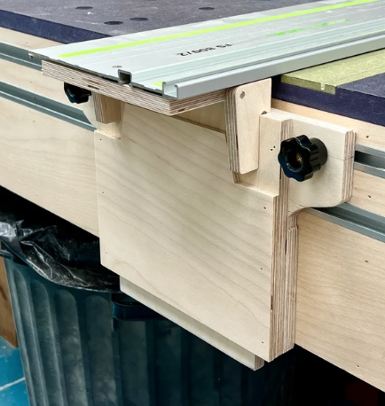
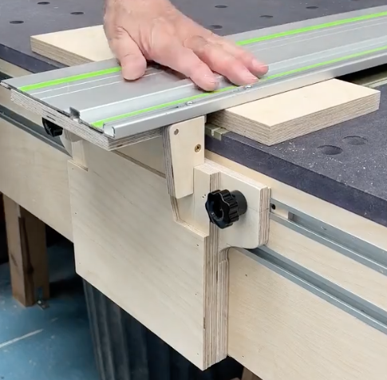

# Todo: Consider to build and use Peter Millards plywood "Pocket-money Rail Hinge"?

```#6eaf13a4``` *As of 2022-08-19 15:00*

[mail plain/text](mail.txt)


I want a self-adjusting cross cut guide rail hinge to use at my MFT cross cutting station and Peter Millards plywood "Pocket-money Rail Hinge" seems to be just that.

1) Consider this youtube video "Pocket-money Rail Hinge" (<https://youtu.be/sHj5G6t1qvY> )?

2) The plans seem to be available as "DIY Plywood Rail Hinge Plans Plus - includes step-by-step build video" at Millards Etsy store ([https://www.etsy.com/se-en/listing/1238195272/diy-plywood-rail-hinge-plans-plus?click_key=b69547cea4d6297ff49566788bfdf351169dd7d4%3A1238195272&click_sum=c49ad6eb&ref=shop_home_active_1&crt=1](https://www.etsy.com/se-en/listing/1238195272/diy-plywood-rail-hinge-plans-plus?click_key=b69547cea4d6297ff49566788bfdf351169dd7d4:1238195272&click_sum=c49ad6eb&ref=shop_home_active_1&crt=1) )?





...


