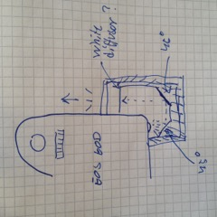

# Todo: DIY 3D Print - Consider to 3D print a back-to-front active led light reflector for my EOS 60D?

```#6f8758cb``` *As of 2018-01-19 12:27*

[mail plain/text](mail.txt)


It seems I should be able to 3D print a piece to put on my EOS 60D so that the LED that flashes on the back when it films will be seen from the front?

1) Consider the design of the reflector?

==&gt; Consider a piece that mounts on the side that reflects the flashing LED light to the front?



==&gt; Consider using small pieces of aluminium foil to create the reflecting mirrors?

…

2) Consider to design the reflector using Fusion 360?

…

…

Consider to make this reflector for my EOS 60D so that I can monitor if the camera is filming while I’m facing the camera?


