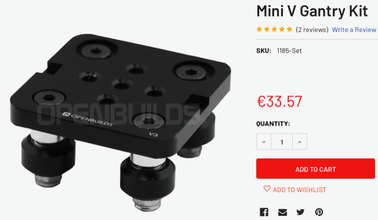
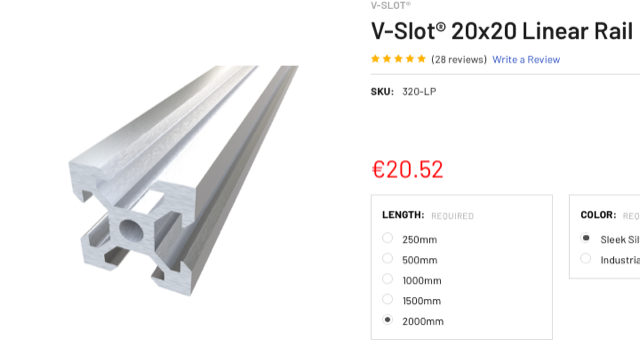

# Todo: Consider the Openbuilds V-slot aluminium extrusion and gantry for my vertical panel saw design (Makita circular saw sled solution)?

```#6fd3103d``` *As of 2022-07-12 15:46*

[mail plain/text](mail.txt)


I want a way to make my sliding workspace wall into a panel saw using my handheld circular saw.

1) Consider Openbuilds V-slot plus gantry system ([https://openbuildspartstore.com](https://openbuildspartstore.com/) )?

==&gt; It seems I can use two ready-to-assemble V-slot gantries (<https://openbuildspartstore.com/mini-v-gantry-kit/> )?

>   
> *The mini V Gantry Kit for a 20x20 V-slot linear rail*

> *NOTE: I would need 4 of theese to make a sled for my circualr saw! **That's 136€...***

==&gt; It seems a 2m 20x20mm V-slot lienar rail would set me back 21€?



...


