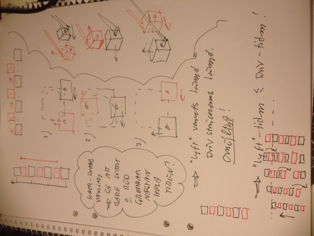

# Todo: Power Feeder - Consider a reciprocating (alternating) push feeder?

```#7087a2b1``` *As of 2018-11-30 13:23*

[mail plain/text](mail.txt)


Consider it could be possible to design a power feeder that pushes the material past the blade with reciprocating (alternating) “pushers”?

1) Consider how to design a push mechanism that uses a file of “pushers” that lifts and go back and take turns to push the material?

==&gt; Consider the benefit with the “push mechanism” is that compared to drive wheels we get much larger contact area and also contact time with the pushed material?

==&gt; Consider with the correct design we still get constant feed speed past the blade?

==&gt; Consider it should be possible to have left and right attached pushers that allow them to be lifted over each other to restart a push stroke?



2) Consider to apply the “Walker robots” mechanisms to make the power feeder push sticks “walk” the material through the table saw blade?

==&gt; Consider the “Walker Robots” web for explanations on the walker robots linkage (<https://www.diywalkers.com/walker-abcs.html>)?

==&gt; Consider this youtube video showing the “walker robots” linkage types in motion (<https://www.youtube.com/watch?v=SAsWFgpvYhA>)?


==&gt; Consider the “Strandbeest” linkage mechanism has a nice “flat” ground touch movement (with a quick lifted retraction motion)?

==&gt; Consider this four bar linkage mechanism is even simpler and also able to produce a flat drive motion and a quick lifted retraction (<https://www.youtube.com/watch?v=Qs-yy7a5ibg>)?


NOTE: It seems the drive stroke of the walking robot linkages does NOT have constant velocity?

==&gt; Consider we may need to control the rotation speed of the motor to make the drive stroke of the walking robot mechanism have constant speed?

...

3) Consider to 3D print details to try out a design that could work?

==&gt; Consider to 3D print the “Four Bar Linkage” to try out as a push stick feeder mechanism?

...


