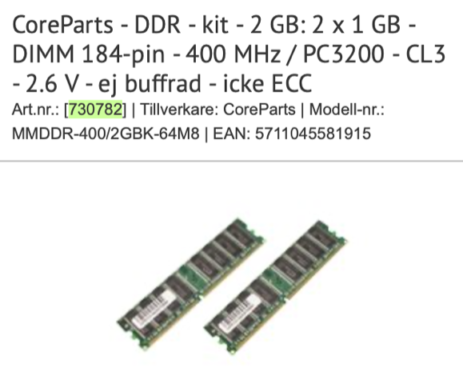
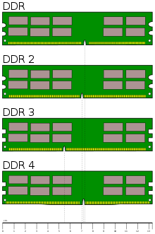

# Todo: Korg OASYS 88 - Consider to upgrade my RAM with one extra GB and thus enable load of both Exs1, Exs2 (Grand Piano) and Exs3 at the same time?

```#7242fbb6``` *As of 2021-03-14 00:24*

[mail plain/text](mail.txt)


I want to learn more about my Korg OASYS 88 from the documentation I have actually never taken the time to read.

1) It seems Danish ComputerSalg sells DDR memory of the compliant type?

==&gt; Consider to upgrade a pair (<https://www.computersalg.se/i/730782/coreparts-ddr-kit-2-gb-2-x-1-gb-dimm-184-pin-400-mhz-pc3200-cl3-2-6-v-ej-buffrad-icke-ecc> )?

> 

==&gt; Consider to check what DDR module is actually installed in my OASYS 88 from 2008?

2) It seems the Korg OASYS 88 uses a "1GB DDR 400MHz (PC3200) CL3" RAM module (<https://forums.karma-lab.com/forum/showthread.php?t=6464> )?

> "...The Oasys uses Hynix HYMD512646B8J-D43 AA memory which specs are 1GB DDR 400MHz (PC3200) CL3. I doubt you'll find the same exact DIMM, so I'd say to buy a 1GB PC3200 CL3 DIMM with a reputable brand name..."

==&gt; According to the Parameter Guide page 1090 the RAM supported is 184 PIN: DDR333 CL2.5 or DDR400 CL3?

> "  
> Specifications: 184‐pin DIMM DDR SDRAM, unbuffered, non‐ECC

> PC2700 (DDR333 CL2.5) PC3200 (DDR400 CL3)

> Number of units: one (not including the factory‐ installed memory)

> Capacity for the additional DIMM: 512MB or 1GB  
> "

3) Consider the wikipedia article on DDR SDRAM (<https://en.wikipedia.org/wiki/DDR_SDRAM> )?

==&gt; It seems I must ensure to get a first generation DDR module as later generations are NOT backward compatible?

> **Double Data Rate Synchronous Dynamic Random-Access Memory,** officially abbreviated as DDR SDRAM, is a double data rate (DDR) synchronous dynamic random-access memory (SDRAM) class of memory integrated circuits used in computers. **DDR SDRAM, also retroactively called DDR1** SDRAM, has been superseded by DDR2 SDRAM, DDR3 SDRAM, DDR4 SDRAM and DDR5 SDRAM. **None of its successors** are forward or **backward compatible** with DDR1 SDRAM, meaning DDR2, DDR3, DDR4 and DDR5 memory modules will not work in DDR1-equipped motherboards, and vice versa.

>   
> It seems the Korg OASYS 88 uses the first generation DDR memory modules?

==&gt; It seems CL3 means "CAS Latency 3 ns"?

> "Timings

> CAS latency (CL), clock cycle time (tCK), row cycle time (tRC), refresh row cycle time (tRFC), row active time (tRAS)."

..


