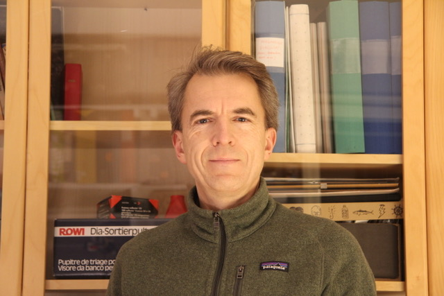
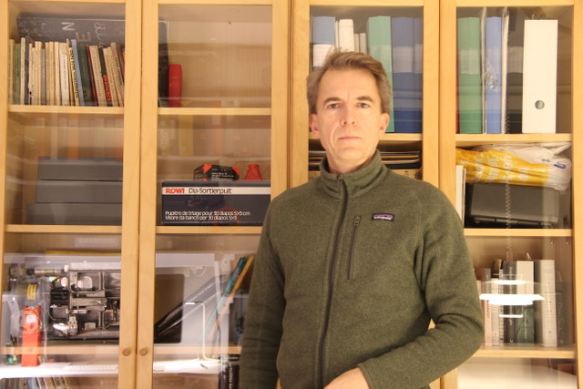
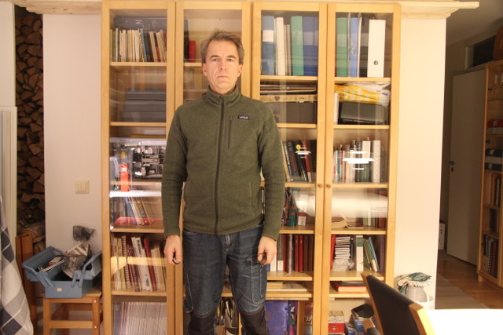
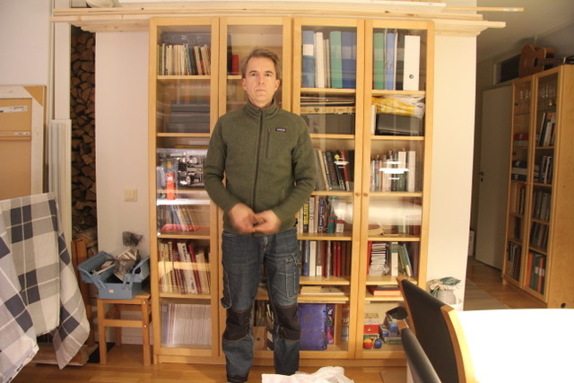
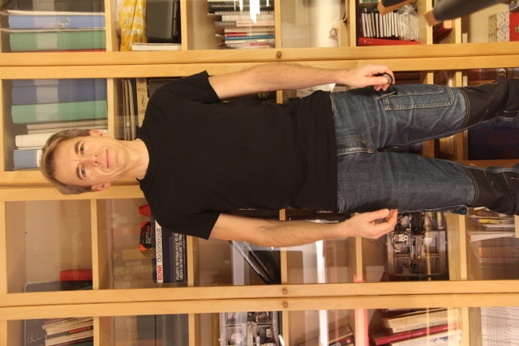
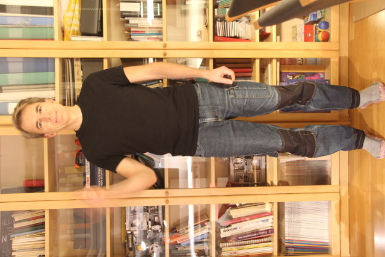
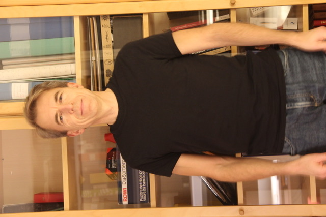
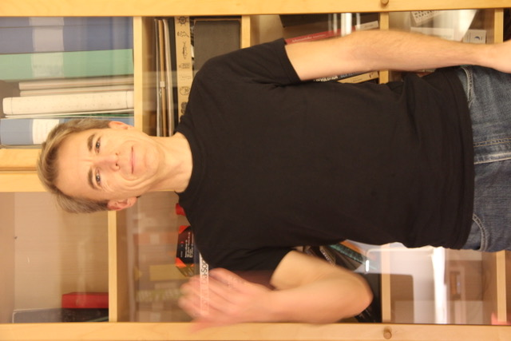

# Todo: Consider the Green Screen size I need for video shooting myself using by EOS 60D 17-58 mm Zoom objective?

```#73af8cde``` *As of 2020-11-01 23:02*

[mail plain/text](mail.txt)


I want a Green Screen setup to shoot myself for youtube video production in my apartment and need to know what size of Green Screen I need.

1) Consider some example photographs to determine the Green Screen Size required for different Zoom levels?

>   
> *For close-up a 80 cm (one bookshelf width) wide green screen seems sufficient*

>   
> *For half body I need a 186 cm (two bookshelf width) wide green screen*

>   
> *For an almost full body frame the Green Screen won't fit my apartment*

>   
> *For a full body frame the Green Screen won't fit my apartment*

2) Consider example photographs taken with my Manfrotto 498RC2 ball head camera mount to tilt the camera 90 degrees?

>   
> *For an almost full body frame I need a 120 cm (1,5 book shelves) wide green screen*

>   
> *For a full body frame I need an almost 160 cm (two book shelves) wide green screen*

>   
> *With a 90 cm (one book shelf) wide green screen I get a half body frame*

>   
> *With a 90 cm (one book shelf) wide green screen I get a half body frame*

2) Consider the wikipedia article on focal length /<https://en.wikipedia.org/wiki/Focal_length> )?

> *"Due to the popularity of the 35 mm standard, camera–lens combinations are often described in terms of their **35 mm-equivalent focal length,** that is, the focal length of a lens that would have the same angle of view, or field of view, if used on a full-frame 35 mm camera. Use of a 35 mm-equivalent focal length is **particularly common with digital cameras**, which often use sensors smaller than 35 mm film, and so require correspondingly shorter focal lengths to achieve a given angle of vie*w*"*

...


