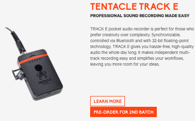
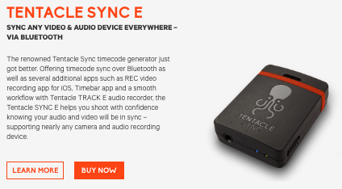
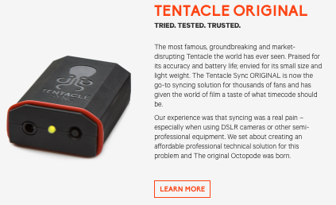
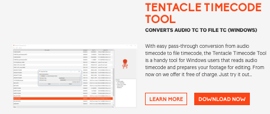

# Todo: Consider to design a device that generates an audible frequency modulated time and ID code to use for marking video and audio recordings for file organisation and post synchronisation?

```#757cc3d8``` *As of 2022-08-04 15:25*

[mail plain/text](mail.txt)


I want an easy and cost effective open source way to process audio and video recordings for cut end editing.

> *So, the basic idea is that wer should be able to record frequency modulated codes onto devices that record audio using a microphone.*

> *And a sufficient audio processing software should be able to decode these FM codes in recordings and use them to find files that "go together" and also synchronise them?*

> *The devise generating the FM code should be cheap and easy to build as it is "only" a binary-to-frequencey converter?*

> *I imagine a device that is able to generate unique GUID codes and play them through a speaker in FM modulation.*

> *Optionally we can allow for recording af some spoken meta-information and have the device be able to generate the same GUID code to go before and after the spoke meta-information?*

> *And the meta-information could basically be just some description of what the recording is about.*

> *DELUXE - If the device has speach-to-text ability we can even encode this text onto the recording using FM modulation of UTF8 or ASCII text?*

> *...*

2) Consider to study the German produced "Tentacle Sync" product line (<https://tentaclesync.com> )?

> *"**Tentacle Sync turns complicated and expensive products into an easy-to-use and affordable bluetooth-enabled solution – for everyone. Use the hardware and software as standalone products or together for a hassle-free syncing workflow. **"*

> 

> 

> 

> 

...


