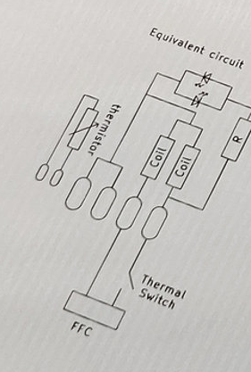
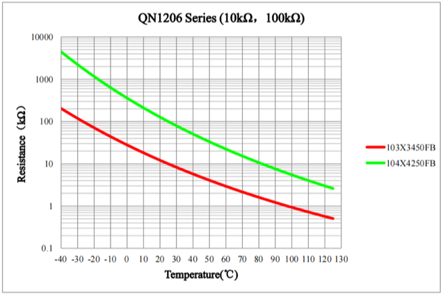

# Todo: Consider to design a temperature control for my TinyFab Up! Mini aluminium heatbed?

```#75a5b212``` *As of 2022-07-23 19:36*

[mail plain/text](mail.txt)


The TinyFab Up! Mini aluminium heatbed comes with a 60 degree C built in temperature thermal switch that controls the flat cable connected power.

1) This seems to be the home of the TinyFab Up! Mini aluminium heatbed (<https://www.tinyfab.xyz/product-page/up-mini-aluminium-heatbed> )?



2) It seems the built-in thermistor is a 100 K ohm one?

> *I have measured the resistance between the connectors for the on-board thermal sensor and got a reading of about 100 K ohm.*

> *And I I heat the thermistor it drops slightly.*

> *So I assume it is a 100 K Ohm **Negative Temperature Coefficient (NTC) thermistor?*

3) Consider I can use this Swedish web-shop Electrokit thermostat (<https://www.electrokit.com/produkt/termostat-50-till-110c-panelmonterad/> )?


> *There are two clues this will NOT WORK?*

> *1) It requires 12V driving power (and the Cetus 3D printer uses a 19V brick)*

> *2) It seems to come with a 10K thermistor (And the bed I am using from Tinyfab xyz has a built in 100 K one)*

> *It may still work though if this module has an on board power regulator so that it can take 19V and not die?*

> *And If I use the provided 10K thermistor instead of the onboard 100K one?*

> *Also, I suppose the NTC operates in a weatstone bridge or a simple resistor ladder so I may be able to modify the board to work with a 100K NTC? I suppose this depends if we can keep the Volt/grade factor even after the modification?*

> *This graph gives us some hope? It seems we can get the same voltage per grade characteristic by matching the 100K NTC with a 100K fixed counterpart (assuming the 10K NTC is matched with 10K fixed counterparts)?*

>   
> Copyright <http://mao.ecer.com/photo/thermistor-sensor/editor/20210610222645_34499.png> .

> *...*

...


