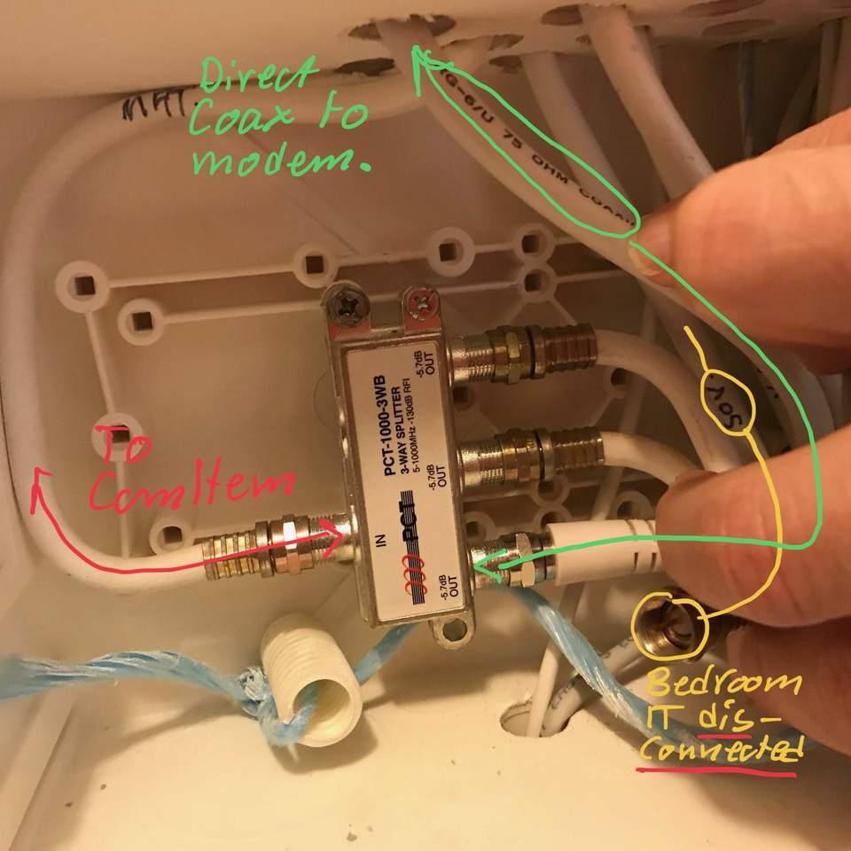

# Todo: AL6 Apartment - Consider my "hack" to connect the COmHem modem directly to the IT connection box (and disconnect the bedroom IT coax. outlet)?

```#765e76d4``` *As of 2019-06-22 16:59*

[mail plain/text](mail.txt)


I have at some point "hacked" the ComHem coax. connection for IT so the Bedroom IT outlet is disconnected and the now free splitter outlet goes directly to the modem.



*In my apartment the ComHem modem is directly connected to the ComHem IT feed splitter in the IT connection box*

...


