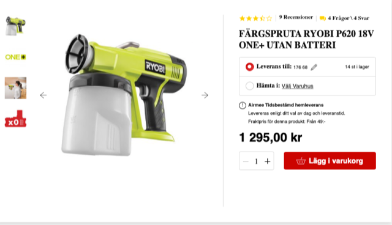
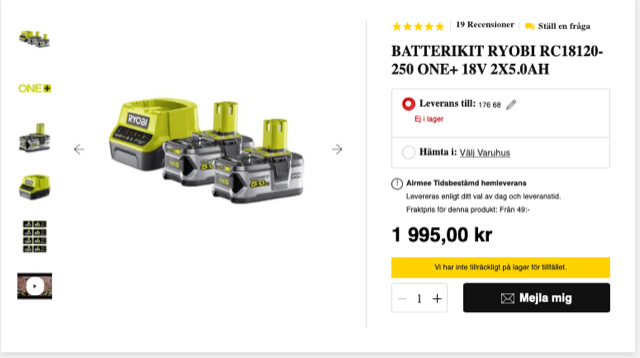
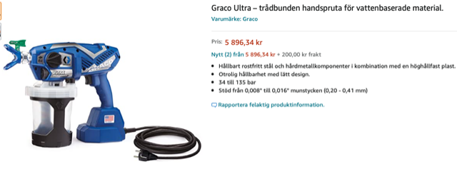
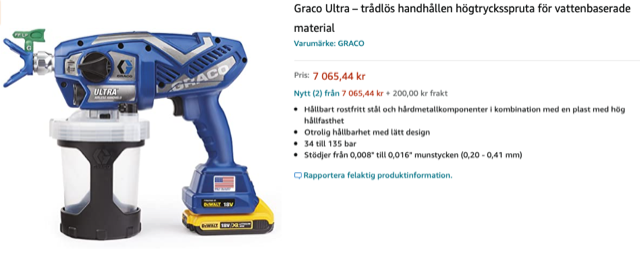

# Todo: Consider to try out Airless Spray Painting with say Ryobi vs Graco cordless tool options?

```#76b482bb``` *As of 2021-07-22 00:24*

[mail plain/text](mail.txt)


I want to speed up my paintwork so maybe an airless spray paint gun is the way to go?

1) Consider the Ryobi P620 18V?

==&gt; The Ryobi P620 18V seems to sell at bauhaus for 1300 SEK?



The Ryobi P620 18V without battery or charger.

==&gt; It seems two batteries and a charger will set me back 2000 SEK



2) Consider one of the lower end Graco handheld paint gunds?

==&gt; It seems I can only find the high end "Ultra" modell that sells for 6000 SEK (Corded) and 7100 SEK for cordless (no battery or charger)





...


