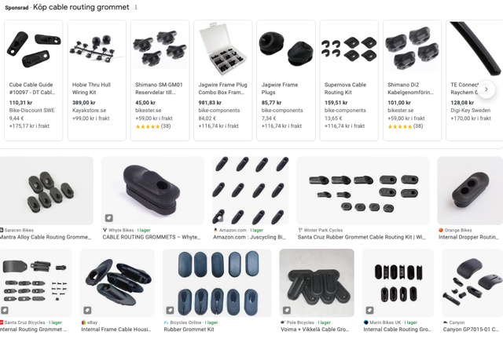
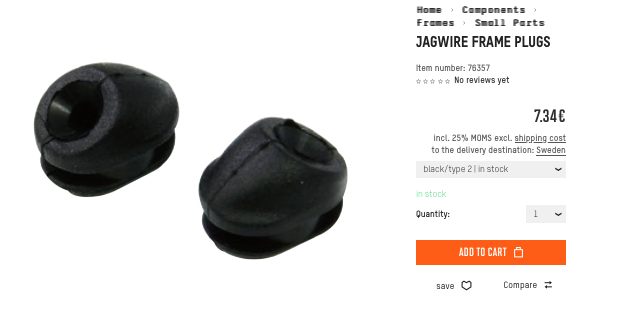
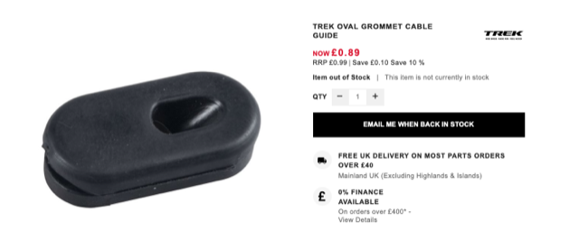

# Todo: Consider ways to install a new cable port and suitable grommet for my internally routed dropper post on Urkraft aluminium frame?

```#77d64a3a``` *As of 2023-06-23 20:38*

[mail plain/text](mail.txt)


I failed to route the dropper post cable internally and need a port in the seat post tube for external cable routing.

-1) I ended up ordering grommets for shimano Di2 cables (that are 5mm in diameter ok)

==&gt; See <https://www.cykloteket.se/sv/articles/2.697.14337/kabelgenomforing-shimano-di2-genomforing-78-mm>

0) It seems I should search for "cable routing grommet" to find a cable holder / protector that can fit the hole in the frame (Swedish: "Kabelgenomföring")?



==&gt; It seems I could use "Jagwire Frame Plugs" type 3 (<https://www.bike-components.de/en/Jagwire/Frame-Plugs-p76357/?o=69401940-black-type-2&delivery_country=SE&cp=21078&upid=google&gclid=CjwKCAjwhdWkBhBZEiwA1ibLmERPTER1ZdfXyV5SqCMYejSIf7VQ6PpnwyKBBo0wFhyjS4WMU4WsThoCeuEQAvD_BwE> )?



*Jagwire type 3 for 5mm cables that mounts into 8mm hole in the frame*

1) Consider youtube video "How-to DRILL a BIKE for Internally Routed Dropper Posts - Step-by-step, MTB Frame" (<https://youtu.be/BGq09CWfJxA?t=160> )

> *It seems he makes a 6 x 12 mm opening in the frame with a 6mm drill bit and a dremmel.*  
> *He then inserts a "**TREK OVAL GROMMET CABLE GUIDE"*

>   
> <https://www.tritoncycles.co.uk/frames-forks-c6/frame-fork-spares-c152/trek-oval-grommet-cable-guide-p17963>

1) Consider this youtube video "Drilling Bike Frame for INTERNAL DROPPER SEATPOST. Is it doable?" about drilling in a steel frame for an internally routed dropper post (<https://youtu.be/MzPCwK7ebA0> )?

2) Consider youtube video "Bicycle internal cabling | DIY" (<https://youtu.be/orjLxpBTCJA> )?

3) Also consider youtube video "How to Run External Cables on an Internally Routed Bike Frame" (<https://youtu.be/WskfysEgKFE> )?

...


