# Todo: Consider youtube video "Using AI as a Design Tool in My Architecture Practice" by 30x40 Design Workshop channel about using  Midjourney AI to "sculpt" architecture design ideas

```#782fef51``` *As of 2024-01-02 22:14*

[mail plain/text](mail.txt)


I want to use AI as a tool to design my new house.

0) Consider the bottomline of his proposed "recipe"?

> RECIPE

> &#91; IMPORTANT MODIFIER &#93; MODERN  
> &#91; ELEMENTAL TYPOLOGY / SUBJECT 1&#93; GRANARY  
> &#91; MATERIALS&#93; MADE OF STEEL  
> &#91;HIGHLY SPECIFIC DETAILS &#93; WITH LADDERS  
> &#91; SETTING, LIGHTING, TIME OF DAY; BE SPECIFIC&#93; IN A FIELD WITH DESATURATED COLOR TONES  
> &#91; CHARACTER MODIFIERS: "BY ... " BY ARCHITECTURAL RECORD MAGAZINE

1) Consider youtube video "Using AI as a Design Tool in My Architecture Practice" by 30x40 Design Workshop channel about using Midjourney AI to "sculpt" architecture design ideas (<https://youtu.be/zhKb9l6LBSo> )?

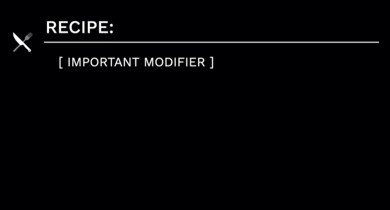

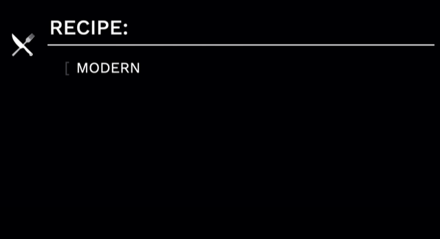

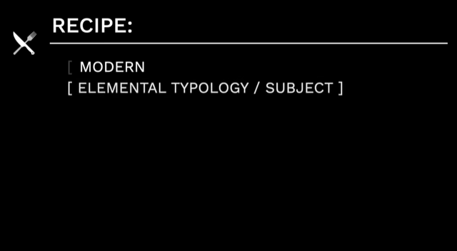

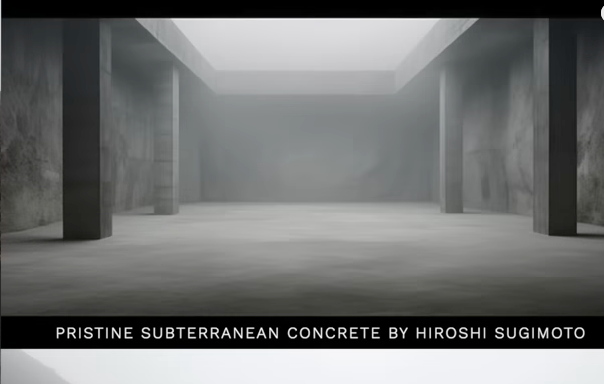

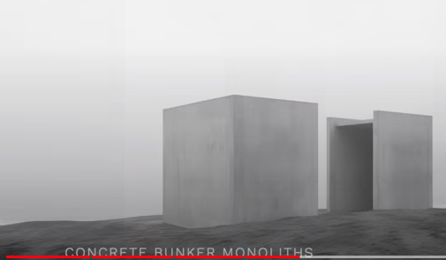

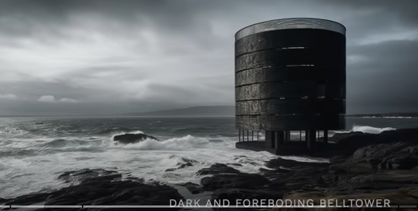

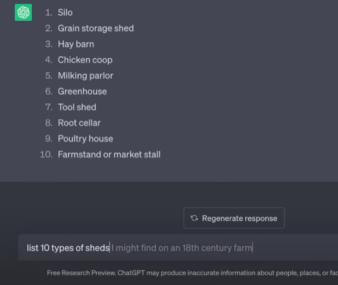

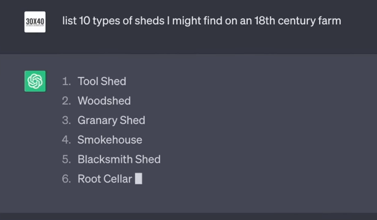

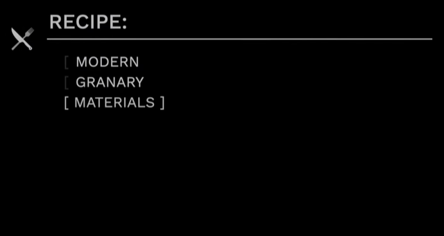

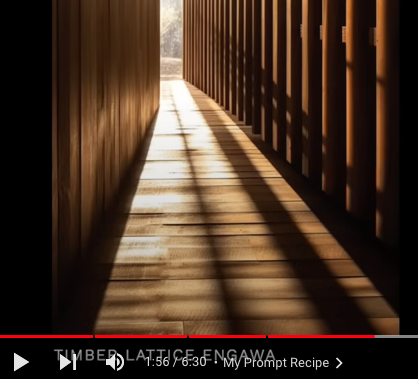

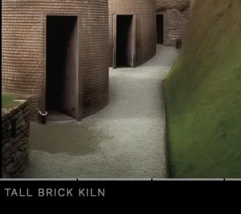

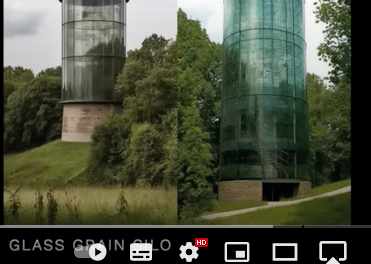

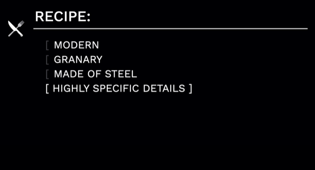

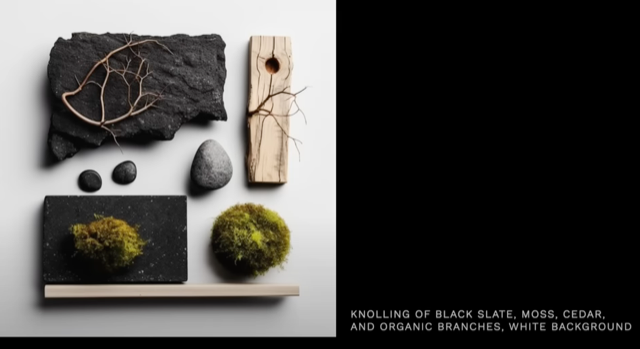

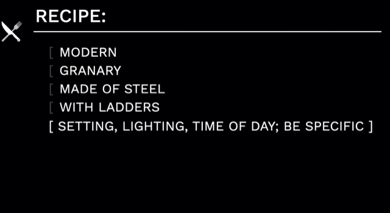

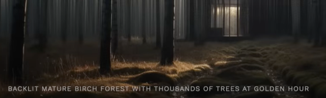

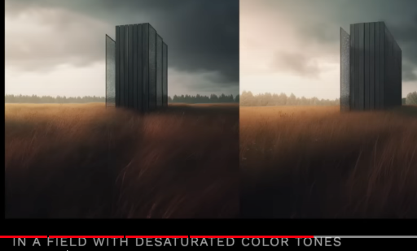

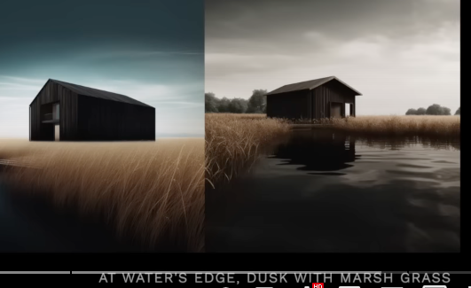

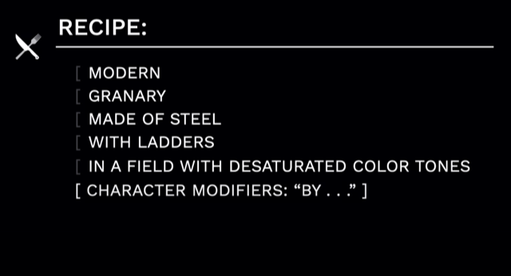

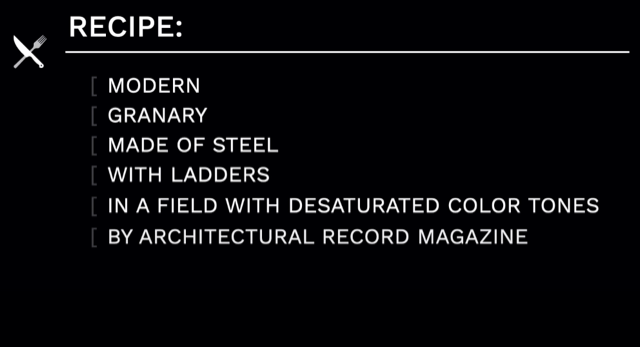

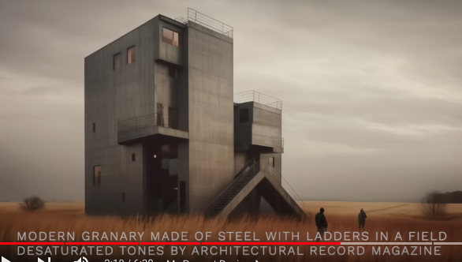

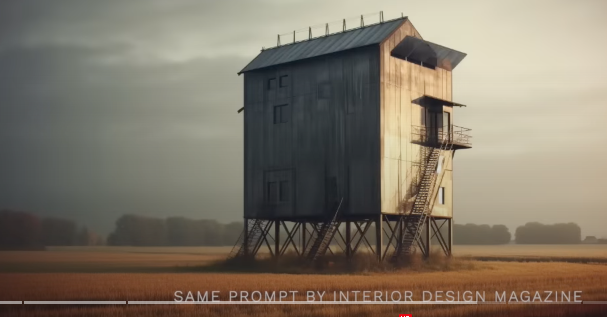

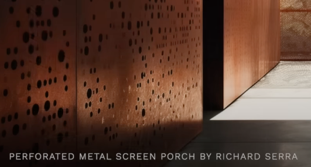

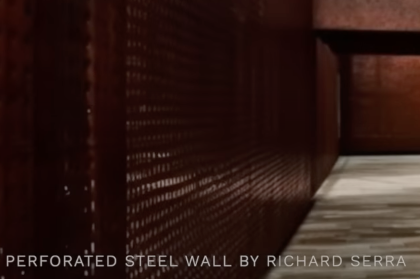

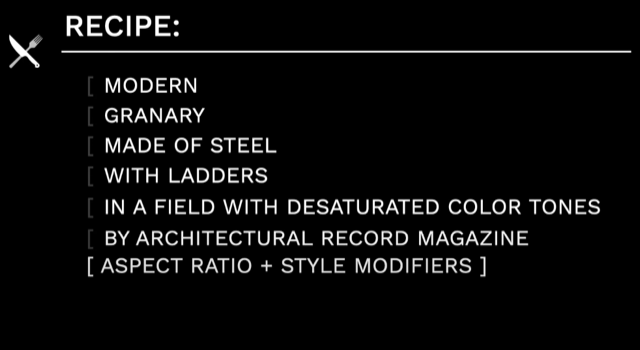

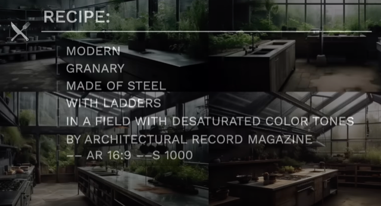

*Midjourney with style modifier 1000 a good setting to have the AI be highly "creative"*

==&gt; It seems he uses Midjourney to "Mix" and "Blend" to then sculpt the images generated to a specific goal.

2) Consider what I can do with the free and paid version of MidJourney (<https://docs.midjourney.com/docs/plans> )?

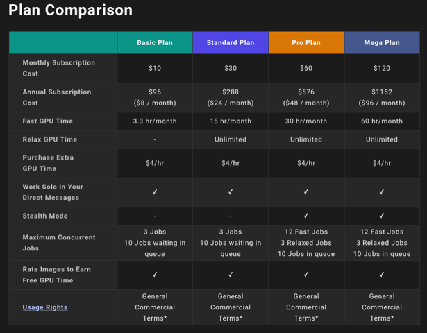

==&gt; It seems one iteracts with MidJourney through Discord (<https://docs.midjourney.com/docs/quick-start> )?

==&gt; It seems "Blend" uses images I dtag-and-drop after command "/blend" in the chat window (<https://docs.midjourney.com/docs/blend-1> )?

...


